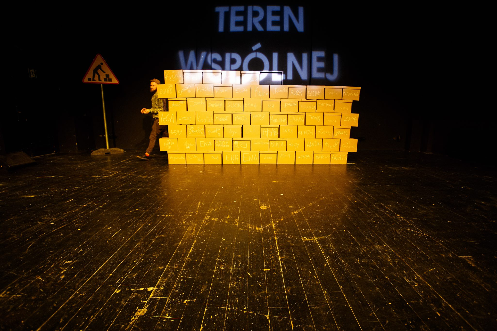
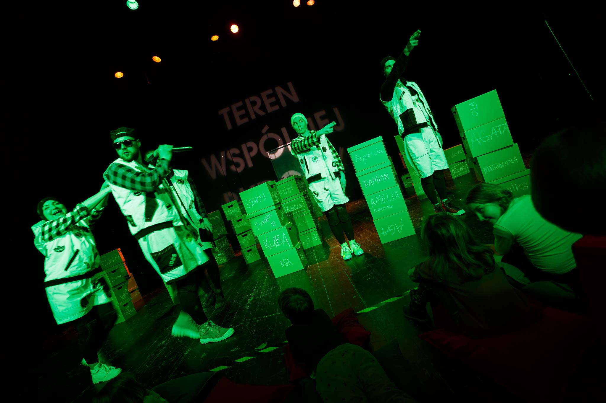

Co to jest ojczyzna? Co się na nią składa? Co się w niej zawiera? A co na pewno nią nie jest?! Czyli milion pytań z zakresu tych niełatwych, o nieoczywistej odpowiedzi. Nieoczywistej i bez jedynej dobrej. I bądźmy pewni, że pytanie o ojczyznę, to tylko jedno z ogromu tych dotyczących niefiguratywnych aspektów rzeczywistości, w których przejawia się dziecięca kosmogonia, fascynacja tym, jak doszło do tego, że świat wygląda właśnie tak, a nie inaczej…

Jak zatem rozmawiać z dziećmi na abstrakcyjne tematy, jak nie infantylizować odpowiedzi i lekceważącą reakcją nie spłycić, nie przeszkodzić i nie podciąć dziecięcych skrzydeł urosłych z wewnętrznej motywacji do poznawania i rozumienia świata? I w końcu, jak wytłumaczyć, czym jest ta cholerna ojczyzna?

Otóż jeśli nie interesuje was martyrologia i patetyzm, wzniosłość i wyniosłość, to najlepiej będzie przyjść całą rodziną, grupą przedszkolną, czy samemu (to rzecz także dla dorosłych!) do Teatru Polskiego w Poznaniu na spektakl *Ojczyzna* w reżyserii Justyny Sobczyk!

Spektakl nie jest zwykłą definicją, bo słownikowe określenie, zamknięte  w granicach słowa, zdania, zapisane, czy wyartykułowane w formie opisu, raczej nie wystarczy by zaspokoić eksplikacyjny głód dziecka. Dlatego w spektaklu Sobczyk, język wzbogacony jest o ruch, zilustrowany muzyką i emocjami. Całość jest bardzo dynamiczna, kolorowa i jednocześnie (co szalenie ważne) pozbawiona trywialności i banalności często właściwych produkcjom dla najmłodszych. Dziecko traktowane jest tu jak partner.

Spektakl rozpoczyna się wspólnym budowaniem z kartonów pierwszej ściany naszej ojczyzny. Każdy dostaje swoje pudło, które (samodzielnie bądź z pomocą opiekuna) podpisuje i układa na środku sceny. Wszyscy, bez wyjątku mają swój kartonowy/klockowy wkład w budowę. Co więcej wkład ten nie jest anonimowy i można na bieżąco śledzić jego losy. Interesującym rozwiązaniem jest to, że już w pierwszej minucie spektaklu, ściana zostaje zniszczona przez pojawiających się na scenie pięciu bohaterów: Klocka (Paweł Siwiak), Dom (Piotr B. Dąbrowski), Drogę (Ewa Szumska), Pana Wojsko (Mariusz Adamski) i Mowę (Barbara Krasińska). Można by powiedzieć, najpierw kazaliście dziecku utożsamić się ze swoim klockiem, śledzić go na scenie, żeby na jego oczach, bezwstydnie zburzyć jego pracę i wkład w budowę?! Niby tak, ale z klocków powstają coraz to nowe budynki, przestrzenie, zapory, klocki biorą udział w konfliktach i realizują pomysły na ich konstruktywne rozwiązanie. Bo przecież ojczyzna to nie wyimaginowany, pewny, stały i niezmienny jak skała, twór. To przestrzeń ciągłych przemian, miksujących się wpływów i rozwoju, obszar mieszczący w sobie różnorodność, jedność i odmienność! I to wszystko z narzędzi, które posiadamy – z naszych potencjałów i różnorodności – nie tylko charakterów i aparycji, ale także potrzeb i interesów. Burzenie pozwala zaczynać wspólne budowanie na nowo. Zmiany, powstający chaos, dają nieskończoną ilość kreatywnych możliwości do rozwijania potencjału wyobraźni, cały wszechświat nowych, nie nadanych jeszcze znaczeń.

To piękne i chyba najważniejsze przesłanie spektaklu! Twój głos i twój wkład jest na wagę złota bo jest niezbędny do wprowadzenia zmian. I nawet jeśli twój klocek się zniszczył, albo leżał na samym dole, to jego rola była równie ważna, jak każdego innego biorącego udział w przemianach. A przyjemność wspólnego budowania nie polega na kolektywnym i jedynym celu – zbudowaniu, lecz wspólnym zaczynaniu wszystkiego od nowa i zarysowującemu się przed nami, ogromowi nowych możliwości.

Język spektaklu, jego energia i ekspansywność rozwija się wraz z postępem akcji. Zaczynamy od prostych echolalii, poprzez sylaby, pojedyncze, proste słowa, które wskazują kierunek i organizują przestrzeń by zakończyć wspólnie zaśpiewaną piosenką, o wyraźnych, słowach budujących zdania, konteksty, komunikatami wyrażającymi emocje i plan działania. Język spektaklu rozwija się kompatybilnie do rozwoju mowy dziecka i jako narzędzie pomaga mu w poznawaniu otoczenia, określaniu potrzeb, nadawaniu mu merytorycznego sensu, rozdzielaniu pojęcia *ja* od reszty świata. Także o języku, który daje możliwości posiadania (oczywiście metaforycznego) wszystkiego co wokół i radości jaka temu towarzyszy, opowiada *Ojczyzna.*

Piękna i ważna to lekcja, podana w naprawdę dobry sposób.

O języku i zmianach szalenie dużo mówi sama autorka sztuki, Krystyna Miłobędzka – poetka, ale także dramatopisarka, której życie i twórczość związane jest z Wielkopolską, gdzie się urodziła, mieszka i gdzie przez lata współpracowała z poznańskim Teatrem Lalki i Aktora Marcinek. Teatr dla dzieci, który tworzyła Miłobędzka, znacznie wyróżniał się spośród ówczesnego repertuaru. Poetka nie mamiła bogatą inscenizacją, czy scenografią, odrywała się od tradycyjnego podziału na widownię i scenę. Jej spektakle miały charakter wspólnej zabawy, gry, otwartej przestrzeni nastawionej bardziej na współuczestnictwo i zabawę, niż bierny odbiór. W jej twórczości skierowanej dla najmłodszych widać dużą fascynację koncepcją sztuki dla dzieci Jana Dormana – twórcy Teatru Dzieci Zagłębia.

Miłobędzka, to autorka tomu dramaturgii dziecięcej *Siała baba mak. Gry słowne dla teatru*, gdzie przy tworzeniu figury teatralnej czerpała z podwórkowego, językowego folkloru.

Traktuje język, jak żywy organizm zdolny do ciągłych modyfikacji, przeistoczeń, przekształceń, dzięki któremu możliwa jest transformacja tego, co wokół wciąż na nowo.

Weźmy zatem z Teatru (razem z klockiem, który można było zabrać do domu) szczyptę optymizmu i przekonania, że wspólne tworzenie i zaczynanie od nowa jest piękne. Budujemy za pomocą języka, przypisując rzeczywistości nowe znaczenia.

Polecam! To naprawdę mądry spektakl.

 

fot. Piotr Bedliński
