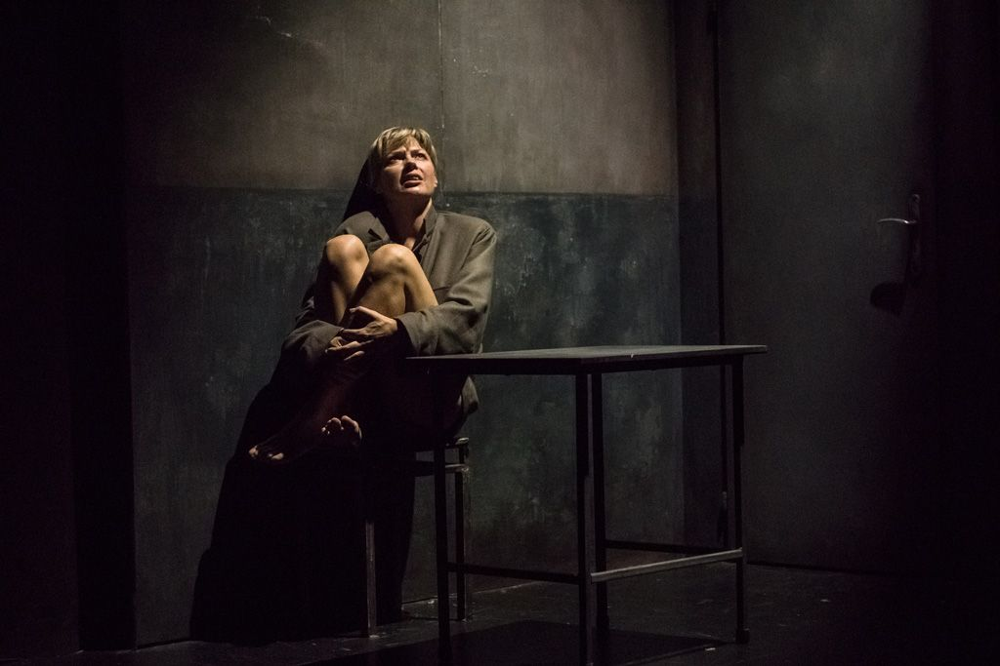
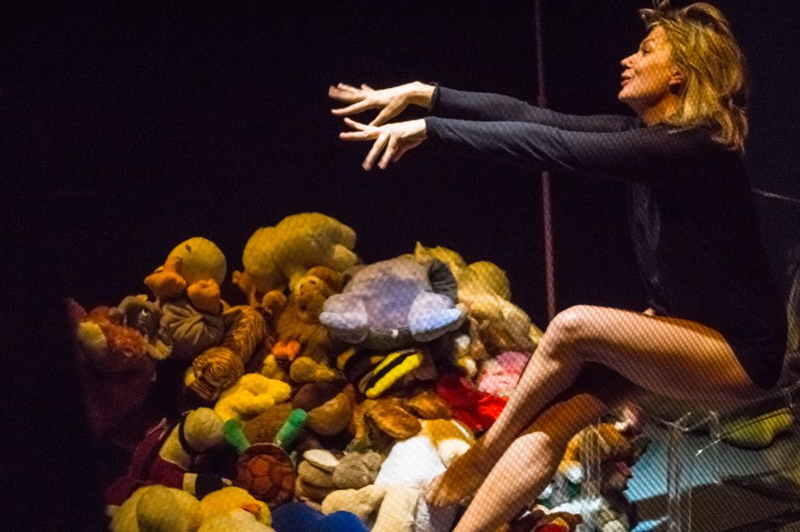

*–  Pamięci rewolucji.

– Którą rewolucję masz na myśli?

– Wiem tylko o jednej jedynej. O tej, kiedy moje ciało wyzwoliło się spod brzemienia czasu i niezależnie ode mnie cieszyło się sobą.*

To motto dramatu, które rozbrzmiewa w holu przed rozpoczęciem spektaklu, powtarzane jak mantra. Nie sposób go pominąć, tak jak nie sposób zignorować spektaklu w reżyserii Ceziego Studniaka.

*Porno* to tytuł spektaklu i pseudonim bohaterki jednocześnie. *Porno* przybija, *Porno* emocjonalnie zużywa i przeciąża. I sami wybierzcie, czy mówię o postaci, czy o spektaklu w ogóle, a każda odpowiedź będzie prawidłowa. Stwierdzicie zatem: eee, czyli nie warto! Otóż warto! Bardzo warto. Bo to jeden z tych spektakli, który odkłada gdzieś w pamięci, na długo pozostającą, wymagającą zastanowienia, w jakiś sposób dręczącą myśl. Jest to wymagający emocjonalnie teatr, którego nie powinniśmy się jednak bać. Zachęcam do stawienia mu czoła i nocnych analiz.

*Porno* to monodram, jedno z najtrudniejszych (jeśli nie najtrudniejsze) i najbardziej ryzykownych w sztuce aktorskiej, zadań, łatwo się na nim wyłożyć. Edyta Łukaszewska poradziła sobie z nim jednak fantastycznie. Postać przez z nią grana była angażująca, ciekawa, ekscytująca. Aktorce udało się uniknąć natarczywości i uciążliwej hiperbolizacji, niepotrzebnego i taniego efekciarstwa. Świat, który stworzyła na scenie, jest wartki, pociągający i uniemożliwiający obojętność. Po prostu dobra robota!

Akcja spektaklu osadzona jest na Węgrzech, w czasie reżimu komunistycznego, poniżającej inwigilacji i cenzury. Porno, to pseudonim nadany przez służby bezpieczeństwa aktorce, której winą jest odgrywanie gdzieś w przestrzeni miasta przedstawień dla bezdomnych dzieci i dokarmianie ich. Postać grana przez Łukaszewską jest wielowymiarowa, wielowarstwowa. Raz irytuje, zaraz jej współczujemy, infantylna i dojrzała jednocześnie, niespokojna i nadpobudliwa, stawiająca opór i pogodzona z losem. Trudne to wyzwanie, zakończone sukcesem.

Jej rola ma nieuporządkowaną strukturę, jest zbitkiem myśli, wspomnień, przemyśleń, odgrywanych rozmów i ilustracji doświadczeń. Sceny dotyczące przedstawień, które  Porno gra dla dzieci, rozmów z sąsiadem, teściową, czy jej przemyśleń wydarzają się wewnątrz ustawionego w centrum sceny sześcianu – klatki (tak jakby Porno była więźniem przypisanego jej i odgrywanego bez jej zgody losu).  Przesłuchania natomiast mają miejsce na tle trzech ścian klatki, przy metalowym stoliku i pomalowanej farbą olejną, ściany. I to to miejsce, te wydarzenia, przesłuchania pozbawiające kobietę człowieczeństwa, odzierające, przez aparat władzy, z godności mają charakter porno – podniety. Nie nagie ciało aktorki, które w pierwszej scenie przedstawia nam rozkładając jego budowę na czynniki pierwsze, nie jej egzaltacja są dla kogokolwiek erotycznie pobudzające. To obsceniczne, chore sprawowanie kontroli, inwigilacja, tępienie wyimaginowanego zagrożenia i dyktatura jest największym, ułomnym, patologicznym i perwersyjnym stymulantem władzy.

W miarę postępowania kontroli, okrutnych przesłuchań i zatracania się Porno w niemożności, klatkę wypełniają spadające przez rurę umocowaną przy suficie, maskotki, by ostatecznie przykryć sobą, wchłonąć kobietę bez reszty. To wymowne, bardzo dosłowne rozwiązanie sceniczne nawiązuje po trochu pewnie do infantylności Porno, jednocześnie unaoczniając przytłaczające, nieme, społeczne przyzwolenie, wydawałoby się niewinne działania, komentarze, które pomnożone przez setki potrafią osiągnąć efekt druzgocący. To symbol narzędzi do sprawowania przez partię kontroli, w postaci pluskiew, agentów, przemocy. Nie dajmy się zatem zwieść pozornej toporności tej pluszowej przenośni.

Porno, która chce jedynie żyć, żyć swoim życiem i na własnych zasadach, w końcu przegrywa. Jej ciało i skołatany umysł nie wytrzymują natarcia. Kontrola, reżim tym razem wygrywa. Śmierć daje dziewczynie poszukiwany przez nią kolor i wolność. Przynajmniej w to chcemy wierzyć…* *

*…moje ciało wyzwoliło się spod brzemienia czasu i niezależnie ode mnie cieszyło się sobą.*

Po zakończeniu spektaklu, Edyta Łukaszewska przerywa oklaski, mówiąc że nie spodziewała się, że tekst, który chciała zagrać już na trzy lata przed premierą (czyli aż osiem lat temu) stanie się kiedykolwiek tak aktualny, jak w dniu premiery (30 września 2016 – przeddzień Czarnego Protestu) i pozostanie bieżący do dziś. W tym miejscu wspomniała o zniszczonym przez Ministra Kultury Teatrze Polskim we Wrocławiu,  Teatrze Starym w Krakowie, cenzurze politycznej, ideologicznej przemocowości w sferze teatru. Apelowała o stawianie czoła i wspieranie wolności polskiego teatru. Apeluję i ja.

 

fot. Materiały Teatr Nowy w Poznaniu
