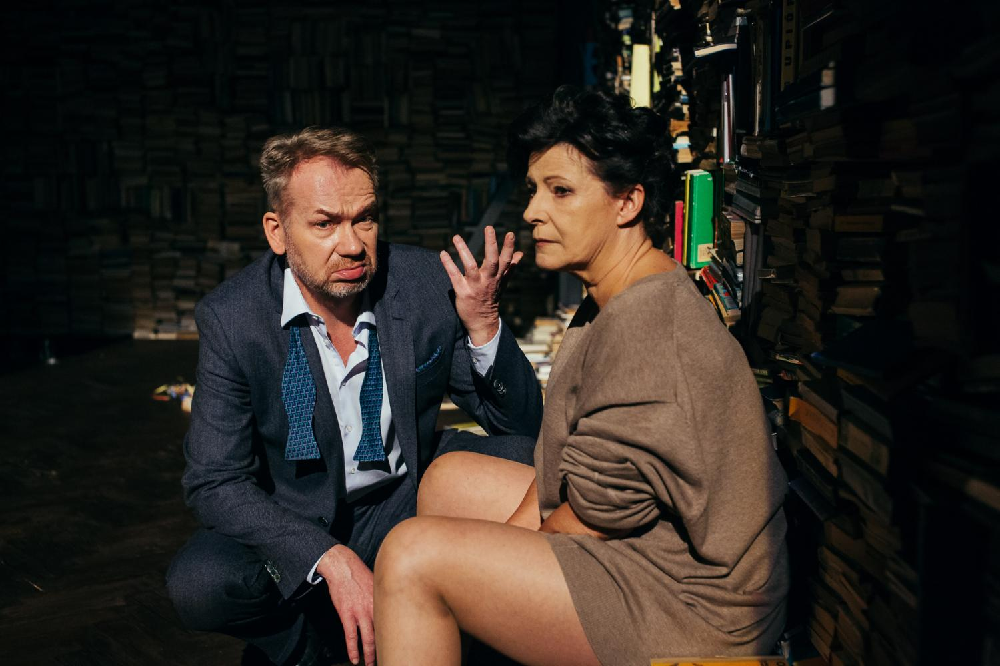
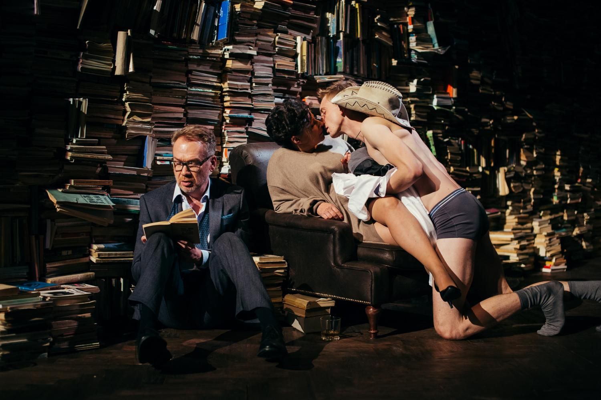
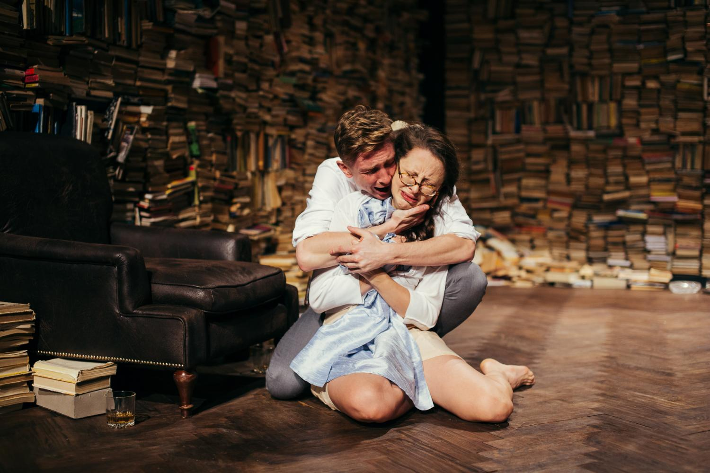

Kto się boi Virginii Wolf, to spektakl w reżyserii Grzegorza Wiśniewskiego na podstawie fantastycznego i ponadczasowego tekstu Edwarda Albee’go.

Rzecz dzieje się gdzieś w Nowej Anglii, w pokoju wypełnionym książkami (świetna scenografia Barbary Hanickiej), późną nocą, kiedy to pewne małżeństwo w wieku, na oko, czterdzieści plus, mocno zmęczone alkoholem, wraca z balu inaugurującego nowy rok akademicki. Ona to Marta (Dorota Kolak) – córka rektora uniwersytetu, on – Goerge (Mirosław Baka) – mąż Marty, niespełniony i niedoceniony wykładowca historii na owej uczelni. Na pierwszym planie nepotyzm i frustracja, które czasem robią miejsce analizie relacji małżeńskiej wspomnianej pary, czasami się z nią mieszają, niekiedy zazębiają.

Para ta nie szczędzi sobie uszczypliwości, obelg, impertynencji, inwektyw, ciętych ironii i sarkazmów. Publiczność zanosi się od śmiechu… A Marta i George we wzajemnej zjadliwości docierają w końcu siarczystych poniżeń i upokorzeń. Przestaje być komediowo, robi się coraz bardziej cierpko i refleksyjnie. On obraża i upokarza ją swoją obojętnością i cynizmem, ona prościej i literalniej – dyskredytując go jako mężczyznę, kochanka, naukowca, człowieka w ogóle.

W pokoju pojawia się kolejne małżeństwo – zaproszeni przez Martę na coś w rodzaju afetr party Nick (Piotr Bierdoń) – przystojny, blondwłosy, wysportowany, szarmancki i szalenie ambitny nauczyciel biologii na uniwersytecie ojca Marty oraz Honey (Katarzyna Dałek) – niezbyt ładna słodka idiotka, trochę tępa i naiwna, żona swojego męża. Młodsi od gospodarzy o jakieś dwadzieścia lat, na pozór idealnie dobrani, kochający.

Ale tylko na pozór, bo ten fasadowy kontrast par legnie w gruzach, gdy z szaf wychodzą potwory.

Okazuje się bowiem, że w tej grze słów i emocji, pary obnażają się coraz bardziej. Odkrywają przed widzami wnętrzności swoich związków i podszycie ich samych. I tak, Nick to małostkowy i zorientowany na karierę emocjonalny chłopiec, który wcale tak bardzo nie kocha swojego Skarbka. Ożenił się z nią po tym, jak uroiła sobie ciążę, a jej ojciec zostawił jej w spadku ogromna fortunę. Nie jest ani kulturalny, ani szarmancki, nie przeszkadza mu uczelniany awans przez łóżko z córką rektora. Nie przeszkadza mu w tym też wymiotujący w łazience Skarb, ani czytający obok, książkę George. Nie przeszkadza też to oczywiście Marcie. Kobieta rozpaczliwie wołająca uwagi i ciepła ze strony nieobecnego męża, idzie do łóżka z Nickiem. Zapytacie kto jest winny? Nikt. Ta swoista psychoterapia, freudowska analiza, czy też terapia małżeńska, która uruchomiła się na scenie, pozostawiona została dokończeniu przez widzów już poza teatrem.

Pełen ciętego dowcipu, emocji i angażującej historii spektakl ma kilka dużych atutów, ale w sąsiedztwie niemałych zgrzytów.

Jeśli chodzi o plusy, to niewątpliwym jest obecność na scenie absolutnie fantastycznego duetu Kolak, Baka. Fenomenalne kreacje, gra aktorska na najwyższym poziomie, ogromne doświadczenie sceniczne jakie mają i bezsprzeczny talent pozwoliły im zagrać nieuciekającą w tanie efekciarstwo i nieznośną przesadę, nonszalancję. Zdecydowanie mocny punkt, to także wspomniana już na początku scenografia Barbary Hanickiej oraz przekład Jacka Poniedziałka.

Niestety w kwartecie z rewelacyjnymi Dorotą Kolak i Mirosławem Baką uwypukliły się różnice w warsztacie drugiego scenicznego małżeństwa.

Postać Honey w wykonaniu Katarzyny Dałek, to w mojej ocenie największy mankament spektaklu. Dałek nie miała łatwej roli – drugoplanowa postać, obecna w rozmowach innych jako opowieść w osobie trzeciej, spędzająca większość czasu na torsjach w łazience gospodarzy. Jednak gdy już się pojawiała, próbując wejść w ton nierozgarniętej i infantylnej, skręcała nieopatrznie w trudną do zniesienia melo – recytację.

Trudne w odbiorze było także oświetlenie, szczególnie zjeżdżające z sufitu szpitalne reflektory – zbyt duża dosłowność chirurgicznej dokładności w roztrząsaniu przeszłości.

Spektakl warty zobaczenia, na pewno ze względu na mistrzowskie kreacje Doroty Kolak i Mirosława Baki. Ale żeby jechać na niego przez pół Polski, to już chyba nie…

fot. materiały Teatru Wybrzeże
