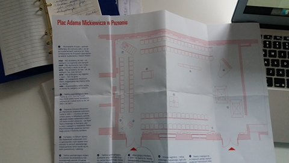
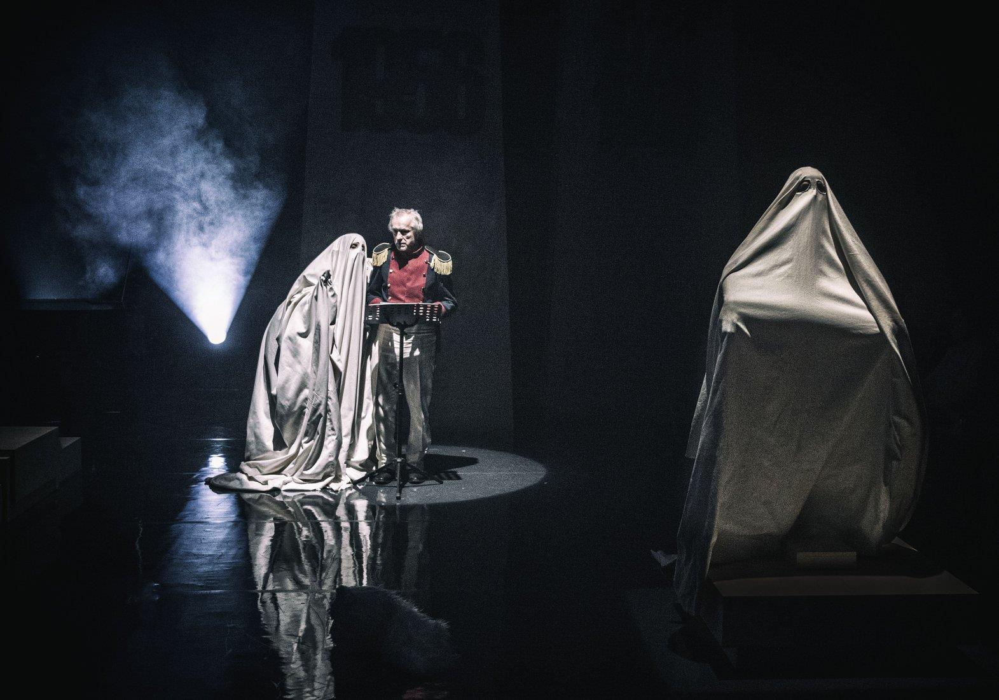
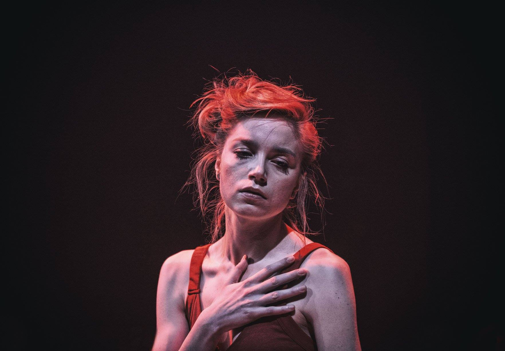

Przyznam szczerze, że romantyzm nigdy nie był moją ulubioną epoką literacką. *Ból świata,* cierpienie z powodu nieodwzajemnionej miłości, bierność… te, czy inne, werteryczne, martyrologiczne cechy bohaterów romantycznych przyprawiały mnie o mdłości, do Kordiana zaś miałam ochotę krzyknąć: ,,stary, ogarnij się, przestań się nad sobą użalać i zacznij, do cholery, działać!”

Jak się okazało twórcy spektaklu, których głosy słyszymy po wejściu do przestrzeni Malarni Teatru Polskiego, zdają się również nie przepadać za werterycznym bohaterem Słowackiego. Zaczyna robić się ciekawie.

Tym bardziej, że znajdujemy się wewnątrz rekonstrukcji Placu Adama Mickiewicza w Poznaniu, wypełnionego po brzegi martyrologicznymi eksponatami, pomnikami, tablicami, upamiętniającymi bohaterstwo, heroizm i inne. W planie wystawy czytamy stające w kontrze do męczeńskich i bohaterskich, opisy kolejnych relikwi. Eksponatem jest też Wiesław Zanowicz grający Kordiana w 1978 roku w rzeszowskim Teatrze im. Wandy Siemaszkowej.

Możemy zwiedzać, zastanawiając się czemu ma to służyć.

I tym bardziej, pamiętając że *Kordiana* Słowacki napisał versus Konradowi z Dziadów cz. 3 Mickiewicza, odnosząc się do mitologizowania powstania listopadowego, do utrwalanego i popularyzowanego przez Mickiewicza kontekstu historycznej sprawiedliwości, boskiej sprawiedliwości i mesjanistycznej wizji Polski jako Chrystusa narodów, czerpiącej siłę z tradycji, z przeszłości, dawnych ideałów, która aby powstać  najpierw musi wycierpieć swoje. Słowacki zaprezentował zgoła inny, krytyczno – rozrachunkowy nurt, podejmujący wątek klęski, apokalipsy, ułudy, demaskacji nieskuteczności mesjanistycznych haseł.  Z prologu do dramatu wiemy, że według niego, kraje poddane są skazane na klęskę. Z góry. A próby walki i buntu są moralnie niejednoznaczne, sprzeczne z chrześcijańskim nauczaniem. Kordian decyduje się na skrytobójstwo cara – oprawcy narodu. W buncie przeciwko ciemięzcy, niewoli, wbrew naukom chrześcijańskim i kodeksowi rycerskiemu (poddany nie może zabić króla, a na króla Polski koronował się właśnie car Mikołaj I), nie w imieniu Polski, ale w obronie własnej indywidualności, chce umrzeć Kordian.

Trumny Kordiana nie sposób nie zauważyć, stoi w centralnym miejscu przed wejściem do Malarni, przykryta biało – czerwoną flagą i kwiatami, pojawia się też podczas spektaklu, w ostatniej scenie.

Po odczytaniu listu od Prezydenta Dudy, który w obliczu obowiązków państwowych nie był w stanie dotrzeć na premierę i po minucie ciszy upamiętniającej bohaterów walczących za Polskę (cóż za piękna ironia), na scenie pojawia się piętnastoletni Kordian (Konrad Cichoń) i Laura (Kornelia Trawkowska). Po apelowej, recytacyjnej rozmowie, odrzuceniu przez dziewczynę, Kordian popełnia samobójstwo. W kolejnej scenie, wyrzucony przez morze na brzeg obcego kraju, przybiera wcielenia kolejnych aktorów, którzy przekazują sobie jego rolę. Tu zaczyna się podróż – kompatybilna do tej oryginalnej z dramatu Słowackiego:

przez Londyn, gdzie uświadamia sobie rolę pieniądza otwierającego drogę do wszelkich godności,

Dover, gdzie czyta *Króla Leara* Szekspira uzmysławiając sobie odrealnienie świata literackiego,

Włochy, gdzie przekonuje się o tym, że kobiety to interesowne kurwy,

Watykan, i tu scena z Konradem Cichoniem w roli niedołężnego, marionetkowego, starego papieża (po parkinsonie sądząc to Jan Paweł II), którego zniekształconych przez chorobę słów rozszyfrować nie możemy, muszą być tłumaczone,

aż na szczyt Mount Blanc, gdzie Kordian postanawia umrzeć za Polskę, a Winkelried przybywa do niego pod postacią polarnego niedźwiedzia. W tej roli jedna z moich ulubionych polskich aktorek, rewelacyjna Sonia Roszczuk.

Jesteśmy już pewni, że na scenie nie ma jednego słusznego Kordiana, że jest ich pięciu! Pięciu Kordianów i jedna Kordianka, a w ramach roli każdego z nich słyszymy prywatną historię aktora. Kordianka na przykład się nie zabije bo nie jest Kordianem. Do tej roli zaproszono performerkę, feministkę Alex Freiheit i jej sceniczne alter ego – Siksę, znane między innymi z ostatniej edycji OFF Festivalu. Siksa to superbohaterka, która zrodziła się z bólu i buntu przeciw despotyzmowi, patriarchalnej polityce, przymusowi podobania się i spełniania oczekiwań. W spektaklu mówi o tym, jak była zgwałcona, a gwałciciel jest jej carem i jak zabijając go każdego dnia, przybliża się do wolności. Kordianka ostro sprzeciwia się sprowadzaniu roli kobiet do nic nie wnoszących do przebiegu wydarzeń, kochanek głównych bohaterów, dzięki którym mogą cierpieć.

Oprócz konceptu łączącego melodramatyczne wspomnienie szkolnego apelu z artystycznością, postdramatyzmem i performansem Siksy na uwagę zasługuje świetna choreografia Agnieszki Kryst, wspaniałe oświetlenie Aleksandra Prowalińskiego i fantastyczna, wspomniana już scenografia i kostiumy Pauli Grochowskiej.

Skrzywanek w wywiadzie dla Wyborczej mówi, że nie chce by ktoś za niego, czy w jego imieniu umierał,* żeby ktoś sobie odbierał życie w tym kraju w imię czegokolwiek! To nie jest droga. Nie chcę dziś Kordianów, którzy będą oddawać życie za ojczyznę.* I ja się pod tym podpisuję! Brak dialogu w obecnej Polsce jest absolutnie patologiczny i chory! Cieszę się, że ktoś wreszcie pochował Kordiana! Nie zrobił tego Słowacki, udało się Skrzywankowi. Tylko że twórcy *Kordiana* chcieliby rewolucji, w którą sami nie do końca wierzą. Nie wierzą w siłę, zjednoczenie, ani prawdopodobieństwo odwagi do wyjścia ze strefy reputacyjnego komfortu. Zabierają bohaterskie tło pomnikom, udzielają głosu zbuntowanej Siksie, starego Kordiana przedstawiają jako zgaszonego mężczyznę w przykurzonym mundurze, tym samym, w którym grał Kordiana po raz pierwszy 40 lat temu. Którego historia, to strach i podpis, którego nigdy nie powinien był złożyć, emigracja i zmiana obywatelstwa, nazwiska. Nie chcą dziś Kordianów – obrazów bezhołowia romantycznych i idealistycznych wizji świata. Tyle wiemy na pewno.

Przygotowując się do pisania o* Kordianie*, zajrzałam do licealnych notatek, w których przeczytałam, że: *Kordian* *nie jest dramatem niescenicznym (jak wiele innych utworów polskiego romantyzmu), tkwią w nim ogromne możliwości inscenizacyjne, może doskonale sprawdzić się w teatrze. *Miała Pani rację, Pani Emilio! *Kordian* ma ogromne możliwości inscenizacyjne, a Jakub Skrzywanek w raz z zespołem wykorzystali je w sposób, którego mało kto by się spodziewał.

 

fot. Magda Hueckel
