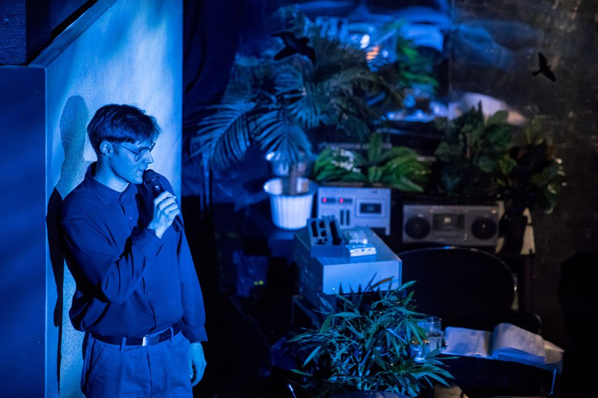
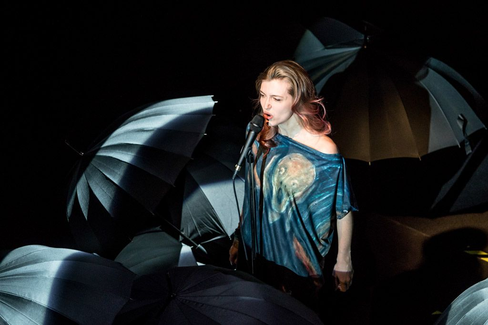

Las czarnych, otwartych parasolek, kobiety śpiewające utwory Jacka Kaczmarskiego i wizualizacje w tle, po lewej stronie orkiestra pod kierownictwem Jacka Skowrońskiego, po prawej kącik z magnetofonem na kasety, stolikiem, fikusem i herbatą w szklance z metalowym koszyczkiem oraz Marcin Januszkiewicz jako alter – ego Kaczmarskiego. Czyli *Kanapka z Człowiekiem* Jerzego Satanowskiego.

Jacek Kaczmarski, którego piosenki w nowych aranżacjach muzycznych zaprezentowano w najnowszym spektaklu Teatru Nowego w Poznaniu — *Kanapka z Człowiekiem*, to mistrz słowa, metafory, poezji śpiewanej, kompozytor, artysta z ogromnych dorobkiem, autor znanej chyba wszystkim Polakom pieśni *Mury.* Zaczął tworzyć w latach siedemdziesiątych XX wieku, a jego teksty szybko stały się synonimem walki z komunizmem. Podczas stanu wojennego, głosem antykomunistycznej opozycji byli głównie mężczyźni. Po niespełna 30 latach od wyzwolenia się Polski spod czerwonego reżimu, na nowo przywołane utwory Kaczmarskiego, okazują się być przerażająco aktualne. Tym razem jednak głos oddano kobietom (jak powiedział o nich w jednym z wywiadów Jerzy Satanowski — *wdowom pamięci po Kaczmarskim*), parasolkami — symbolem solidarności kobiet w walce z próbami ograniczenia przez polityków ich praw — nawiązując do Czarnego Protestu. W *Kanapce…*, kobiety te, to obdarzone świetnymi głosami, wyraźne i autentyczne w swoich interpretacjach: Pamela Adamik, Bożena Borowska – Kropielnicka, Karolina Głąb, Oliwia Nazimek oraz Agnieszka Różańska.

Spektakl ma formę koncertu, podczas którego zaśpiewane zostały 22 piosenki. Wśród nich te najbardziej, z dorobku Kaczmarskiego, znane: *Obława, Nasza Klasa, Dzieci Hioba,* czy wspomniane już *Mury*. Oś inscenizacyjną spektaklu stanowi połączenie pieśni z wizualizacjami Justyny Bieleckiej, prostym ruchem scenicznym polegającym jedynie na zmianach miejsc przez aktorki oraz wtrąceniami narratora — Marcina Januszkiewicza, komentującego poezję Kaczmarskiego z pokojowej przestrzeni po prawej stronie sceny, fantastycznie interpretującego także kilka z piosenek. Tu wspomnieć należy przede wszystkim mistrzowskie, emocjonalne, nie trącące tkliwością wykonanie przez niego utworu *Raj. *Słowem, bardzo oszczędna w środki realizacja. Z tym, że ta prostota jest tu uzasadniona, najważniejsze bowiem są język, rytm i rym, emocje towarzyszące interpretacjom oraz fakt ich nieprzerwanego (a może na powrót?) obowiązywania. Wspomniane wizualizacje stanowią tło i komentarz nawiązujący do kolejnych utworów. Są to między innymi obraz Edwarda Muncha *Krzyk,* *Rozstrzelanie* Andrzeja Wróblewskiego, czy *Alegoria Malarstwa* Jana Vermeera. Przywołane w kontekście tych obrazów utwory, noszą te same, co płótna tytuły i stanowią ich poetycką interpretację. Kostiumy Joli Łobacz  kolorem, charakterem, czy wprost — nadrukiem także nawiązują do obrazów, tworząc   wraz ze śpiewem i wizualizacjami sugestywną całość.

Poezji Kaczmarskiego nie sposób interpretować w oderwaniu od kontekstu społeczno – politycznego. Wydaje się więc naturalnym komentować przywołane w *Kanapce…* utwory w odniesieniu do obecnych realiów politycznych i podziału Polaków. Interpretacja *Bajeczki z perspektywki* o *malutkim tyranku*, który to został *prezydentkiem, *staje się więc zaskakująco i okrutnie, niemal dosłowna. Pozostaje zatem zanucić wersy *Obławy* z nadzieją na zjednoczenie, w którym leży siła niezbędna by wpływać na bieg wydarzeń:

*Nie dajcie z siebie zedrzeć skór! Brońcie się i wy!*

*O bracia wilcy! Brońcie się nim wszyscy wyginiecie!*

fot. Jakub Wittchen
