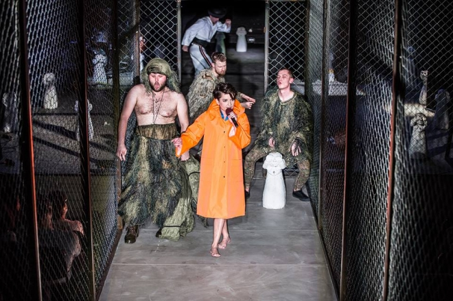
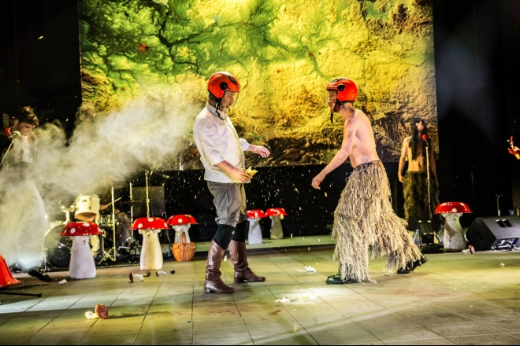

Szajba. To słowo według Małgorzaty Sikorskiej – Miszczuk najtrafniej oddaje charakter funkcjonowania Polaków. W naszym kraju *każde spotkanie rodzinne,* *każde poranne wysłuchanie wiadomości pokazuje, jak daleko fruniemy, jaki potężne moce w nas buzują*. To prawda, każdy ma swoją szajbę… co często uniemożliwia zbudowanie przestrzeni na kompromis, na rozmowę, na wspólną wizję.

Sikorska – Miszczuk *Szajbę*, sztukę political fiction, czyli zbiór nieprawdopodobnych, niebyłych stereotypów, zwyczajów, rytuałów związanych ściśle z aktualnym kontekstem politycznym, napisała w 2006 roku. Ówczesne okoliczności społeczno — polityczne były takie, że 14 lipca zaprzysiężony został rząd Jarosława Kaczyńskiego, który w koalicji z Samoobroną i Ligą Polskich Rodzin mieli podejmować kluczowe decyzje dotyczące kraju. Byłam wtedy nastolatką, ale pamiętam dobrze krzyki rodziców i ich łapanie się za głowę podczas wieczornych wiadomości. Pamiętam też stanowczy stosunek mojej nauczycielki języka polskiego do absurdalnych zmian, jakie wprowadził ówczesny minister edukacji Roman Giertych. Duża część kraju była wtedy skrajnie wkurzona i zażenowana. Chciała, żeby ta groteska dobiegła wreszcie końca.

Tekst swoją pierwszą premierę miał w 2009 roku w Teatrze Polskim we Wrocławiu, wyreżyserował go wtedy Jan Klata. Od dwóch już lat trwały pierwsze rządy Donalda Tuska, które wydały się wreszcie profesjonalne, pomogły śmiać się i wspominać z niedowierzaniem poczynania Andrzeja Leppera, Romana Giertycha, Jarosława Kaczyńskiego. *Szajba *wpisała się w tamte społeczne nastroje perfekcyjnie i modelowo. Śmieszyła surrealistyczna wizja Polski, do rozpuku bawił pamflet i paszkwil, niepoprawna politycznie satyra. A teraz? Chyba zbyt realne i dotkliwe to żarty. Niewielu miało, w marcu 2018 roku, w Teatrze Fredry w Gnieźnie, siłę się śmiać.

*Szajba* jest historią o Polsce i Polakach, o podziałach między rodakami i próbie osiągnięcia pełnej władzy przez jednego człowieka. Brzmi znajomo? Jest zbiorem anegdot, absurdu i nonsensu. To historia walki dożywotniego premiera Polski — Mistera Ble (Roland Nowak) z terrorystami z Kujaw, którzy chcą zetrzeć Polskę z mapy świata, a w jej miejscu wbudować wielkie i potężne Kujawy. Przywódcą zamachowców jest niejaki 99 Groszy (Paweł Paczesny), porywczy i okrutny Kujawiak, spadkobierca myśli i kontynuator planu zagłady Polski wielkiego El Kujawy Pierwszego. Jego pseudonim pochodzi od kwoty, która pewnego wieczoru zabrakła mu do piwa i zmusiła do spędzenia nocy na trzeźwo. Towarzyszy mu Zachar (Sebastian Perdek), który odpowiedzialny jest za skonstruowanie i wybuch bomby mającej zmieść Polskę z powierzchni Ziemi oraz unicestwienie usa (nie USA). Połączenie kabelków uniemożliwia mu jedynie tkwiąca w oku i w dupie rzęsa. Cały świat drży ze strachu czytając udostępniane za pośrednictwem sieci kolejne informacje dotyczące rozwoju akcji i następnych kroków separatystów.

Mister Ble zabójczo kocha Ojczyznę — krainę mlekiem, miodem i otrębami płynącą. Jest skoncentrowany na stworzeniu nowej polityki historycznej opartej na polskości, polskiej dumie, przebaczeniu. Jego doradcą jest Niemiec w wojskowym anturażu, pamiętający II Wojnę Światową i hitlerowską propagandę — Hans (w tej roli kapitalny Michał Opaliński). Dzięki ich rozmowie dowiadujemy się, że Polska skapitulowała dopiero w kwietniu 1940 roku, a Niemcy zasłynęli z buntu przeciwko Hitlerowi oraz z szacunku do wszystkich ras i wyznań, szczególnie do Żydów; a także o pretensjach Niemców o autorstwo idei Holocaustu, które przestało być oczywistym, odkąd obozy koncentracyjne zaczęto nazywać polskimi. Trochę bawi nas ta paranoja, nikt jednak nie ma siły zaśmiewać się do łez. O łzy przyprawia za to raczej ten rzeczywisty polski absurd i realne zagrożenie nacjonalizmem.

Mister Ble nie grzeszy błyskotliwością i polotem, stwarza raczej pozory stanowczego i męskiego. Jego żonę Wiktorię (Katarzyna Strączek) poznajemy kiedy piecze dla wspomnianych dyskutantów kiełbaskę na kiju. Jej rolę Ble sprowadza do funkcji służki i kochanki. Niezaspokojona erotycznie i emocjonalnie, chce wyzwolić się z niesatysfakcjonującego i poniżającego związku z Ble, a także zaspokoić swoje fantazje na temat 99 Groszy. W końcu ucieka na Kujawy. Wiktoria kojarzy nam się  z kobietą walczącą o swoje miejsce w patriarchalnym świecie. Czy to zabawne, że musi walczyć, czy to w jakikolwiek sposób *fiction*? Niestety nie… po raz kolejny doskwiera nam dotkliwości tematu.

Niedorzeczności i paranoi jest tu więcej, jedna goni drugą, tylko zamiast śmieszyć wbijają coraz mocniej w fotel. Bo pojawia się tu i Malala Yousafzai — Pakistanka, najmłodsza w historii laureatka Pokojowej Nagrody Nobla, która w *Szajbie  * miałaby indoktrynować wśród dzieci Islam. Są też żarty z kujawskich samobójców męczenników, dla których profesor Bralczyk (Wojciech Siedlecki) ma wymyślić inherentną nazwę, może* mękujaw*, albo *kujater*?, i który po zabiciu przez terrorystów zmartwychwstaje bo językowa misja, którą rozpoczął nie wypełni się sama.

Od tych wszystkich wydarzeń oddziela nas wysoki płot zwieńczony drutem kolczastym, przez który nikt nie przedostanie się na drugą stronę. Banalny, acz boleśnie dosłowny synonim podziału, odgrodzenia, zamknięcia i złudnego poczucia bezpieczeństwa, którego autorem jest Mirek Kaczmarek.

Historii akompaniuje dziecięcy zespół z Akademii Młodego Muzyka w Gnieźnie i góralski taniec z ciupagą, które wchodzą w przebieg wydarzeń tworząc skoczny kolaż antonimów.

Ostatecznie zwycięża jednak znajdująca się w butelkach po occie *polska żółć* — toksyczna i zabójcza substancja, która w dosłownym geście rozbijania jej przez Ble i 99 Groszy o mapę Polski zgładzi wszystkich — i Polaków i Kujawiaków. Kiedy na terenie dawniej zamieszkiwanym przez Polaków lądują Małpy z filmu Franklina J. Schaffnera i przeczesują okolicę w poszukiwaniu oznak dawnej cywilizacji, znowu zamiast śmiechu pojawia się zgrzyt zębów i refleksja nad podziałem naszego kraju, trwoga o to gdzie ten brak dialogu nas zaprowadzi…

W potoku słów, anegdot, kolorowości, absurdów — zgrabnie zresztą skomponowanym — przed zdrowym śmiechem powstrzymywała dobijająca aktualność. Wszystkich wykurzyła polska żółć, a kolczasty drut nawet nie drgnął. Nie śmieszy ta *Szajba*, kiedy  tylu wokół ma szajbę…

fot. Natalia Kabanow
