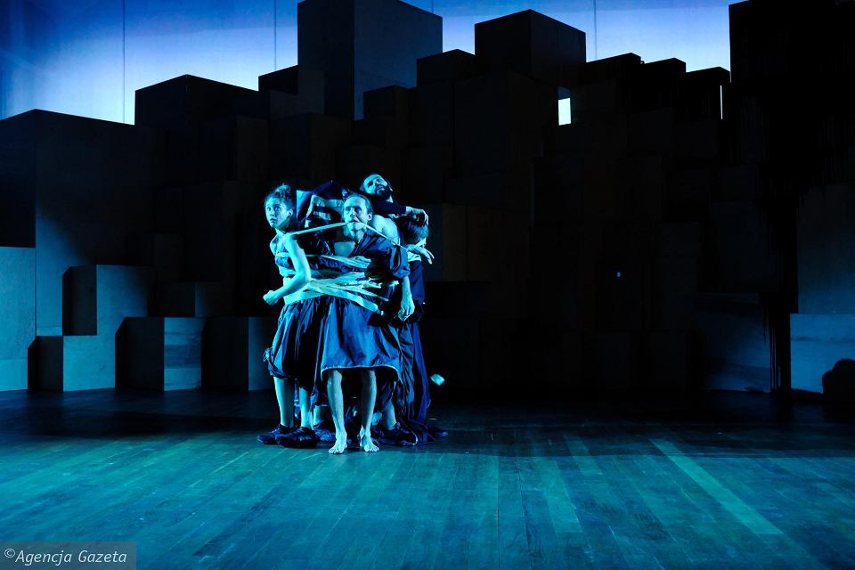
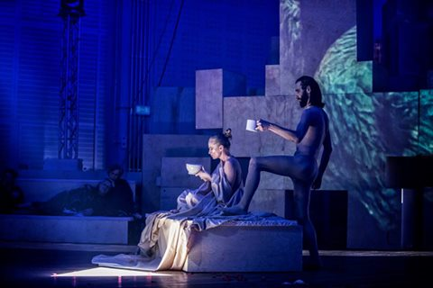

Krzysztof Garbaczewski, którego prace ze względu na swoją niejednoznaczność, otwartą strukturę, multimedialność i nieoczywiste wybory tematów, jest dziś jednym z najbardziej wnikliwie obserwowanych reżyserów młodego pokolenia. Artysta znany przede wszystkim z *Opętanych* według Witolda Gombrowicza z 2008 roku, *Wyzwolenia* z warszawskiego Teatru STUDIO, które swoją premierę miało w marcu 2017, czy powstałych kilka miesięcy później w Teatrze Powszechnym w Warszawie, *Chłopów*. Warto wspomnieć, że Garbaczewski w 2008 roku był też asystentem Krystiana Lupy przy Factory 2 w Starym Teatrze w Krakowie.

Najnowsza premiera młodego twórcy opiera się na *Uczcie* Platona, tekście poświęconym miłości — Erosowi. Reżyser wykorzystał niemal całą, fenomenalnie przełożoną przez Andrzeja Serafina, treść dzieła.

*Uczta* rozpoczęła się zanim całej publiczności udało się zająć miejsca. W tym czasie dokończona została scenografia — grecka kolumna zbudowana ze zwiniętych karimat, z ciała Jacka Poniedziałka ustawiono posąg (a może stało się jeszcze coś, czego nie udało mi się zobaczyć). Po tym prologu rozpoczyna się właściwa część *Uczty*. Aktorzy ubrani w czarne, udrapowane i przewiązane w talii foliowe worki (kostiumy — Sławomir Blaszewski), na tle mobilnych prostopadłościanów ze sklejki, ustawionych na kształt starożytnego amfiteatru (scenografia — Aleksandra Wasilkowska), po których w trakcie trwania spektaklu będą przesuwać się oniryczne wizualizacje Roberta Mleczko, spotykają się u Agatona. Wszyscy na sporym kacu (wieczór wcześniej musieli naprawdę przesadzić z winem) dlatego dziś pije tylko ten, kto chce i ile chce. Jako temat do dysputy, Eryksymach (Piotr Polak) proponuje Erosa i przy aprobacie pozostałych biesiadników zapowiada jej przebieg — wszyscy po kolei wypowiedzą serię pochwał na cześć wspomnianego boga. W tym miejscu rozpoczyna się schematyczna jak układ zwrotek i refrenu w piosence, część. Ci, którym po wczorajszym nie przeszła ochota na alkohol, podchodzą do jednej ze ścian amfiteatru nalać sobie do plastikowego kubeczka wino. Następnie na scenie zostaje jeden aktor, który rozpoczyna swoją rozprawę o Erosie. Pozostali wychodzą, a Sokrates (wspaniały Jacek Poniedziałek) za każdym razem opuszczając scenę powtarza: *Jeśli na czymś się znam, to na **erotyce*. Kiedy wracają, Eryksymach odsyła do domu stojącą z boku fletnistkę (Magdalena Popławska). Układ ten, w miarę kolejnych powtórzeń, cieszy się coraz żywszą reakcją publiczności.

Aktorzy w swoich monologach rozprawiają o erotyce, o naturze Erosa i jego atrybutach, zaś w cały spektakl to (chyba można tak powiedzieć) filozoficzna opowieść nie tylko o sile pożądania, o relacjach, zmysłach i ideach, ale także o polityce, o odkrywaniu natury człowieka.

Garbaczewski w jednym z wywiadów powiedział, że *platońskie dialogi w spektaklu to duże wyzwanie.* Jego sposobem na teatralne, inscenizacyjne ich okiełznanie jest otoczenie ironią, pastiszem i dezynwoltura. Najlepsze tego przykłady to choćby scena, w której pojawia się Magdalena Cielecka w roli Diotymy, jedynej kobiety, która zabiera tu głos, mówiąc o naturze ludzkich relacji. Wije się przy tym na łóżku, pośród złotej satyny, wprawiając w zakłopotanie i podniecenie młodego Sokratesa (Paweł Smagała), który nie wiedząc co ze sobą począć pyta na jaką herbatę Diotyma ma ochotę — czarną, czy zieloną. Albo melodramatyczna scena kłótni, pretensji Alkibiadesa (Bartosz Gelner) z Sokratesem, w której młody kochanek wykrzykując zdziera z siebie kolejne części garderoby, czy ta w której stojący razem na środku sceny aktorzy oklejają się taśmą tworząc jeden twór, czyli dwupłciowego, mitologicznego boga, Androgyne.

Spektakl kończy się innym tekstem platońskim — *Obroną Sokratesa* i śmiercią filozofa. Swoją ostatnią mowę Sokrates wygłasza nago, osądzając swoje oskarżenie o szerzenie nihilizmu i bezbożności wśród młodzieży, jako strach władzy przed samodzielnym myśleniem ludzi. Ten najbardziej przejmujący moment spektaklu kończy się wypiciem przez filozofa trucizny z puszki coca – coli. Po śmierci pozostali aktorzy, którzy podczas monologu Sokratesa siedzieli wokół sceny, przykrywają teraz jego ciało owocami, sałatą, polewają ketchupem i bitą śmietaną. Taki to koniec człowieka, którego myśl stała się ,,pożywką” dla przyszłych pokoleń.

Na zakończenie jeszcze tylko ontologiczny monolog Magdaleny Popławskiej, w którym po zejściu wszystkich żywych ze sceny, na tle martwego, obłożonego jedzeniem ciała Sokratesa, przy włączonych światłach, mówi o badaniu struktury rzeczywistości. To łatwa do pominięcia ze względu na rozproszoną i zmęczoną już uwagę, scena. Serwuje zaś ona naprawdę przykre podsumowanie: że  myśl, idea, wnioskowanie, a samodzielne myślenie przede wszystkim! traktowane jest przez ,,zjadaczy wszystkich rozumów” z zatrważającą lekkością i lekceważeniem…

Pozostaje pytanie, czy obcowanie z filozofią w tym starożytnym wydaniu byłoby dla publiczności przyswajalne, gdyby nie zastosowana przez Garbaczewskiego dezynwoltura? Czy w przeciwnym razie zmęczeni filozoficznymi rozważaniami wpadlibyśmy, jak Jaśmina Polak w jednej ze scen w atak silnego, fizycznego bólu?  Zastanawiam się, bo taki jej ogrom, mimo prostej struktury spektaklu, bywał czasami przytłaczający… Nie mniej, ten prosty i wielce aluzyjny spektakl warty jest zobaczenia.

 

fot. materiały Nowy Teatr w Warszawie
