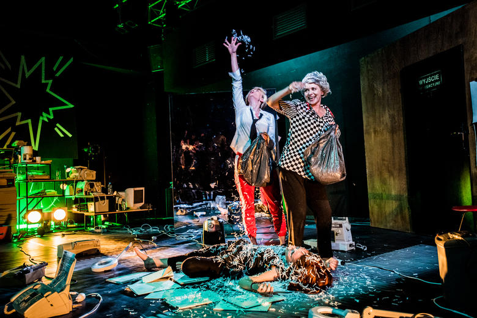
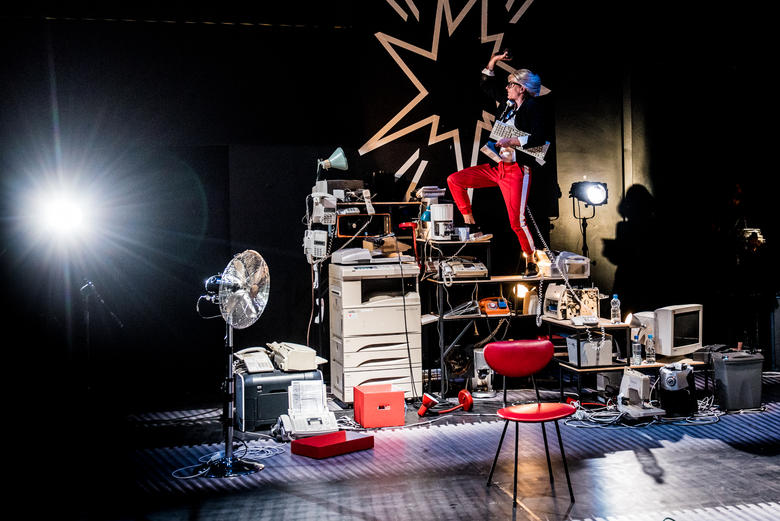
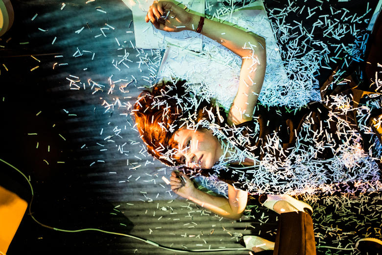

Workplace w reżyserii Bartka Frąckowiaka, to opowieść o trzech kobietach. Na pozór niepodobnych, bo w końcu w różnym wieku, z różnymi kwalifikacjami, na trzech różnych poziomach drabiny społecznej, każda w innym miejscu życia. Pierwsza z nich, grana przez Magdalenę Celmer — najmłodsza, dopiero wchodząca na rynek pracy, zgłębiająca tajniki etatu. Druga — mająca już dość bogate doświadczenie zawodowe i pozycję, wracająca właśnie na stanowisko po urlopie macierzyńskim i pracująca z tego tytułu od świtu do nocy. Po pierwsze z wdzięczności za ponowne przyjęcie do pracy (*to jak dostać pracę na nowo* mówi postać brawurowo zagrana przez Anitę Sokołowską), po drugie żeby spłacić kredyt hipoteczny — bagatela 422 tysiące złotych. Trzecia kobieta to pani sprzątająca, która tak naprawdę ma nie jedną, a tysiąc prac, a i też niepełnosprawnego męża alkoholika. To rola świetnej Beaty Bandurskiej.

Powiedziałam *na pozór*, bo coś, oprócz fantastycznej gry aktorskiej je jednak łączy — wszystkie swoją pracę straciły i wszystkie spotykają się w swoistym laboratorium kariery, gdzie kobiecy głos z offu dyktuje kolejne zadania symulujące przebieg rozmowy kwalifikacyjnej i swego rodzaju etiud, podczas których żonglując emocjami,  przyjmują kolejne maski, wcielają się w role pracodawców i pracownic, z różnych miejsc zatrudnienia. I sceny te, to kluczowe momenty spektaklu bo to właśnie w nich zostaje podkreślony problem dystrybucji przemocy wobec kobiet w miejscu pracy — tej patriarchalnej, społeczno-ekonomicznej, ale też kobiet wobec kobiet. Jest podkreślony, wcale nie zdemaskowany, bo nikt w tym spektaklu nie odkrywa Ameryki, a stawia sobie raczej za cel uwypuklenie, zwrócenie uwagi (jak czytamy w opisie) na *utratę godności, stabilności i poczucia własnej wartości *kobiet w skutek działania globalnej gospodarki kapitalistycznej.

Spektakl ma formę kompozycji muzyczno-ruchowo-emocjonalnej, gdzie trzy kobiety w przestrzeni przypominającej zapomniany magazyn sprzętów biurowych (scenografia Anny Marii Zajęby i Mikołaja Małka) projektują kolejne sceny dotyczące swojej przeszłości i przyszłości. Dobrze wykorzystana scenografia, która dzięki swej mobilności i możliwości przeistaczania pozwala na odkrywanie nowych przestrzeni i tworzenie nowych światów. W połączeniu z emocjami, zamianą ról i peruk pozwala na dużą uniwersalizację problemu.

Umożliwia przebywanie w agencji reklamowej odpychającego seksizmem i sprośnością, prezesa (ale przecież gdzieś trzeba zdobyć doświadczenie, gdzieś trzeba zacząć…). Pozwala też na wyjazd w celach zarobkowych do Niemiec by opiekować się schorowanymi seniorami, którym różne dolegliwości i niepełnosprawności nie przeszkadzają w klepaniu po tyłku i łapaniu za piersi młodej opiekunki. Przenosi do biura, gdzie jedni sprzątają (zagryzając zęby w poczuciu niesprawiedliwości ekonomicznej), a drudzy kserują i biegają z dokumentami, permanentnie udowadniając swoją niezbędność. Sala poporodowa natomiast stwarza przestrzeń by salowa (której praca w szpitalu to jedna z tysiąca) mogła wreszcie wypowiedzieć się na temat wyniosłości *pani z biura* – młodej mamy i obwinienie jej (bo kogoś trzeba) za błędy systemu.

Wiele w tych scenach śmiechu bo aktorki markują nowe role z dużą lekkością i często z dużą przesadnością, co daje efekt rzeczywiście groteskowy. Tylko niestety jest to śmiech powodujący raczej wyrzuty sumienia niż radość… po wyjściu z teatru czujemy się winni każdego uśmiechu. Bo pojawia się w dobie zwątpienia w siłę i wartość demokracji, kiedy niepełnosprawni muszą walczyć o opiekę ze strony państwa, kiedy kobiety muszą dowodzić swoich praw protestując na ulicach. Bo kapitalistyczny pęd za pieniędzmi, za lepszym jutrem sprawił, że kobiety z Workplace czują się dobrze tylko ukryte i razem. Reżyser schował je pod ogromną miotłą, czyli tam, gdzie nie dociera wzrok, ani głos wolnego rynku, gdzie są niewidoczne i mogą choć na chwilę się zatrzymać i zastanowić na tym, czego tak naprawdę chcą i czego potrzebują. A pragną jedynie spokoju… kobieta spłacająca kredyt pragnie się jedynie i wreszcie wyspać.

To ostatnia scena spektaklu. Po nim kobiety wychodzą z aktorskich kreacji, aby podzielić się z widownią swoimi refleksjami na temat utopii pracy. Ich wypowiedzi nie są tak przejmujące i wzruszające, jak te sprzed roku, kiedy żegnały się z Teatrem Polskim w Bydgoszczy, po zakończeniu kadencji Pawła Wodzińskiego i Bartka Frąckowiaka. Wszak ówczesny moment musiał być dla aktorek ekstremalnie trudny, właśnie rozpadał się ich zespół, właśnie zdecydowały o wyjściu z etatowej strefy komfortu. Rok później grają *Workplace* podczas Spotkań Teatralnych Bliscy Nieznajomi jako część Biennale Warszawa i z frontu freelancerskiego. Historie kobiet przedstawione w spektaklu, uzewnętrznienie aktorek i towarzyszący temu bydgoski kontekst oraz okoliczności społeczno-polityczne, to pretekst by wraz z oklaskami po prostu nie zapomnieć i może lub, albo zacząć działać… 

 

fot. Monika Stolarska
