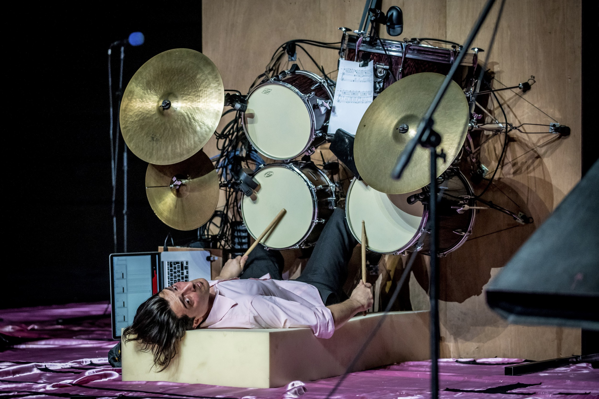
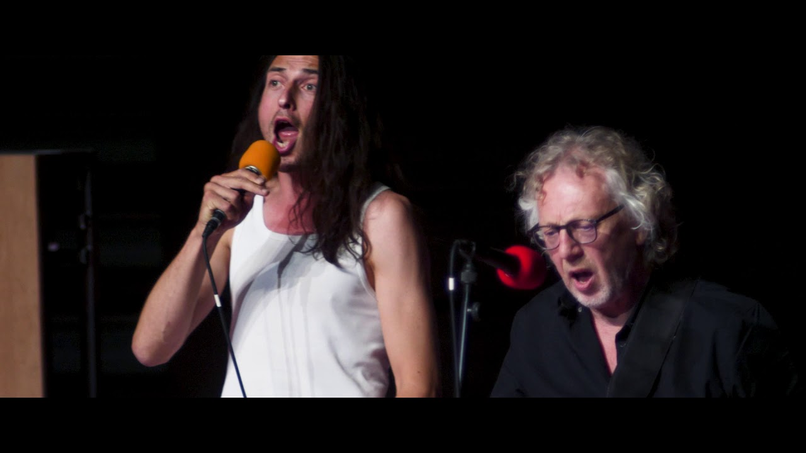
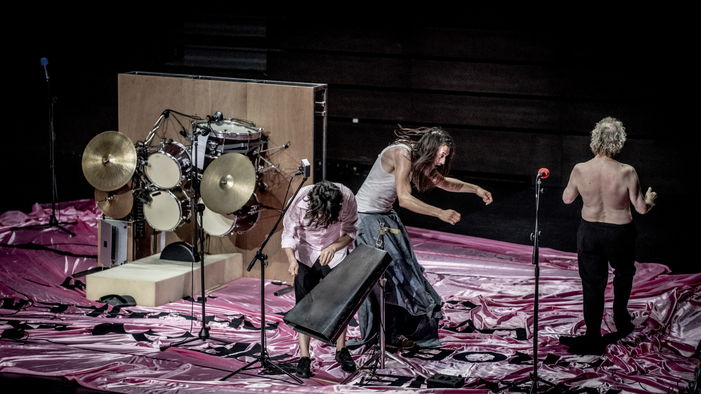

Koncert zespołu zwróconego/patrzącego w złym kierunku. W złym czyli jakim? W kierunku rozpadu, porażki? Czy może intensywności, dzikości, energii? Może chodzi o sposób tego patrzenia, że jest trochę odchylony, wariacki? Faktem jest, że gdzie by nie patrzyli, podkreślają wybrany kurs dźwiękiem, szaleństwem i jakąś dziwną hipnotyczną lekkością płynącą równolegle z nomen omen, ale rozsadzającą głowę i ściany Auli Artis, muzyką.

*Concert by a band…* w reżyserii Maartena Seghersa to performans muzyczny/instalacja muzyczna na trzech wykonawców. Pierwszym z nich sam Seghers — od 2001 roku członek kompanii Needcompany i jeden z kuratorów tegorocznej edycji Malta Festival, we współpracy z Nicolasem Field oraz Romboutem Willems. Wszystko w tym performansie jest trochę odklejone, niepoczytalne, począwszy od składu, po kostiumy. Perkusista gra wyłożony na wznak bo instrument ustawiony został wertykalnie, w gitary uderzają bo trudno to nazwać grą, a i słowa, które wypuszczają z ust, są tyle donośne, co zupełnie niezrozumiałe. Przypominają raczej dźwiękowy odpowiednik kontaktu improwizacji, ich muzyczne gesty wydają się być, zupełnie jak w tanecznej improwizacji, czymś nieplanowanym, wynikającym z odpowiedzi na impuls pochodzący od partnera, czymś co skupia się na reagowaniu a nie planowaniu. Całość sprawia wrażenie nie wyreżyserowanego, choć w istocie takim jest i aż prosi się, aby móc zobaczyć nagrania z prób, jakiś zapis z procesu tworzenia.

 

 

Na wrażenie lekkości i wdzięcznej przypadkowości składają się wspomniane już kostiumy — spodnie z nogawkami za długimi o jakiś metr i utrudniającymi chodzenie, ale za to jak finezyjnie zwisającymi niczym tren albo syreni ogon, gdy ich śpiewający właściciel zostaje podniesiony przez kolegów w górę… albo koszula za duża co najmniej o 10 rozmiarów, przewiązana w pasie i z podskakującymi rękawami zakończonymi supłem. Różowa koszula perkusisty natomiast, w konfrontacji z ostrymi dźwiękami, światłami wyglądała po prostu zabawnie, jak dowcipna jest lekkość i nieodparty optymizm performerów.

Wydaje się, że performerzy puszczają do nas oko, zdają się mówić, że może i są zwróceni w złym kierunku, ale przynajmniej są niestrudzeni! Nawet jeśli nie zrozumiemy przed czym lub przed kim się opędzają, albo dlaczego czują zakłopotanie (wyłapałam często powtarzającą się frazę *get lost – spadaj *lub *czuć się zakłopotanym*), to trud i starania które podejmują wydają się być kluczowe.

Jest w tym wszystkim coś dziwacznego, niezwykle hipnotyzującego. I wchodzi się w to od razu! Albo nie? Ale to tym gorzej dla odpornych na ten trans bo pewnie męczą się przez godzinę… ja w te krzyki i pokręcenie wskoczyłam absolutnie!

fot. Mat. Malta Festival
