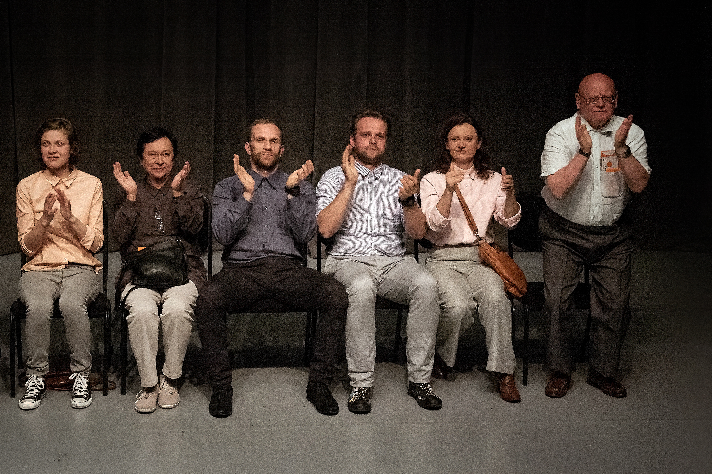

Anna Karasińska powiedziała, że *Drugi spektakl* jest realizacją, co do której nie ma pewności, czy odniosłaby sukces w innym niż Poznań, mieście. Jest to bowiem spektakl przygotowany dla, z myślą i o tej właśnie publiczności, i po to by wytworzyć wzajemną relację, poczucie wspólnoty pomiędzy tą właśnie publicznością, a ich miejską sceną. Po dwóch latach od premiery, spektakl nie traci świeżości i adekwatności.

*Drugi spektakl* jest raczej pewnego rodzaju eksperymentem scenicznym, symulacją, wydarzeniem teatralnym niż prawilnym spektaklem z aktorami i widownią, gdzie każdy zna i dobrze czuje się w swojej roli. Karasińska w miejscu, gdzie spodziewalibyśmy się aktorów, granych przez nich postaci, postawiła ludzkie lustra. Zniknął sztywny podział na oświetloną scenę i bezpieczny półmrok przykrywający widzów. Jest publiczność. Na scenie i na widowni.

Pierwsza część spektaklu to rzecz bardzo dosłownie o publiczności — ćwiczenia z bycia publicznością, zestaw scenek, mini etiud aktorskich. Dziesięciu aktorów Teatru Polskiego (Kornelia Trawkowska, Małgorzata Peczyńska, Katarzyna Węglicka, Monika Roszko, Mariusz Adamski, Przemysław Chojęta, Paweł Dobek za Michała Kaletę, Wojciech Kalwat, Paweł Siwiak, Wiesław Zanowicz) wchodzi na scenę, po kolei zajmują miejsca. W rękach mają bilety, sprawdzają numery rzędów, niektórzy mylą miejsca, komuś dzwoni telefon (ale dzielnie udaje, że to nie jego), ktoś inny trudzi się by niepostrzeżenie zjeść cukierka. Głos z offu — Narrator zapowiada każde z kolejnych zdarzeń, następnie sprawnie markowanych przez aktorów. To niezwykle zabawna i mocno autorefleksyjna część spektaklu. Utożsamiamy się z widownią na scenie, widzimy w niej samych siebie, widzimy przyjaciela siedzącego obok nas i panią z kokiem w drugim rzędzie… Miałam wrażenie, że z każdą kolejną zapowiedzią, poznańska publiczność spuszcza z tonu, śmieje się głośniej, szczerzej, jest mniej zachowawcza. A aktorzy dalej demonstrują… jak można bawić się numerkiem z szatni, jak pogadać z koleżanką, z którą nas rozsadzono, jak przetrwać przerwę w spektaklu. Cała część przebiega w tym samym schemacie: zapowiedź Narratora, demonstracja, dzwonek, zatrzymanie.

Druga część spektaklu jest natomiast o wymaganiach stawianych twórcom teatralnym/aktorom przez publiczność, ale także o potrzebie kontroli i o oczekiwaniach widza. W trzecim rzędzie stoi krzesło z napisem *rezerwacja*. Miejsce to zajmują kolejni aktorzy, którzy przedstawiają pozostałym swoje wymogi, nadzieje. Chcieliby *coś przeżyć, żeby coś ich poruszyło*. I do końca spektaklu pozostają niezadowoleni. Wspomniane oczekiwania co do przebiegu akcji, wzbudzonych przez nią emocji są nawiązaniem do presji, wysokich oczekiwań stawianych przed Karasińską po jej ogromnym sukcesie jakim okazał się spektakl *Ewelina płacze* produkcji TR Warszawa.

*Drugi spektakl* jest drugą z kolei realizacją teatralną reżyserki. To bardzo zabawna, nienachalna, lekka i oczyszczająca  kpina z poznańskiego snobizmu, spięcia i zapięcia na ostatni guzik, ale także wyraz ogromnego talentu i przenikliwości reżyserki, umiejętności kreowania idealnie wycelowanych sytuacji teatralnych.

fot. Monika Lisiecka
