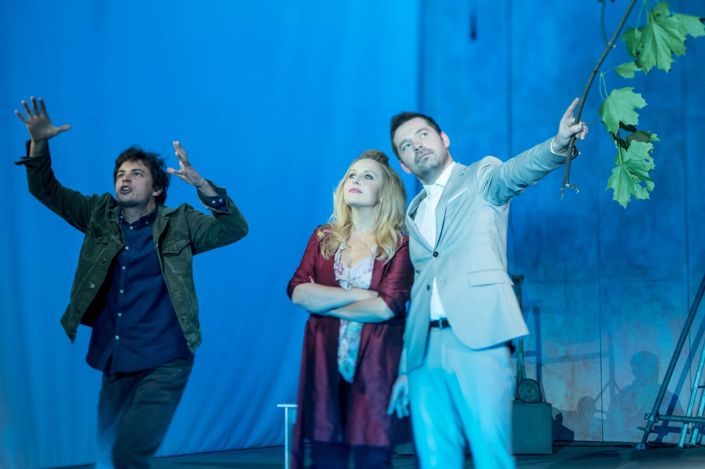
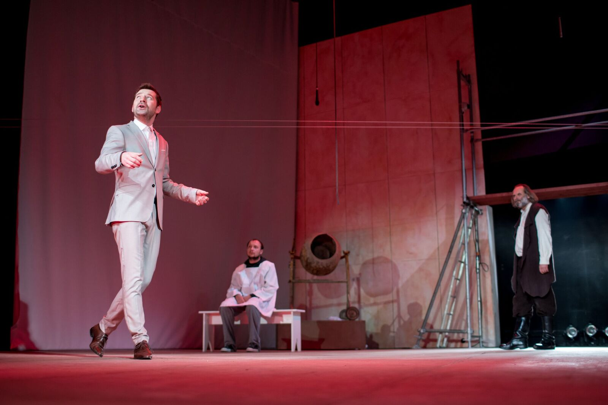

*Pan Tadeusz* jest premierą inaugurującą 95 – lecie Teatru Nowego w Poznaniu, ale to nie pierwsza adaptacja tego dzieła przez profesora Grabowskiego, którą mieli okazję oglądać Poznaniacy. W 2013 roku spektakl produkcji Teatru Starego w Krakowie wystawiony został w Teatrze Polskim podczas Spotkań Teatralnych *Bliscy Nieznajomi*.

Czesław Miłosz powiedział kiedyś o *Panu Tadeuszu *Adama Mickiewicza, że jest *to poemat metafizyczny mówiący o równowadze, porządku świata, w którym Soplicowo jest ogrodem Pana Boga*. *Pan Tadeusz* w wydaniu Mikołaja Grabowskiego nie skupia się na tajemnicy i krzepieniu podupadłych polskich serc. Raczej odziera tekst z jego epopejowości. Wyciągając z niego na pierwszy plan humor, mocno ironizując, stawiając na komizm, śmiech i farsę, tworzy parodię romansu i kryminału. Oczywiście przy współpracy z fantastycznym zespołem aktorskim Teatru Nowego.

Jeśli już mowa o romansie, to oczywiście z udziałem Telimeny, Zosi, Tadeusza i Hrabiego!

Telimena (w tej roli wspaniała Anna Mierzwa) to kobieta dojrzała, pewna siebie, świadoma swoich walorów i atutów, także tych fizycznych, których nie kryguje się wykorzystywać. Jest zadziorna a jednocześnie namiętna i kochliwa, to intrygantka lawirująca między objęciami Tadeusza i Hrabiego. W dużym dekoldzie, na wysokich, czerwonych obcasach. Nie wiem tylko co by na to powiedział Mickiewicz, który przy tworzeniu *Pana Tadeusza*, czerpać miał z wątków autobiograficznych. I tak w postaci Telimeny na przykład, ukryć cechy, postawy i stosunek do swojej żony — Cecylii…

Zosia (świetna Alicja Juszkiewicz) u Grabowskiego jest zwykłą, wiejską dziewczyną, której raczej brak manier i dystyngowania. Wychowana z indykami i włażąca na drzewa. Przedstawienie Zosi w ten sposób, tworzy przezabawną polemikę i zmienia utarte (także przez ekranizację *Pana Tadeusza*, Andrzeja Wajdy) wyobrażenie Zosi — naturalnej, zgrabnej i zwiewnej nimfy. W spektaklu, daleko tej kreacji do złotowłosej Alicji Bachledy-Curuś i pojęcia damy, a już na pewno daleko do pojęcia kochanki. Kontynuując zaś wątek autobiograficzny wieszcza, w literackiej Zosi upatruje się zafascynowania Mickiewicza Ksawerą Deybel, z którą poeta miał wieloletni romans.

Podatny zaś na zaloty dużo starszej od siebie i dojrzałej Telimeny oraz urodę nieopierzonej jeszcze Zosi, Tadeusz, to debiut aktorski nowego aktora Teatru Nowego, Jana Romanowskiego, który radzi sobie z tą rolą koncertowo. Tadeusz w jego wykonaniu bez wątpienia zapada w pamięć. W przeciwieństwie do tego z epopei, gdzie choć stanowi tytułowego bohatera, zdecydowanie nie jest najważniejszą, ani najbardziej barwną postacią utworu. W spektaklu, Młody Soplica to dziecinnie zdziwiony, zachwycony wszystkim i wszystkimi, zadziorny chłopak, któremu wydaje się być już dojrzałym mężczyzną. W miłości niezdecydowany, za to w sprawie kawy ze śmietanką (absolutnie prześmieszna scena) już tak!

Hrabia to kolejna świetna kreacja aktorska, tym razem Mateusza Ławrynowicza. Postać podatna na wpływy, romantyczna i wrażliwa, zdecydowanie bardziej obyta wśród szlachty i kobiet niż Tadeusz.

Co do kryminału, to postaciami wokół których buduje się największe napięcie, są oczywiście ksiądz Robak (Mariusz Zaniewski) i Gerwazy (Ildefons Stachowiak). I te role, to kolejny przykład aktorstwa na naprawdę wysokim poziomie! Spowiedź Jacka Soplicy w drugiej części spektaklu, przedstawienie przez Zaniewskiego w tym krótkim monologu całej skomplikowanej konstrukcji biograficznej postaci, syntezy zbrodniarza i pokutnika, a wcześniej także cichego konspiratora, to duży aktorski sukces. Podobnie zresztą, jak atmosfera niepokoju i napięcie budowane przez Stachowiaka.

W odpowiedni nastrój wprowadza również scenografia spektaklu (Jacek Ukleja). To surowe wnętrze, powiedzieć można, że w stanie deweloperskim. Ledwo co wylana betonowa posadzka, wybielone ściany, w rogu betoniarka, w centrum sceny rusztowanie. Z boku sceny, pod rusztowaniową siatką ochronną znajduje się zespół kameralny, który gra muzykę na żywo. Tu dzieje się cała akcja, to Soplicowo – pomieszczenie w budowie, w które trzeba włożyć jeszcze sporo pracy by doprowadzić je do stanu wygodnego użytkowania. A opisywana przez Mickiewicza i hiperbolizowana przez Grabowskiego duma, pycha, warcholstwo i skłonność do kłótliwości polskiej szlachty raczej w tym nie pomaga. Budowa na scenie jest podkładem do grzybobrania, polowania, jest kościołem, jadalnią, karczmą Jankiela, lasem, łąką i świątynią dumania. Miejscem, które tworzy tło do fantastycznych aktorskich ról. To one, poza lekkością, której nadał epopei Grabowski, są największym, zdecydowanie najmocniejszym aspektem spektaklu.

*Pan Tadeusz* Mikołaja Grabowskiego na pewno nie jest artystycznym arcydziełem, nie jest też odkrywczy, ale jest zbawiennym, zabawnym oderwaniem od epopejowości dzieła, jego drugim, zdecydowanie bardziej humorystycznym dnem. Przekonuje, że nie taki wieszcz i 13-zgłoskowiec straszny jak go malują.

fot. Jakub Wittchen
