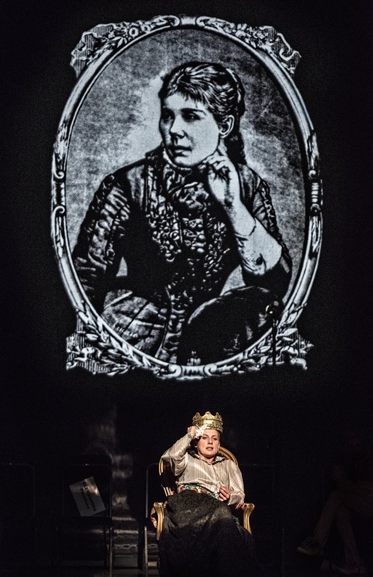
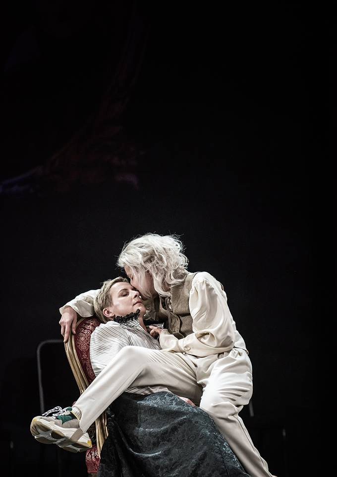

Po pierwsze *O mężnym Pietrku i sierotce Marysi. Bajka dla dorosłych *w reżyserii Wiktora Rubina, wydaje się być spektaklem bardzo lekkim, ale niech pierwsze wrażenie was nie zmyli. W istocie, spektakl ten stanowi ważny głos w dyskusji na temat dyskryminacji kobiet homoseksualnych, które jak w rozmowie z Martą Kaźmierską (Gazeta Wyborcza) powiedział reżyser: *w społeczeństwie dyskryminowane *[są] *podwójnie. Raz – jako osoby homoseksualne, dwa – jako kobiety, bo dyskurs homoseksualny jest głośniejszy, bardziej opisany i zamieszkały przez mężczyzn. *Twórcy inkorporują historię Marii Konopnickiej i jej wieloletniej partnerki Marii Dulębianki i traktują ją jako pomost do rozmowy na temat emancypacji i homoerotyczności kobiet, dziś, a także o niebezpieczeństwie wynikającym z patriarchatu.

Po drugie, spektakl jest przykładem naprawdę dobrego aktorstwa — przede wszystkim świetna Agnieszka Kwietniewska w roli Konopnickiej i fantastyczna, charyzmatyczna, zadziorna Kornelia Trawkowska w roli Heleny.

I po trzecie, *O mężnym Pietrku…* wbrew przypuszczeniom tych z widzów, którzy prace duetu Rubin i Janiczak znają, nie jest spektaklem interaktywnym. Widz nie jest tu ani elementem ani uczestnikiem akcji.

Spektakl rozpoczyna film z wizyty aktorek Agnieszki Kwietniewskiej (Konopnicka) i Moniki Roszko (Dulębianka) w archiwum i na cmentarzach gdzie pochowane zostały Marie. Poszukują tu prywatnych zapisków z dzienników, listów, jakiegokolwiek śladu, namacalności po związku Konopnickiej i Dulębianki. Informacji znajdują niewiele, jedynie kilka słów o chorobie Konopnickiej i o tym, jak opiekowała się nią Dulębianka. Natomiast groby partnerek, które aktorki odwiedzają są oddzielne. Mimo woli Konopnickiej by zostały pochowane w jednej mogile, na której stać będzie pomnik dwóch kobiet czytających jedną książkę. Grób początkowo był jeden, ale został rozdzielony decyzją rządu II Rzeczypospolitej, aby nie naruszać pasującego patriarchalnego porządku, obrazu pisarki — patriotki, a obecność Dulębianki skutecznie wymazać z jej biografii.

Na scenie zaś, na tle dwóch starych, potężnych, drewnianych szaf, oprócz Dulębianki i przechodzącej właśnie menopauzę Konopnickiej w wykonaniu (jeszcze raz podkreślę) wspaniałej Agnieszki Kwietniewskiej, dzięki której mamy do czynienia nie tylko z powszechnym wyobrażeniem: wieszczki, patriotki, pozytywistycznej bajkopisarki i poetki, ale z postacią wielowymiarową, niejednoznaczną, kobietą zagubioną, miotającą się, pewną siebie i jednocześnie słabą, wiedzącą czego chce i odczuwającą ciągłą niemożność określenia się, która była idealna patriotką piszącą idealne patriotyczne teksty bo potrzebowała pieniędzy; poznajemy córki Konopnickiej, Maksymiliana Gumplowicza oraz Marguerite Radclyffe-Hall i jej partnerkę Mabele Batten.

Twórcy przywołują tylko dwie córki z ośmiorga dzieci Konopnickiej. Pierwsza, Helena (Trawkowska) to dziecko — wstyd, dziecko — hańba, dziecko, które chce się *oddać do schroniska lub lombardu*, nimfomanka i histeryczka. Druga córka, Zofia (groteskowa rola Mariusza Adamskiego) to dziecko — ulubieniec. To Zofia najprawdopodobniej zniszczyła pamiętniki Heleny, listy Konopnickiej i Dulębianki, po śmierci tej pierwszej. I nie bez przyczyny Zofię — strażniczkę czystości wizerunku Konopnickiej — gra mężczyzna. To kolejna wymowność. Te dwie kobiety: jedna — poszukująca wsparcia i miłości matki, mówiąca: *ja tu zostaję dopóki mnie nie pokochasz* i druga, podziwiająca i zapatrzona w matkę, przywołane na zasadzie absurdalnego, zabawego przeciwieństwa w pewien sposób demityzują Konopnicką, odkrywają jej człowieczeństwo, wahania, tęsknoty i frustracje, tak skrzętnie usuwane przez kolejne pokolenia władzy.

Maksymilian Gumplowicz, historyk, szaleńczo zakochany w młodszej od siebie o 30 lat, Konopnickiej, zdolny zrobić dla niej wszystko. Zastrzelił się w wieku dwudziestu kilku lat… z miłości do poetki. To postać (mimo całego dowcipu językowego, kostiumu) fatalna, podporządkowana, dająca się wykorzystywać.

I w końcu Radclyffe-Hall — brytyjska pisarka i  poetka, autorka *Studni Samotności *— książki z jawnym wątkiem lesbijskim i jej partnerka — śpiewaczka kabaretowa Batten. Są afirmacją i narzędziem, dzięki któremu Marie mogą spróbować się określić, ale też ucieleśnieniem oskarżenia Konopnickiej, zbiorczym głosem wszystkich tych (współczesnych i ówczesnych) którzy mają żal do poetki, że milczała, że nie zostawiła świadectwa. Są głosem Dulębianki. Bo ona, wymazana z biografii swej wieloletniej partnerki, kochanki, po śmierci Konopnickiej wyrzucona z ich domu, na koniec wyrzucona także ze wspólnego grobu, jest naga. Dosłownie i w przenośni. Monika Roszko podczas manifestu Konopnickiej do kobiet nieheteronormatywnych stoi bez ubrania. Chłodno, niemal biernie, jakby pogodzona ze swoim, jak i losem kobiet w Polsce w ogóle, trzyma w ręku kartę z pytaniem: *Gdzie jesteście?*, które kontynuuje wyrzucając po kolei kolejne. Na podłodze lądują wszystkie ciotki, sąsiadki, kumy, policjantki… kobiety, których prawa w Polsce są łamane!

Polecam wybrać się Poznania na spektakl Wiktora Rubina i Jolanty Janiczak, którzy w Teatrze Polskim, za pośrednictwem biografii Konopnickiej i Dulębianki podejmują nader ważny temat! Praw i wolności kobiet, emancypacji, patriarchatu. Jedno, że ten temat podejmują, a dwa, że robią to naprawdę dobrze! I to w tak prostej formie, bez zbędnych ozdobników, przegięcia językowego, czy estetycznego.

fot. Magda Hueckel
