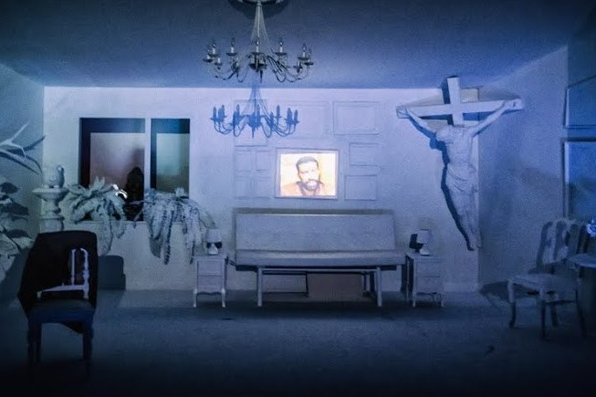
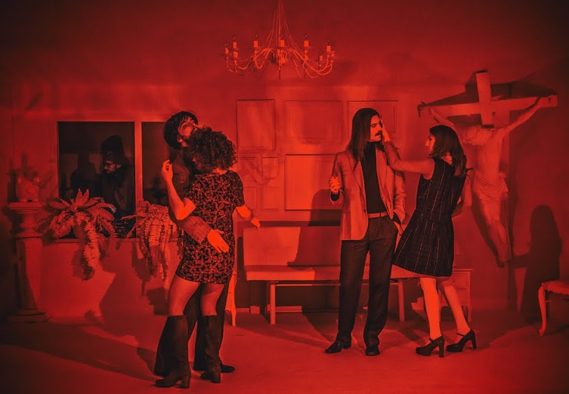

*Strach zżerać duszę* w reżyserii Agnieszki Jakimiak, to przykryty humorem, przegięciem, pastiszem, fantastyczną warstwą estetyczną, dramat.

I nie chodzi tu o romans głównych bohaterów nagrodzonego w Cannes filmu Rainera Wernera Fassbindera, który stał się inspiracją do stworzenia spektaklu. Nie chodzi o samotność, starość, emigrację, niedopasowanie, brak akceptacji, niechęć niemieckiego społeczeństwa, czy ostatecznie połączenie tego wszystkiego za sprawą dwójki przegranych – Emmi, starszej, niemieckiej sprzątaczki o polsko brzmiącym nazwisku i młodego, marokańskiego gastarbeitera, Alego.… To nie ten dramat, nie ta historia.

Wykorzystana została ona jako klucz do sportretowania nastawienia homogenicznego społeczeństwa do *innego, innej*, do wszystkiego co nowe i nieznane i wytrącające przez to ze strefy komfortu. O stosunku Polaków – narodzie bardzo jednolitym, do ludzi innego wyznania, innej rasy, narodowości.

Ali i Emmi nie biorą udziału w spektaklu, obecni są za to ich sąsiedzi, ich niechęć i plotki, obecna jest rodzina, dorosłe dzieci Emmi, ich złość i brak zrozumienia. To zamknięcie i strach przed innością, do której nie wiadomo jak się odnieść, jest źródłem agresji.

Spektakl (na szczęście!) nie jest gorzko – patetyczny. Cierpkość pojawia się dopiero wraz z refleksją, że ten śmiech, choć głośny i szczery, jest trochę przez łzy. Wystarczy włączyć telewizję. Wystarczy przejść niedaleko Mostu Poniatowskiego w Święto Niepodległości by wiedzieć, że to tu, że to o tym.

Ale! Wracając do śmiechu! Spektakl rozpoczyna debata z udziałem twórców spektaklu, która zwykle odbywa się po premierze: reżyserki (Karolina Adamczyk), dramaturga (Julian Świeżewski), muzyka (Łukasz Jędrzejczak) a także samego Fassbindera (Grzegorz Artman), rozmowę moderuje Klara Bielawka. Pełno tu pstryczków w nos, kąśliwych uwag do siebie nawzajem, do wchodzącej publiczności i komentarzy na temat spóźniającej się reżyserskiej, zagranicznej gwiazdy. Wszystko na tle przepięknej scenografii Mateusza Atmana. Za plecami odbywającej się debaty znajduje się biały pokój, w którym, nie tylko ściany, a dosłownie wszystko jest białe. Białe są i stół i krzesła, i kwiaty, donice, sofa, ogromny ukrzyżowany Jezus w rogu pokoju i nawet woda w białej konewce jest biała. Biel jest wszechobecna i wszechogarniająca! Przepiękna! Tworzy wspaniały podkład do gry świateł w kolejnych scenach. I można ją dowolnie zapisać. Trudno oderwać oczy.

Po zakończeniu debaty, z sufitu zjeżdża ekran, na którym wyświetlone zostają fragmenty filmu połączone są ze scenami dogranymi przez aktorów spektaklu. Tym samym, na przykład Brigitte Mira, grająca w kinowej wersji rolę Emmi rozmawia przy stole nie z El Hedi ben Salem (Ali z filmu) a z Grzegorzem Artmanem.

Pokój w każdej kolejnej scenie zmienia kolor, raz jest czerwony, raz żółty, innym razem zielony. Aktorzy mają na sobie peruki i stroje odpowiadające charakterem tym z filmu (lata 70. ubiegłego wieku). Raz są zawistnymi sąsiadami z dołu, sklepikarzem, który postanawia nie obsługiwać tej *starej baby* i *arabskiego psa, *krzyczącą córką i rozbijającym telewizor, synem. Nie są przywiązani do ról, w każdej fantastyczni, przezabawni! Grają farsą, komiczną hiberbolizacją gestów i słów.  Przez rozbawienie uwypuklają tragizm, brutalność wynikającą z braku tolerancji i zakłamania.

Najbardziej gorzki jest wniosek, do którego dochodzą rodzina, sąsiedzi, otoczenie Emmi i Alego — że właściwie korzyść (nie tylko materialna) wynikająca z publicznej akceptacji *innego* jest większa niż jawny sprzeciw, otwarta złość. A nienawidzić można przecież na odległość i podskórnie. Analiza ta niczego zatem nie zmienia… zrozumienie i akceptacja się nie pojawia, pozostaje zimna kalkulacja.

Rytm całemu spektaklowi nadaje Jędrzejczak, poruszający się do klubowych bitów za oknem pokoju. Wychodzi na ostatnią scenę. Ubrany w krótkie futerko, wełnianą czapkę, z wyrysowaną na torsie głową jelenia. Wychodzi, żeby zaśpiewać pieśń o Cyganie, czarnym Cyganie. Dość że czarnym to jeszcze Cyganie… 

Gorąco polecam! To bardzo mądrze zrealizowany spektakl.

fot. Magda Hueckel
