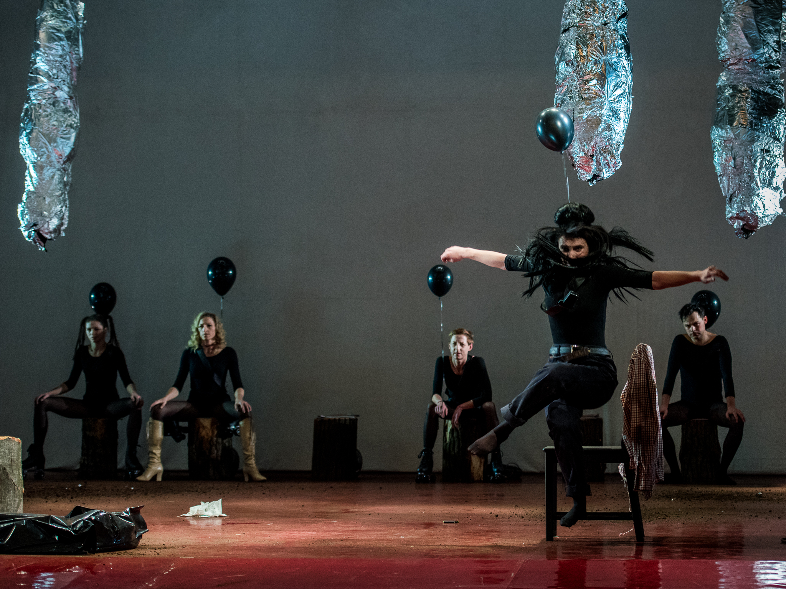
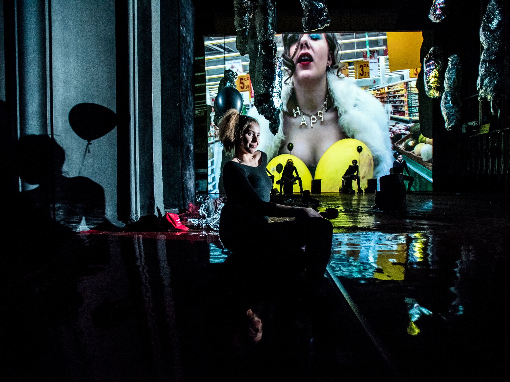

Bo dobra dziewczyna to martwa dziewczyna…

Sześć kobiet. Sześć historii. Sześć upadków. Kulturowa fascynacja martwym, kobiecym ciałem i medialna fiksacja na temat celebryckiego staczania się. Im bardziej poniżający obrazek, tym lepiej, tym więcej seksistowskich gifów, komentarzy i krzykliwych, prasowych nagłówków. *Dead Girls Wanted, *to sześć monologów skrzywdzonych, upadłych kobiet, bądź kobiet już martwych, których śmierć poprzedzona była upadkiem. Kobiet ikonicznych dla popkultury, gwiazd, celebrytek, których ucieczką przed swoją rolą, przed sławą i związanymi z nią oczekiwaniami jest autodestrukcja.

Inspiracją dla Jolanty Janiczak i Grzegorza Stępniaka, do powstania tekstu, była książka Alice Bolin *Dead Girls: Essays on Surviving an American Obsession*. Książka dostępna jest na razie  tylko w języku angielskim i dotyczy, jak wskazuje tytuł — obsesji amerykańskiej popkultury na punkcie martwych dziewczyn.

Z perspektywy rozwoju fabuły, te martwe dziewczyny są w filmach, czy serialach raczej mało ważne. Ich znalezione ciała są szansą do rozwiązania przez mężczyzn policyjnej zagadki, wykazania się w roli detektywa, śledczego, prokuratora. Jedną z przedstawicielek martwych, telewizyjnych kobiet, znanych na szeroką skalę jest Laura Palmer z miasteczka *Twin Peaks*. I to właśnie fragmentem z tego serialu i obrazem nieżywej Palmer, której ciało ,,zagrała” Jola Janiczak, rozpoczyna się spektakl — kolaż pełen przeróbek, tekstów piosenek, swoistych spowiedzi gwiazd, które nie oczekują rozgrzeszenia.

Jako pierwsza swój monolog rozpoczyna Nastazja Filipowna (nieudana, pretensjonalna rola Beaty Deutschman) z *Idioty* Fiodora Dostojewskiego. I dalej, zgodnie z myślą Michela Foucaulta, że* najwięcej o danej kulturze mówi to, co zostało przez nią wyrzucone na margines*, otwierają się przed nami kolejne kobiety, jedna po drugiej — gwiazdy medialnych performanców, bohaterki alkoholowych i narkotykowych ekscesów, osaczane przez paparazzi, fotografowane i kręcone w stanie odurzenia, nagie, zarzygane, półprzytomne, pogrążone w depresji, będące pożywką dla mediów. Martwe lub uśmiercone (jak Britney Spears, czy Lindsay Lohan) za życia. Mówią o swoich lękach, uzależnieniach, o wyrachowanych, pazernych krewnych. Mówią o bezsilności i lęku, a jednocześnie emanują jakąś dziwną siłą i pewnością siebie, którą jakby odzyskały po śmierci lub poprzez autodestrukcyjne akty. Aktorsko jest już tylko coraz lepiej.

Świetny w roli  Whitney Houston, Łukasz Stawarczyk — ubrany w białe futro, co kilka zdań kryje głowę pod wodą, w cynkowej wannie (bezpośrednie odniesienie do miejsca, w którym znaleziono ciało Houston po przedawkowaniu). Wzruszająca Magdalena Celmer w czarnym koku, jako Amy Winehouse, która błaga o wsparcie, uwagę, miłość Blake’a (były partner Amy, którego rola w jej karierze i uzależnieniu była niebagatelna). Hipnotyczna Karolina Staniec, Annę Nicole Smith (znaną między innymi z sesji dla Playboya i śmierci w wieku niespełna 40 lat w wyniku zażycia dwunastu rodzajów różnych leków), zagrała w supermarkecie. Film z odurzoną Smith w wykonaniu Staniec, spacerującą w coraz większym zagubieniu, smutku i upojeniu, obserwujemy na ogromnym ekranie z tyłu sceny. Na koniec dwie jeszcze żywe kobiety, czyli Britney Spears i Lindsay Lohan. Jeszcze bo wciąż balansują na krawędzi życia i śmierci. Britney, ulubienicę moich rówieśniczek z lat 90. zagrała Małgorzata Saniak; przez całą swoją scenę biegnie bez tchu (lub może bardziej jedzie bo jest, jak cała reszta aktorów, na wrotkach) przed siebie, zostawiając w tyle wszystko i wszystkich, którzy czegoś od niej wymagają, oczekują. I na koniec wspaniała Agnieszka Kwietniewska w roli Lindsay Lohan — amerykańskiej aktorki filmowej i serialowej, aktorki Disneya, która pomimo młodego wieku była już na kilku odwykach, o której media przypominają sobie przy okazji kolejnych skandali. I która pomimo wspinania się przez całą scenę po szczeblach wysokiej drabiny, gotowa za sukces zapłacić wiele, kariery pewnie w najbliższym czasie nie zrobi.

*Dead Girls Wanted* to kompletna i radykalna dekonstrukcja amerykańskiego snu.

O znieczulicy społecznej, o przyzwoleniu na cynizm i seksizm i o *kulturowej obsesji na temat martwych dziewczyn* (jak czytamy w opisie spektaklu) jest najnowsza premiera Teatru Zagłębia w Sosnowcu. Naiwnym jest jednak sądzić, że *Dead Girls Wanted* to spektakl tylko o cierpieniu i psychicznym załamaniu przywołanych w nim kobiet, czy o zainteresowaniu mediów ich martwym ciałem. To także rzecz przypominająca o poczuciu winy i o odpowiedzialności społecznej, a także o ,,pokazywaniu widzenia” — bo przecież wszyscy (nawet ci, którzy nie do końca szukali) widzieli nagranie zataczającej się podczas koncertu w Belgradu, Amy Winhouse, widzieli zdjęcia naćpanej Whitney Houston, widzieli zdjęcia, czy nagrania rozdygotanej, łysej Britney Spears, biagającej po parkingu i demolującej auta parasolką. Ale czy ci sami widzieli coś więcej prócz tego? Może jakieś refleksje na temat toksyczności mediów, może jakąś tragedię tych poniżonych, wycieńczonych psychicznie kobiet, którym odmawia się prawa do człowieczeństwa? Jeśli nie, to pewnie warto wybrać się do Sosnowca. Mam nadzieję, że dzięki takim spektaklom, jak *Dead Girls Wanted,* w których mówi się wprost, przedstawia się wprost, analizuje i poddaje ocenie wprost, teatr ma szansę wyjść poza terytorium uzgodnione, czyli takie gdzie przekonani mówią do osób przekonanych, przez co komunikat krytyczny nie przedostaje się dalej.

fot. Monika Stolarska
