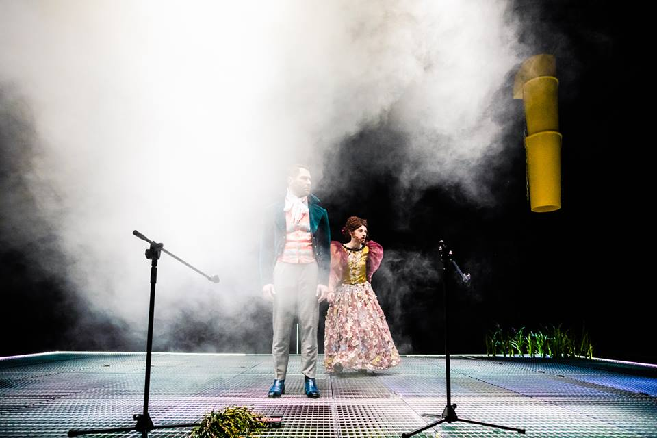
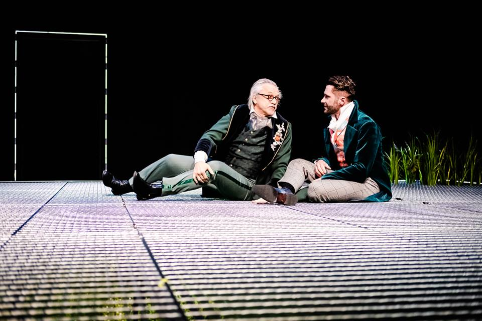

Zmieniająca się rola współczesnego mężczyzny, czy upadek męskości to od kilkunastu lat przedmiot zainteresowania wielu psychologów i badaczy, co potwierdzają oczywiście liczne publikacje na ten temat. Podam zaledwie dwa przykłady, jeden światowy i drugi z naszego poznańskiego podwórka, żeby tę tezę potwierdzić. W 2015 roku, nazywany *głosem i twarzą współczesnej psychologii* — Philip G. Zimbardo i  Coulombe Nikita S. napisali książkę *Gdzie ci mężczyźni?* W wywiadzie z Martyną Harland dla Gazety Wyborczej, profesor Zimbardo mówi, że *dziś kobiety już wiedzą, że mogą osiągnąć wszystko, cokolwiek zapragną. To spuścizna emancypacji i efekt ich ciężkiej pracy. Tymczasem mężczyźni mają nadal nastawienie hedonistyczne. Chcą się przede wszystkim dobrze bawić, tu i teraz. To podejście nie zmienia się u nich od lat.*

A jedenaście lat temu profesor Uniwersytetu im. Adam Mickiewicza, Zbyszko Melosik wydał książkę *Kryzys męskości w kulturze współczesnej, *w której pisze, że owy kryzys *przybiera formę społeczno-kulturowej epidemii. *

W dobie silnej emancypacji kobiet, feminizmu, konieczności (lub nie) przyjmowania niestereotypowych ról rodzinnych, nowych wyzwań dla płci, nie dziwi fakt niesłabnącego zainteresowania również teatru tym tematem.

I tak, Andrzej Błażewicz wystawia w Teatrze Polskim w Poznaniu *Śluby Panieńskie* Aleksandra Fredry. W opisie do spektaklu czytamy między innymi, że to spektakl, w którym twórcy *portretują problemy współczesnego mężczyzny (…), tropią stereotypy i przemocowe wzorce zachowań wobec obu płci (…)* stawiają pytania o *tożsamość męskości w całej swojej rozciągłości obejmując obszary zarówno hetero-, jak i nieheteronormatywne. *

Po przeczytaniu opisu, pełnego zapewnień i cytatów z wypowiedzi autorytetów w dziedzinie psychologii, jak Freud, czy wspomniany przeze mnie P. G. Zimbardo, zastanawiam, czy byłam na dobrym spektaklu, czy nie pomyliłam przypadkiem scen. Bo owszem, widziałam i słyszałam Anielę i Klarę — rzeczniki tytułowych *ślubów* wiecznego panieństwa. Widziałam i słyszałam płacz Albina, którego w książkowej wersji Klara nazywa przekornie* fontanną. *Zauważyłam też młodego fircyka i hulakę, Gustawa oraz dobrego wujka Radosta. A więc* Śluby…* były. Ale czy spektakl ten faktycznie mówił cokolwiek o upadku męskości, czy uruchomił inną niż patriarchalna narrację?! Opis do spektaklu i zapewnienia twórców wydają się być w tym przypadku sporym nadużyciem, a doszukiwanie się w spektaklu wspomnianych treści było by nadinterpretacją.

Najmocniejszą stroną spektaklu jest scenografia Aleksandry Grabowskiej, która w połączeniu ze światłem (również Grabowska) zdaje się tworzyć obrazy wręcz oniryczne. A jest  to ściółka leśna przykryta kratą podobną do doświetlaczy piwnicznych i zsyp do gruzu w rogu sceny, z którego raz po raz wyłania się jabłko, które mitologizuje, dopowiada o magnetyzmie serc i dwóch przeznaczonych sobie połówkach błąkających się po świecie. Las, zieleń, słońce ukryte jest pod kratą. Widzimy je, ale nie możemy dotknąć.

Kolejny plus* Ślubów…* to na pewno aktorstwo. A grają tu sami mężczyźni (to pewnie to przełamywanie stereotypów…): Mariusz Adamski w roli hardej i zbuntowanej Klary, Konrad Cichoń jako delikatna i wrażliwa Aniela, Piotr B. Dąbrowski — przepoczwarzający się z birbanta w czułego partnera i kochanka (scena miłosna Anieli i Gustawa leżących na trawie, wspaniale doświetlona, jest jedną z najbardziej udanych i wizualnie urzekających). Dalej, Paweł Siwiak w roli Albina, w wersji Błażewicza wzbudzający raczej współczucie i rozczulenie niż zdenerwowanie, jakie to wywoływał fredrowski Albin. Choć przyznam, że śpiewanie przez kilka minut w płaczu, ,,smutnej” piosenki, to już trochę za dużo. Ale tak, chłopaki też płaczą i są wrażliwi, oczywiście! Sam jednak pomysł zbudowania z tego argumentu dla całej sceny, wydaje się być karykaturalny. I last but not least, Wiesław Zanowicz w roli opiekuńczego wuja, któremu sen z powiek spędza chęć doprowadzenia Gustawa przed ołtarz.

Scenografia, światło, aktorstwo to zdecydowanie najmocniejsze punkty *Ślubów panieńskich*, z których to niestety, ale nie wybrzmiewają treści, o których zapewniają nas w opisie, twórcy.

fot. materiały Teatr Polski w Poznaniu
