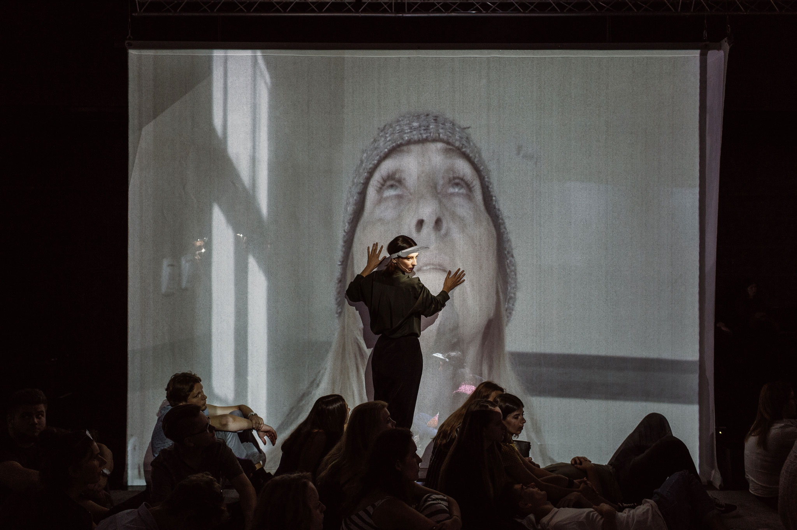
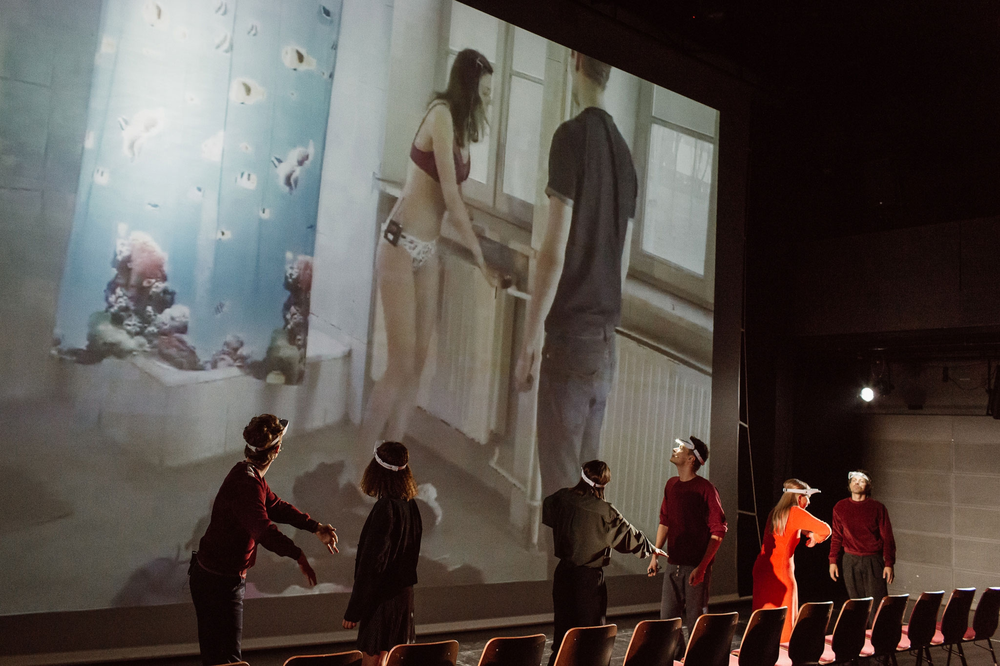

*Czarne papugi* w reżyserii Michała Borczucha to przedziwny, poetycki, polifoniczny świat utkany z opowieści, chaosu, rozmów i niekoherentnych obrazów. Świat, którego celem nie jest postawienie puenty, a przyglądanie się. Zainteresowanie, które towarzyszy tej obserwacji wynika chyba przede wszystkim z tego, że jest to świat trwający poza naszym doświadczeniem.

Osią spektaklu jest film oraz wędrujący w ciemności, pomiędzy widownią, snujący wielowątkowe, chaotyczne opowieści, aktorzy (Dominika Biernat, Pola Błasik, Lidia Bogaczówna, Iwona Budner, Monika Niemczyk, Natalia Strzelecka, Karol Kubasiewicz, Krzysztof Piątkowski, Rafał Szumera) oraz fantastyczne eksperymenty ze światłem i obrazem (reżyser świateł — Jacqueline Sobiszewski, multimedia — Michał Dobrucki). Tematem natomiast jest tu schizofernia. Jednak nie w kontekście medycznym, a jej aspekt społeczny, sensualny. Nie choroba sama w sobie, a tabu, którym jest otoczona. Nie przywłaszczenie i markowanie schizofrenii jest tu tematem, a raczej obserwacja.

Spektakl opiera się na surrealiatycznym tekście chilijskiego dramatopisarza Alejandro Moreno Jashésa, rozmowach z byłymi pacjentami szpitala psychiatrycznego w Kobierzynie oraz pobytem aktorów pracujących przy spektaklu w szpitalu psychiatrycznym w Krakowie. Swoisty patchwork doświadczeń i punktów widzenia.

Poetycki tekst Jashésa skupia się na ciemności wypełniającej wnętrza naszych ciał. Opowiada o tym, co dzieje się z naszymi organami po ataku serca, lub w stanie ekstazy. Robi to jednak nie za pośrednictwem świadomości, a oczu, których źrenice odwracają się do wewnątrz czaszki i wędrując w głąb ciała widzą… ciemność. Bo jak powtarzają wciąż aktorzy: *ciało jest ciemne w środku. W naszych oraganach nie ma światła.* Tekst ten to oryginalnie monolog, który u Borczucha osiąga wielogłos.

W spektaklu wzięła udział grupa badawcza krakowskich artystów, byłych pacjentów szpitala psychiatrycznego: Monika Bąkowska – artystka wizualna, Laura Makabresku – fotografka, Maja Sądel – performerka, Piotr Mierzwa – poeta. Ich historie nie są główną osią, czy treścią fabularną. Przetworzone rozmowy, ich wspomnienia pozwalają jednak zbudować swego rodzaju laboratorium dezintegracji i tak charakterystyczny dla spektakli Borczucha mikrokosmos, prywatność. To chociażby wspopmnienie ogniska, na którym nie mogła być razem z przyjaciółmi jedna z artystek, bo przebywała wtedy na oddziale w szpitalu psychiatrycznym; bezładne retrospekcja z egzotycznej podróży kobiety — wspaniała Monika Niemczyk, czy przywołany przez tę samą aktorkę słodko – gorzki obraz jednej z pacjentek szpitala, którą zapamiętano za sprawą jej ekstrawaganckiego podejścia do mody i kradzieży ubrań osobom przebywającym na tym samym oddziale. 

Z kolei zarejestrowany w formie filmu pobyt aktorów w krakowskim szpitalu psychiatrycznym, rozmowa z pielęgniarką przyjmowanej na oddział Alicji (Dominika Biernat) i przekonywanie, że to co się tutaj dzieje jest udawane, że leki które ma dostać Alicja muszą być na niby bo kręci się tu film, że to wszystko jest na niby — ona, choroba, cała ta sytuacja są wariackie, ,,schizofreniczne”, poetyckie zarazem. Podobnie jak fragmenty filmu nagrane w opuszczonym kompleksie szpitalnym z początku XX wieku.

*Czarne papugi* nie jest teatrem, do którego przywykła większa część widowni. Po pierwsze za sprawą nieoczywistej przestrzeni, bez podziału na scenę i obserwującą z wygodnych foteli, publiczność. Widzowie siedzą tu na dywanie, na kilku ławkach i krzesłach rozsianych po całej przestrzeni. Co więcej, mogą dowolnie przemieszczać się podczas trwania spektaklu, szukając własnej perspektywy (niewielu się jednak na to decyduje). Akcja spektaklu dzieje się też w kilku miejscach, jest polifoniczna — bo i na kilku ekranach wyświetlany jest film, aktorzy poruszają się między widownią, albo znajdują się wewnątrz półprzezroczystych kubików, które jednocześnie są też ekranami. Nie jest łatwy w odbiorze także za sprawą poetyckości, surrealistycznego tekstu, zaplanowanego chaosu, połączenia dokumentu, filmu z tetarem i szumem, wielością dźwięków i docierających z różnych stron bodźców. To próba wywołania doświadczenia odmiennej sensualności schizofreników, o której mowa na początku tekstu.

Borczuch inkorporuje tekst Jashésa i tworzy za jego pośrednictwem traktat o ciemności. Podczas spotkania prasowego, reżyser powiedział, że:* temat w tekście Alejandro i temat wyłaniający się z materiałów warsztatowych, filmowych ze szpitala komplementują się i budują *[ten]* traktat. (…) Dotyczy on mroku, wyrasta z obserwacji, rozwija fakt fizyczny mroku panującego wewnątrz ludzkich ciał. *Dodam, że to traktat poetycki (powtórzę, mimo że użyłam tego słowa już wielokrotnie) i wzruszający. I przygnębiający. To niełatwy w odbiorze, choć piękny za sprawą filmu, światła, intymności teatr.

fot. Michał Ramus © Teatr im. J. Słowackiego w Krakowie
