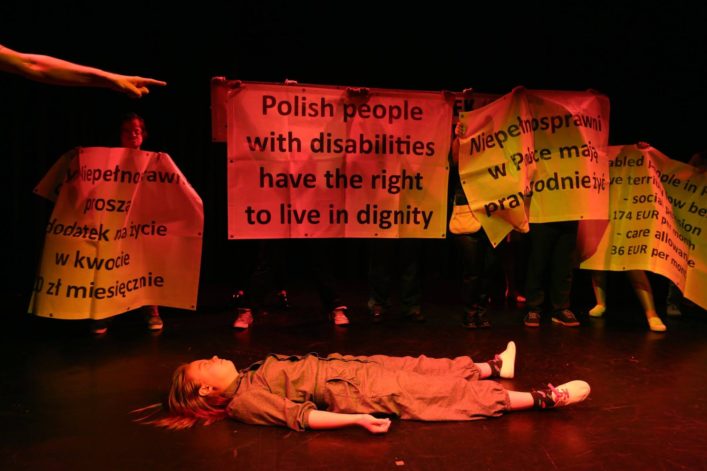
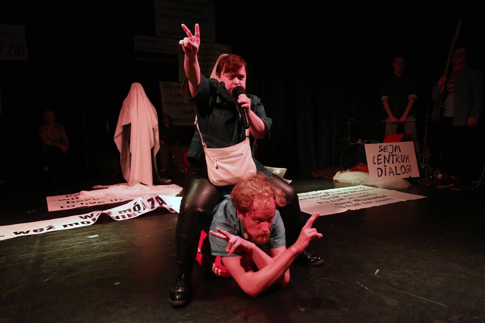
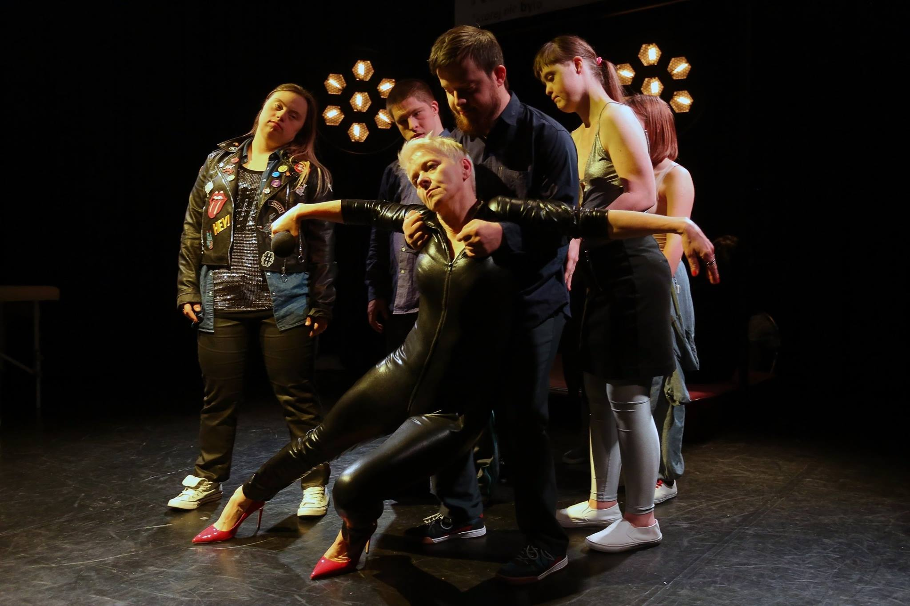

Iwona Hartwich — jedna ze strajkujących przez 40 dni w polskim Sejmie matek dorosłych osób z niepełnosprawnościami — została SUPERBOHATERKĄ ,,Wysokich Obcasów” 2018. Jednogłośnie, decyzją kapituły plebiscytu i Czytelników. Nominowana *za to, że otworzyła oczy Polaków na los dorosłych osób z niepełnosprawnościami. *Zapytana w wywiadzie przez Monikę Redzisz* co podczas strajku było najgorsze, odpowiedziała: ***Te pełne pogardy słowa…*** *Jak sobie przypomnę, co mówiła pani Krynicka – że znajdzie paragraf na rodziców. Poseł Żalek mówił, że z dzieci robimy żywe tarcze i że nie wolno nam dać pieniędzy do ręki. Dla pana Karczewskiego byliśmy epidemią. Pani Szydło wolała sobie pływać po Dunajcu, a kiedy wreszcie się zjawiła w Sejmie, nie raczyła nawet do nas podejść. (…) Prezydent, który najpierw dał nam nadzieję, a potem o nas zapomniał. Premier Morawiecki z kolei okłamywał społeczeństwo, twierdząc, że osoba niepełnosprawna dostaje 3 tys. zł miesięcznie. *A pamiętacie komentarz hejtera, w którym wypomniał jednemu ze strajkujących niepełnosprawnych, markowe buty? A niewybredne wypowiedzi na temat matek, które zamiast opiekować się swoimi niepełnosprawnymi dziećmi, ciągają je pociągami po Polsce? Albo że siedzą te matki niewdzięczne w domach, nie muszą pracować, bo za darmo! dostają pieniądze, z naszych, ciężko pracujących Polaków, podatków? Dostają i jeszcze narzekają skubane!

Czy naprawdę w takiej Polsce, gdzie osoba niepełnosprawna w ramach pomocy może liczyć na litość, gdzie jest wykluczana z życia społecznego i szczelnie owijana tabu, żyję? Chcę wierzyć, że nie! Że ta głośna grupa hejtu, to tylko jej część. Cieszy mnie wygrana pani Iwony w plebiscycie na SUPERBOHATERKĘ i cała jestem poparciem dla strajkujących! Bo ten protest nie skończył się w ubiegłym roku w Sejmie. On nadal trwa.

Wyrazem tego jest spektakl Teatru 21 *Rewolucja, której nie było*, w reżyserii Justyny Sobczyk, który zobaczyłam w poznańskim Centrum Kultury Zamek, w ramach cyklu Teatr Powszechny.

Wrażliwość, pracę, spojrzenie, szczerość i spontaniczność Teatr 21 uwielbiam ponad wszystko i kocham całym sercem! Ale gdy osoby niepełnosprawne, osoby z zespołem Downa komentują strajk, w którym wagą jest ich godność i godność ich rodzin, to ma to moc wszechpotężną, torpedującą! W tych okolicznościach niewiele trzeba by było zrobić, żeby wbić widownię w krzesło, a tymczasem zrobiono tyle, że spadł na nas grad emocji, mądrości i siły!

Spektakl podzielony jest wyraźnie na dwie części. Pierwsza to przypomnienie, komentarz wydarzeń ze strajku, druga to to, co odbyło się po nim i odbywa nadal.

W części pierwszej, wypełnionej po brzegi transparentami z protestu, aktorzy i aktorki Teatru 21 (Teresa Foks, Daniel Krajewski, Maja Kowalczyk, Barbara Lityńska, Aleksander Orliński, Aleksandra Skotarek, Magdalena Świątkowska, Piotr Sakowski) oraz Maciej Pesta, który gra strażnika sejmowego, Beata Bandurska i Martyna Peszko, grające tu matki, za pomocą prostych środków, jak krótkie scenki dramowe, odnoszą się (nie rekonstruują) do postawy wobec niepełnosprawnych, prezentowanej przede wszystkim przez polityków, ale także wszystkich tych, którym niewidzialność osób niepełnosprawnych, brak ich aktywności w życiu społecznym, zepchnięcie do strefy *dla ich dobra,* odpowiada.

W części drugiej spektaklu aktorzy i aktorki mówią głośno o potrzebie ich traktowania nie przez pryzmat ich niepełnosprawności, odrzucają litość. Chcą, żeby społeczeństwo (nie tylko ich bliscy) zobaczyli w nich ludzi, którzy marzą, mają plany, potrzeby, ambicje, którzy chcą brać śluby, tańczyć na nich i spędzać noce poślubne w Dźwirzynie, chcą być gwiazdami rocka i się całować.

 

 

Martyna Peszko w jednej ze scen opowiada, że czasami czuje się nienormalna, odbiegająca od jakiejś odgórnie przyjętej normy — nie ma dzieci, choć jej rówieśnicy w większości je mają, ma problem z zarządzaniem swoimi finansami, gubi rzeczy, jest roztargniona (mimo że przeczytała informację o odłączeniu wody w mieszkaniu, zrobiła sobie maseczkę, której potem z wiadomych powodów nie mogła zmyć). Koledzy w szkole mówili do niej: *Martyna, ty Downie* i ona sama czasami myśli o sobie, *Martyna, ty Downie. *Ta krótka scena uzmysławia jak płynne jest pojęcie normy społecznej i jak bywa ono niesprawiedliwe. Bo niby dlaczego osoby niepełnosprawne są niejako *z urzędu* poza każdą z tych norm?

*Rewolucja, której nie było* to rzecz jasna spektakl odnoszący się bezpośrednio do protestu dorosłych osób niepełnosprawnych i ich rodzin w polskim Sejmie, w 2018 roku. Ale także, a może przede wszystkim, dyskurs na temat niewidzialności osób niepełnosprawnych, egzemplifikacja ich wykluczenia, wyrzucenia przez społeczeństwo na margines, odebrania im prawa sprawczości, decydowania o swoim rozwoju, artykułowania potrzeb.

Chcę wierzyć, że po proteście w Sejmie, po *Rewolucji, której nie było, *osoby niepełnosprawne stają się… widoczne.

—

Iwona Hartwich:

*Oczywiście, że mam *[jeszcze siłę do dalszej walki]*!** (…) protesty są bardzo potrzebne, bo kiedy nas tam nie ma, to bardzo szybko o nas zapominają. ****O najsłabszych nie pamięta się długo.**** Dlatego muszę wracać i przypominać.**

Pamiętajmy, nie tylko gdy nam o tym przypominają…

 

fot. Grzegorz Press

* *Mamy supermoce* [w:] *Wysokie Obcasy*, nr 15 (1029), 13 kwietnia 2019
