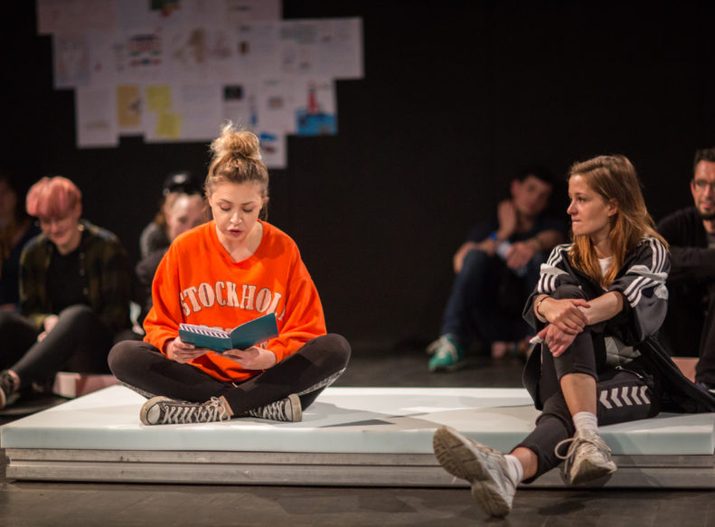

*Zobaczyć, że jestem silna, że mam w sobie jakiś nieokiełznany, ponadziemski power, który rozpierdala wszystko z taką siłą, że ludzkie części ciała ludzkiego latają w przestworzach. Krew leje się bo idę ja i nikt mnie nie zatrzyma, bo bije ze mnie taka moc, jak wszystkie części Władcy Pierścieni i Matrixa razem wzięte. Więc nie zatrzyma mnie nic. Tak jebnę, z taką mocą, że przelecę na drugą stronę muru. Będę biec w zwolnionym tempie przez Jeżyce, Łazarz i Grunwald. I przelecę nad światem z takim hukiem, że gwiazdy się odwrócą. Tak zrobię.**

Jest moc w tych dziewczynach i w tym jak opisują świat. Jest też wrażliwość i intymność. I dużo silnych emocji — gorączkowego, egocentrycznego ADHD.

Spektakl Aleksandry Jakubczak to żywe archiwum dziewczyńskości i dziewczęcej, nieokiełznanej siły. To bardzo sentymentalna, rozbrajająca opowieść o dorastaniu, a dokładniej, o dorastających kobietach, o kształtowaniu się tożsamości i mających na nie wpływ czynników (jak dom, czy rówieśnicy). Ujmująca jest tu szczerość historii o eksperymentowaniu, poszukiwaniu przez dziewczyny określenia oraz poufność opowieści o tropieniu punktu odniesienia, przy jednoczesnym zachowaniu statusu wyjątkowości. Pogmatwane to wszystko, ale kto z nas przez to nie przechodził? Fakt podobnych doświadczeń, odwołanie do sentymentu, rozrzewnienie na myśl o dorastaniu, przeżywaniu kolejnych uczuciowych końców świata i… nieskażona dziewczyńska moc, pozwalają osiągnąć (tak trudne czasami) poczucie wspólnoty. I wiecie co jest najwspanialsze? Że bez patosu i melancholii!

*Dziewczyny opisują świat*, to spektakl, który powstał na podstawie przesłanych na facebookowe wezwanie twórczyń, pamiętników, notesów dziewczyn oraz dziennika reżyserki. Jana Łączyńska stworzyła przestrzeń, w której nie ma podziału na scenę i widownię, przedstawienie odbywa się pośród publiczności siedzącej na miękkich gąbkach, rozsianych po całej sali. Sprzyja to wspomnianemu już poczuciu wspólnotowości, stwarza ciepłą atmosferę, idealną do wyjawiania sekretów. Aktorki (Paula Głowacka, Cristina Ferreira, Lena Schimscheiner) za pomocą tańca, rozmów, piosenek i krzyków przywołują z pamiętników nastoletnie wspomnienia. Opowiadają z perspektywy dorastających, kształtujących swoją personalność, kobiet. Wspomnienia, które wywołują uśmiech i te, na myśl o których spuszczamy głowę w zamyśleniu. Jest tu miejsce i na historię miłości, przygotowania do pierwszego razu z Marcinem, a także rozdzierające serce na milion kawałków, rozstanie z Piotrkiem. Tę tragedię ilustruje rozpaczliwy, wzbogacony o teatralne gesty, śpiew *Total Eclipse of the Heart *(polecam włączyć w tle, kiedy będziecie czytać:) ) i wyświetlane na ekranie zdjęcia idolów z lat 90 XX wieku — Eminema, Beyonce, Pink, czy Kurta Cobaina. Są tu też cytaty z rodziców całej Polski, krzyczących, że *dom to nie hotel*. Są pretensje do siebie i świata i kilka haseł o polityce zasłyszanych pewnie przy okazji któregoś z niedzielnych rosołów. Dziewczyny marzą o tym jak będzie wyglądać ich przyszłość oraz o tym co kupią w Piotrze i Pawle, jak już będą dorosłe i bogate. Wpływ na osiąganie emocjonalnej dojrzałości mają także te gorzkie wydarzenia, które dziewczyny przywołują w jednej z ostatnich scen — urodziny, podczas których ojciec odszedł z domu i kolejnych, o których zapomniał, depresja matki i próba poradzenia sobie z lawiną tych faktów przez rozedrganego, nastoletniego człowieka.

Prócz historii z pamiętników, Jakubczak ubiera dziewczyński świat w zdjęcia zapisanych kartek z przesłanych dzienników, które wyświetlane są na ekranie, szepty do ucha i wspólne czytanie. Piękne to, proste i bliskie.

*Dziewczyny opisują świat* to wzruszający spektakl *o* *tworzeniu się kobiecego podmiotu i różnych modelach kobiecości funkcjonujących i przekazywanych przez pokolenia polskich kobiet.*** To także bardzo ważna teatralna realizacja z punktu widzenia aktywności kobiet. Bo pamiętać należy, że:

Dziewczyny są sprawcze!

Dziewczyny mają moc!

Dziewczyny mogą!

Fajny ten spektakl, no!

—

*Z trailera do spektaklu

** Opis do spektaklu

fot. ma. Scena Robocza w Poznaniu
