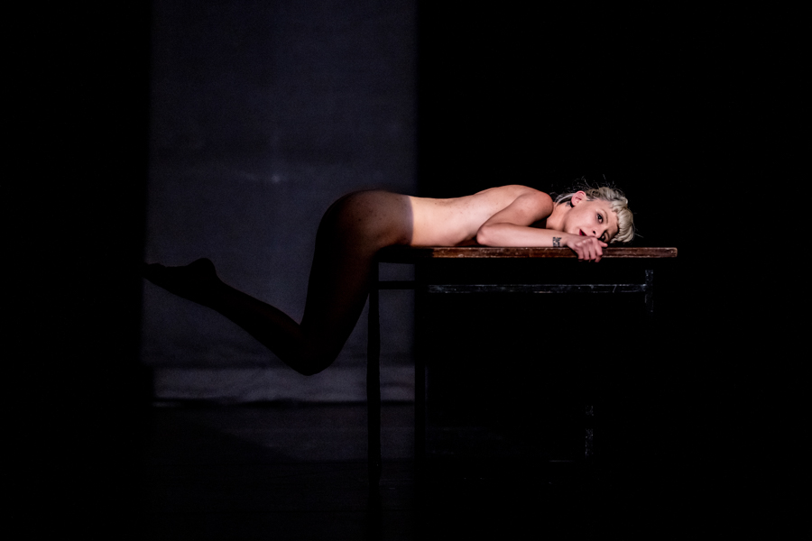

Alice Joana Gonçalves to portugalska performerka, artystka wizualna i co ciekawe, prawniczka. Karierę prawną porzuciła jednak na rzecz sztuki. Studiowała taniec współczesny i klasyczny. Już jej pierwszy spektakl* Apocalipse *z 2012 roku spotkał się z fantastycznym odbiorem i zdobył nagrodę Young Creator Award 2012. Artystka w swoich pracach skupia się głównie na ciele. Na instynktach, emocjach go pobudzających i nim kierujących. Sama o sobie i swoich projektach mówi: *W mojej pracy nie tylko stopniowo skupiam się na fizycznej obecności mojego ciała, ale rozwinęłam ideę własnego ciała jako formy sztuki; używania go jako instrumentu, transformowania go oraz zmieniania jego kształtów, używając moich anatomicznych ruchów w zgodzie z chęciami i potrzebami. **To trudne by oddzielić moją sztukę od mojego życia. Moje życie karmi moją sztukę w takim stopniu, gdzie obydwie karmią synergicznie siebie nawzajem – są one jednością, tym samym. Moje ciało przez to staje się dziełem sztuki, rozproszonym zarówno w czasie jak i w przestrzeni, jednocześnie stając się ofiarą i sprawcą nieodzownego napięcia wywołanego jego fizyczną obecnością wydarzającą się w przestrzeni publicznej. Mój proces kreatywny podzielony jest na sferę intymną i sferę publiczną. **Zawsze pracuję opierając się na emocji lub doświadczeniu zmysłowym należnym ludzkiej naturze, ostateczny rezultat pracy jest jak surowa emocja.**

Podczas Festivalu Malta zaprezentowała spektakl *The Foxes*. W krótkim filmie udostępnionym przez stronę Festivalu, mówi słowami wiersza: *J***e*st siła w byciu kruchym. Jest siła w byciu cichym. Jest siła w byciu potrzebującym. Jest siła w byciu romantycznym. Jest siła w byciu wrażliwym. Jest siła w byciu głębokim. Bycie prawdziwym to jest siła. *

*The Foxes *jest kontynuacją spektaklu *The Hunting* z 2013 roku. Te dwa projekty opierają się na idei ciała, jako nośnika przeszłości. Żałuję, że nie miałam okazji zobaczyć pierwszej części historii, z którą *The Foxes* tworzy artystyczną całość.

Na scenie nie znajduje się nic prócz dwóch stołów, które tworzą coś w rodzaju schronienia, oparcia, ochrony. Najpierw dla jednej kobiety, potem dla dwóch. Performans ten to gra dwóch nagich ciał, ciepłego, punktowego światła, sugestywnej muzyki i cienia. Ich ciała, ruch są bardzo eteryczne, tajemnicze, ale nie w wymiarze erotycznym. Są dziełem sztuki i narzędziem sztuki jednocześnie. Ludzkie i zwierzęce, jak podświadome i naturalne są instynkty. Już zresztą sam ruch, którym jedna z performerek otwierając spektakl skrada się przez scenę, przywodzi na myśl polującego drapieżnika — skupiona, czujna, bezszelestna, ostrożnie stawia każdy krok, wykorzystując do tego najmniejszy nawet mięsień. Brak w tym jednak napięcia, z jakiegoś powodu wiemy, że kobieta nie ma na celu łowów. Raczej inkorporuje nie swój ruch by sprawdzić możliwości swojego ciała. 

Spektakl dzieli się na trzy wyraźne części. Każda z nich mówi o cielesności i jej kruchości, a całość jest procesem. Pierwsza część, to przekraczanie materii — tak własnego ciała, przez to, że  porusza się nienaturalnym dla niego ruchem, jak i materii w sensie dosłownym — przedmiotu, przeszkody (w tym przypadku stołu). Druga część, to wtapianie się w materię, przystosowywanie swoich ruchów, ciała do kształtów z zewnątrz. Niezwykła plastyczność, która pozwala na oplatanie swoim ciałem przestrzeni wokół, tworzenie z nią całości.  Trzecia część, w której na scenie pojawia się twórczyni performansu, jest czymś w rodzaju pojawienia się nowej autonomii i anatomii. Dwie kobiety, dwa ciała, jedna liryczna opowieść, wrażliwość. Kobiety poruszają się synchronicznie, są takie same i różne jednocześnie. Łączy je nagość i cienie ciał, które rzucają. W poetycki sposób przechodzą od równoległości do zaznaczenia swojej wolności. Granice tych zmian, przechodzenie z jednoczesności do niezależności są ledwie zauważalne.

Podczas spektaklu nie dzieje się wiele pod względem akcji, jest ona raczej powolna, subtelna, cicha, łagodna. Sam spektakl trwa zaś zaledwie 45 minut. Jednak w ciałach performerek, w ich ruchach kryje się niesamowita subtelność i lekkość, której obserwowanie wystarcza za wartką fabułę. To przepiękne, kruche i niesamowite pod względem estetycznym wydarzenie. Bardzo hipnotyzujące. Poetycka opowieść o ciele jako instrumencie do opowiadania historii, ciele jako nośnika przeszłości, ciele jako autonomii.

[http://www.alicejoana.com](http://www.alicejoana.com/)

fot. materiały prasowe Malta Festival Poznań
