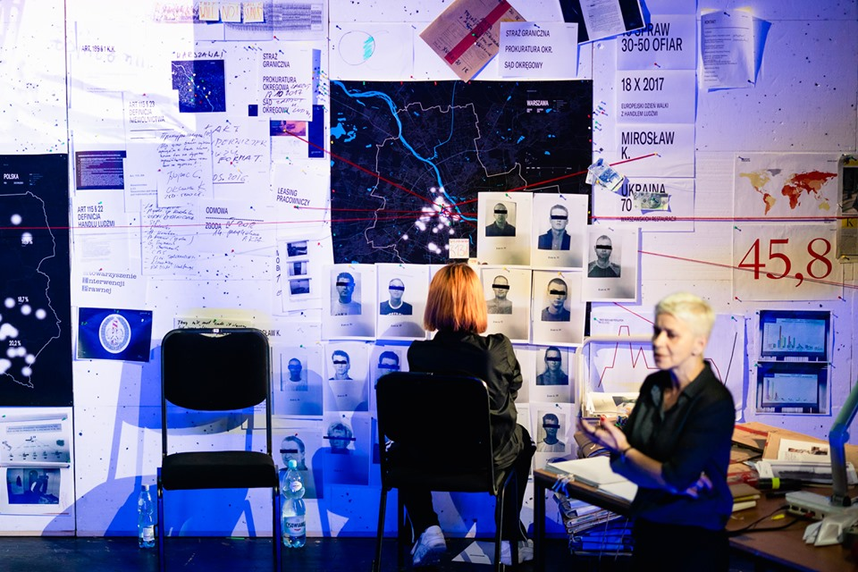
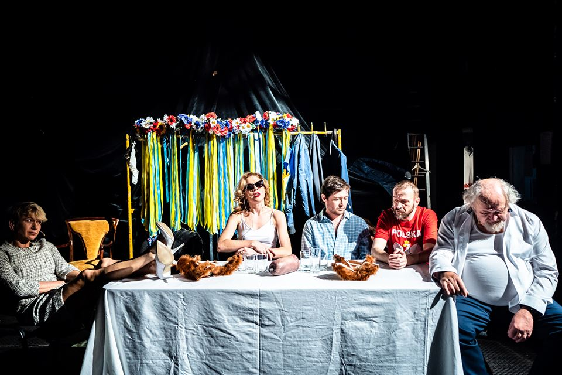
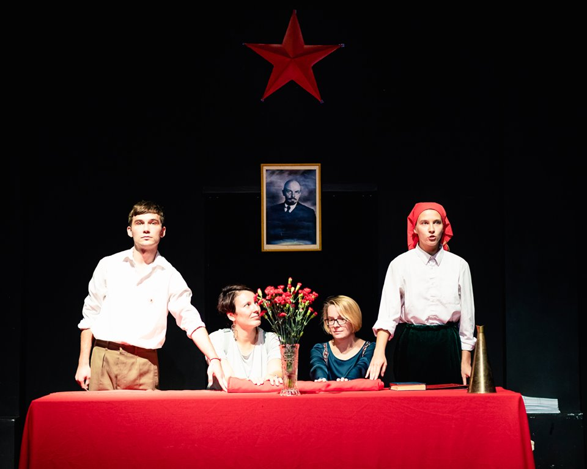
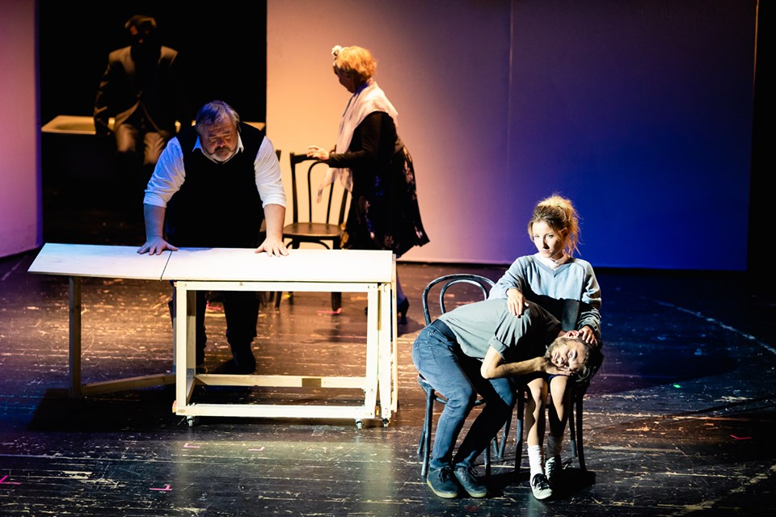
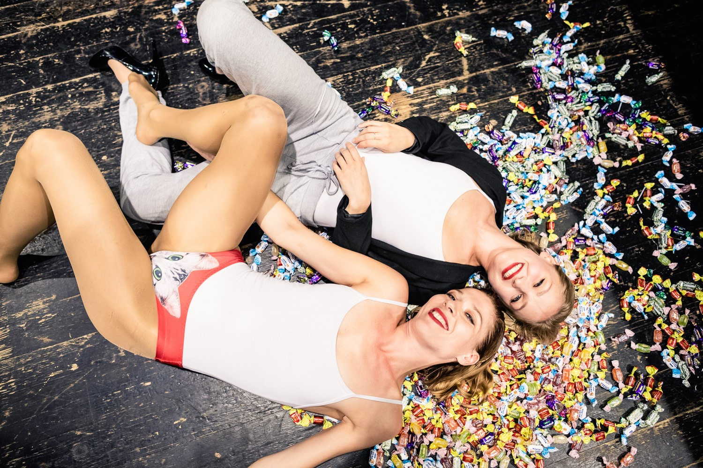
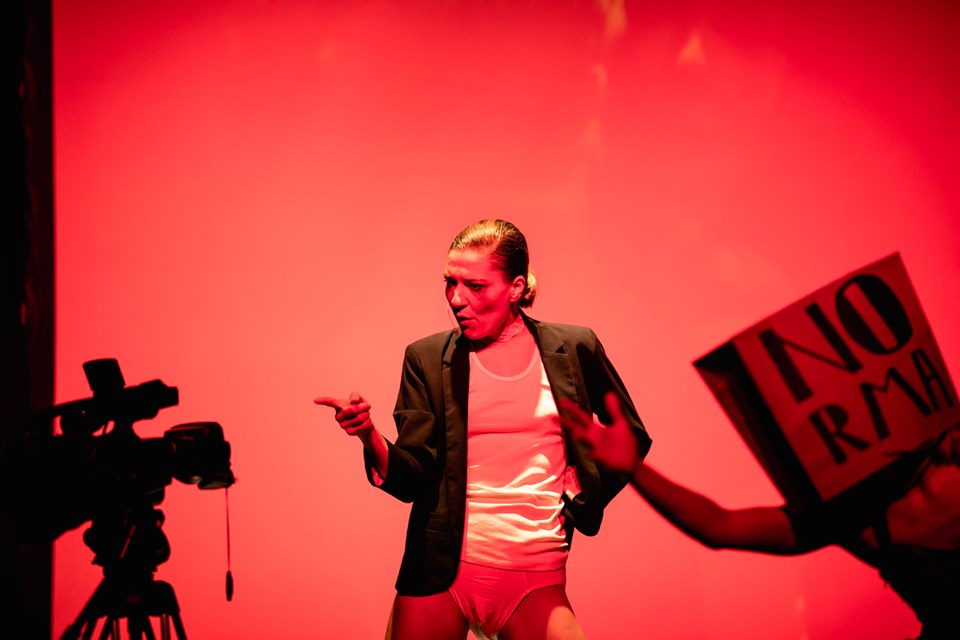

Tegoroczna edycja Spotkań Teatralnych *Bliscy Nieznajomi* różniła się od poprzedniej nie tylko za sprawą zmiany daty (do tej pory Festiwal odbywał się w maju), ale także zaproszonych do Poznania spektakli. Tym razem były to przedstawienia głównie ukraińskie. Dotychczas w programie Bliskich Nieznajomych znajdowały się produkcje jedynie polskie, wybrane zgodnie z myślą przewodnią/idiomem danej edycji. W tym roku tematem była Ukraina. W Polsce mieszka i pracuje obecnie 1 mln 200 tys. Ukraińców. W samym Poznaniu żyje 100 tys., co oznacza, że co dziesiąty mieszkaniec stolicy Wielkopolski jest ukraińskiego pochodzenia. Agata Siwiak — dyrektorka artystyczna i kuratorka Festiwalu oraz Maciej Nowak — dyrektor artystyczny Teatru Polskiego, mocno podkreślali, że *po raz pierwszy od czasów powojennych stajemy się społeczeństwem wielokulturowym, *co według mnie jest zjawiskiem absolutnie wspaniałym i wyjątkowym, ale też wymagającym od społeczeństwa pewnej dojrzałości. Dobrze, że polski teatr interesuje się współczesną kulturą i sztuką ukraińską, podejmuje z nią dialog i współpracę. 

Oś Spotkań wyznaczyły spektakle teatralne, a program uzupełniły dwie projekcje filmowe (*Donbas* i *Jazda obowiązkowa*) oraz koncerty (Alexandra Malatskovskaja, Karol Firmanty, Vidlunnia, Mikołaj Tkacz, Roman Szumski, Hubert Karmiński, Dawid Dąbrowski i Ostap Mańko) i odbywające się po przedstawieniach, rozmowy z twórcami.

Na otwarcie i zamknięcie Festiwalu zaproponowano produkcje polskie. 

Pierwsza to *Modern Slavery* zespołu Biennale Warszawa w reżyserii Bartka Frąckowiaka. To teatr dokumentalny, polityczny o współczesnym niewolnictwie, powstały na podstawie materiału zdobytego podczas śledztwa przeprowadzonego przez artystów. Twórcy przy wykorzystaniu środków odsłaniających rzeczywistość, charakterystycznych dla teatru dokumentalnego: nagrań, zapisów rozmów, filmów, dokumentów, akt, fragmentów wypowiedzi specjalistów, mówią o globalnym, a tak rzadko podejmowanym w debacie publicznej, zjawisku handlu ludźmi, nielegalnym wykorzystywaniu do przymusowej, nieodpłatnej pracy. Przytaczają paraliżujące dane z raportu Global Slavery Index, który ujawnia, że* w Polsce w 2016 r. żyło ponad 181 tys. nowoczesnych niewolników, co odpowiada 0,476 populacji Polski*. Podczas spektaklu przywołują dramat wykorzystywanych przez Mirosława K. do niewolniczej pracy, Ukraińców oraz historię obozu pracy we włoskiej Foggi, gdzie niewolniczo pracowali z kolei Polacy.

Spektakl w zamyśle, scenografii bardzo przypomina *Sprawiedliwość* Michała Zadary, przedstawienie zrealizowane w ubiegłym roku w Teatrze Powszechnym w Warszawie. *Modern Slavery* podobnie jak *Sprawiedliwość* nie powstał po to, żeby pokazać wydarzenie, ale dokumentalność, performatywność dokumentalności. Pomimo rzetelności przeprowadzonych badań, ogromu przytoczonych danych i w końcu drastyczności tematu, przedstawienie pozostawiło niestety wrażenie przegadanego, przekonującego przekonanych.

*Bliskich Nieznajomych *zamknął bardzo dobry spektakl w reżyserii Katarzyny Szyngiery – *Lwów nie oddamy*. Tytuł sarkastycznie odnosi się trwającego od 2015 roku sporu pomiędzy Polakami i Ukraińcami o  dwa ukryte w skrzyniach lwy, sprzed bramy cmentarza Łyczakowskiego we Lwowie. Jeden z lwów trzyma łapą herb Lwowa z napisem ,,Zawsze wierny”, drugi – z herbem Polski i inskrypcją ,,Tobie, Polsko”. Polacy twierdzą: *no komu te lwy co zrobiły*, a Ukraińcy badają czy nie mają one charakteru anty ukraińskiego. Lwy pojawiają się w spektaklu kilkukrotnie, ale *Lwów nie oddamy* opowiada głównie o trudnych, polsko – ukraińskich relacjach, na których ciąży historia, pamięć o konfliktach i wzajemna niechęć… mimo że obecnie więcej nas łączy niż dzieli. 

Spektakl powstał na bazie materiału dokumentalnego, który reżyserka wraz z Mirosławem Wlekłym zgromadzili podczas pracy reporterskiej. Są to nagrania wywiadów z mieszkańcami Rzeszowa (Rzeszowa, bo to produkcja Teatru im. Wandy Siemaszkowej) i Lwowa, czy wypowiedzi cytowane z ankiet przeprowadzonych w jednym z rzeszowskich liceów ogólnokształcących. Z obu źródeł wynika mniej więcej to samo — uprzedzenie. Aktorzy pokazują co i jak pamiętamy i jaki to ma wpływ na nasze relacje, przerysowując utrwalone stereotypy. W spektaklu, uprzedzenia te obrazują dwa obozy aktorów – Polaków i Oksana Cherkashyna – *typowa Ukrainka* oraz przytoczone przez twórców polsko – ukraińskie konflikty oraz polski i ukraiński narodowiec, recytujący w jednej z ostatnich scen wspólny ksenofobiczny manifest. 

Spektakli ukraińskich pokazano aż cztery. Pierwszy z nich to *Czerwone Wesele* Teatru Publicyst z Charkowa – przedstawienie, które performatyką, stylem wypowiedzi, a także kostiumami i scenografią nawiązuje do teatru propagandowego z czasów radzieckich. Tytułowe czerwone wesele to nazwa świeckiego obrzędu celebrującego *nowy, rewolucyjny porządek, inspirowany przez awangardowe idee wolności, wspólnoty, równości, wyzwolonej seksualności, emancypacji*.* 

Teatr Publicyst za pomocą prostych środków, jak parafraza teleturnieju, ironia, propagandowy musical robotników, żywa gazeta, chcą przepracować i zmierzyć wpływ komunizmu na teraźniejsze funkcjonowanie społeczeństwa ukraińskiego. Na Ukrainie nadal trwa proces dekomunizacji, wyzwalania się z sowieckiej przeszłości, który zdaje się, że w Polsce został już (przynajmniej na tym poziomie, o którym mówi Teatr Publicyst) zanalizowany. Być może dlatego, pomimo pomysłu na rekonstrukcję historyczną, zmiksowaniu jej z sarkazmem, elementami musicalowymi, czy pop kulturowymi, nie wzbudza emocjonalnego pobudzenia. 

*Piękne, piękne, piękne czasy* Rozy Sarkisian na motywach *Wykluczonych* Elfriede Jelinek, Pierwszego Teatru we Lwowie to spektakl o trudnych relacjach rodzinnych, szerzej – społecznych, przesiąkniętych przemocą. Powodem jest wojenna trauma, która zakaża punkty styczne pomiędzy ludźmi agresją i okrucieństwem. Spektakl o tym, że w obliczu traumy wszyscy jesteśmy równi, bez względu na zasoby materialne, intelektualne, czy kulturowe. 

Rzecz dzieje się w Wiedniu końca lat 50. XX wieku i przedstawia trzy rodziny, wszystkie zainfekowane przemocą. W spektaklu kat staje się ofiarą i na odwrót, spokój i cisza zmienia w piekło, a uosobienie dobra zabija z zimną krwią. Odreagowywanie przez zabijanie, kradzieże, rozboje, zdrady, gwałt i manipulacje. Twórcy spektaklu, choć w bardzo chaotyczny sposób, wyjmują na powierzchnię to, co zwykle przemilczane, okryte misterium walki i aureolą poświęcenia dla ojczyzny i wolności.

*Piękne, piękne, piękne czasy* to prócz ważkości tematu, także pokaz świetnego aktorstwa. 

Kolejny ukraiński spektakl to *Restauracja Ukraina*, niezależna produkcja Niny Khyzhnej i Oksany Cherkashyna. To przedstawienie o wszechobecnej na Ukrainie korupcji, a także patriarchacie i zniewoleniu wynikającym z obu tych zjawisk, o poświęceniu wolności na rzecz schematycznego poczucia bezpieczeństwa. Co warte zaznaczenia, premiera spektaklu odbyła się w ramach Międzynarodowego Dnia Korupcji. 

Dwie bardzo charyzmatyczne artystki, stworzyły spektakl polityczny, który estetyką ironii, humorem, nawiązaniami do popkultury, performuje protest. 

I na koniec przepiękny, wzruszający i jednocześnie niezmiernie smutny spektakl Rozy Sarkisian *Psychosis* na motywach dramatu *4:48 Psychosis *Sarah Kane oraz wierszy Anne Sexton i Sylvii Plath. W spektaklu grają twórczynie *Restauracji Ukraina* – Nina Khyzhna i Oksany Cherkashyna oraz Alexandra Malatskovska. 

*4:48 Psychosis *to ostatnie dzieło Sarah Kane – przedstawicielki nowego brutalizmu, dzieło w którym mówi o seksie, śmierci, chorobie psychicznej, cierpieniu. To rodzaj monologu wewnętrznego, powstałego na podstawie przeżyć poetki (chorowała na psychozę maniakalno-depresyjną. Zmarła śmiercią samobójczą po napisaniu *4:48 Psychosis*). Jej głos podzielony jest w spektaklu na trzy aktorki. Chaotyczne wypowiedzi, mieszają się z rozmowami z lekarzami, kochanką, samą sobą. To inscenizacja próby znalezienia ratunku. 

Spektakl odłożył się w moim ciele na długo, nie dawał zapomnieć. Aktorki za sprawą muzyki, pastiszu, cierpkiego, czarnego humoru pozbawionego uśmiechu, groteskowości przynoszą na scenę sprzeczności – siłę kobiet i ich słabości; szaleństwo, niepokorność i cierpienie; świadomość i chęć wymazania wspomnień, ból, dojmujący ból i humor. Pozytywnym efektem ubocznym spektaklu jest rozprawienie się z patriarchalnym podejściem do roli kobiety w społeczeństwie, rozbicie tabu depresji i afirmacja kobiecej siły oraz prawa do samostanowienia, seksualności – zgodnej z preferencją kobiety, człowieka, a nie takiej jaką przypisano w zgodzie z paternalistycznym postrzeganiem. To zdecydowanie najlepszy, wyjątkowy i najsmutniejszy – w organicznym sensie, punkt tegorocznych Spotkań Teatralnych.

W tym roku, nazwa *Bliscy Nieznajomi* zyskała absolutnie nowe znaczenie. Bo ludzie, z którymi współżyjemy na co dzień – często mieszkamy w jednej kamienicy, robimy zakupy w tej samej Biedronce, jeździmy do pracy jednym tramwajem, są nam obcy, nieznajomi. Festiwal miał pomóc nam wszystkim – i Polakom i Ukraińcom poznać się nawzajem. Szkoda tylko, że w tak misternie przygotowanym wydarzeniu artystycznym, społecznym zabrakło ukraińskiego tłumaczenia polskich spektakli…

Nie mniej, Bliscy Nieznajomi ze swoim programem idealnie wpisują się w nowe, wspaniałe bo wielokulturowe okoliczności. Agata Siwiak po ostatnim spektaklu wspomniała, że istnieje spora szansa kontynuacji konceptu w rozpoczynającym się właśnie sezonie teatralnym. Z niecierpliwością czekam i trzymam kciuki życząc powodzenia!

* z programu festiwalowego

fot. Marek Zakrzewski
