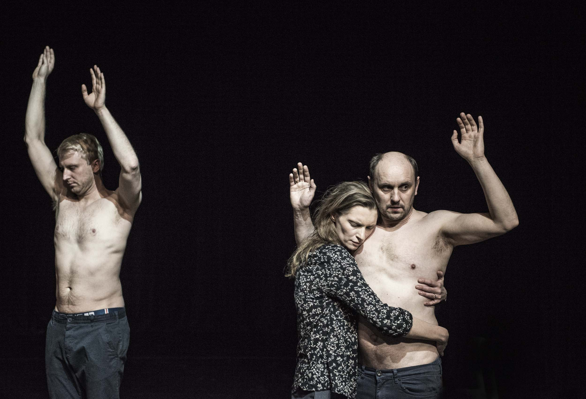

Anna Karasińska w wywiadach powtarza, że zanim rozpocznie pracę w danym teatrze, najpierw stara się zapoznać z miastem, z atrybutami jego mieszkańców i ich potrzebami. Co takiego odnalazła, zdiagnozowała w Warszawie, gdzie w TR premierę dwa lata temu miała *Fantazja*? W rozmowie z Marceliną Obarską (Culture.pl), reżyserka mówi, że: *był to smutek i dehumanizacja miasta, które jakimś cudem odbudowało się na cmentarzu, ale tego nie przepracowało, bo nie miało jak. I teraz, takie jak jest, z tym cmentarzem pod chodnikiem, wstydzi się siebie i chce być nie sobą, tylko zachodnią Europą. (…) Czułam, że potrzebny jest spektakl, który będzie sprzyjał nawiązywaniu utraconego kontaktu. Ze sobą i z innymi.**

*Fantazja* to projekt/przypomnienie o codziennym doświadczaniu niepowtarzalnej a ignorowanej przez nas sytuacji bycia tu i teraz. Jego forma zaś rozmontowuje utarte, tradycyjne rozumienie teatru.

*Fantazja* jest spotkaniem nie tylko aktorów, aktorek i reżyserki, ale także zaangażowaniem do tego spotkania widowni. Oś spektaklu opiera się na wyobraźni i niejako wymusza na partycypujących w tym doświadczeniu widzach, empatyzowanie, fantazjowanie na temat konkretnych ludzi, w konkretnych sytuacjach, kreślonych z offu przez obecną w teatrze Karasińską. Reżyserka od razu wyjaśnia, że spektakl jest rodzajem eksperymentu, że nie ma wyraźnego scenariusza i opiera się na żywym reagowaniu przez nią nad przebiegiem. Z racji tego, że dzieje się tu i teraz, niewykluczone, że się zaśmieje albo pomyli. Podczas spektaklu, który ja oglądałam zamierzenie to zostało zaburzone przez wyświetlane nad sceną, angielskie tłumaczenie, które dyktowało pewną kolejność, rozstroiło dowolność reżyserki, spontaniczność podejmowanych przez nią decyzji. Nie mniej, można powiedzieć, że sposób ten odkrywa przed nami pewne profanum teatru, czyli rozmowy reżysera z aktorami, przygotowania, momentami przypomina improwizację. Co najważniejsze, taka forma skutecznie rozwiązuje uprawomocniającą się po wejściu do teatru, umowę pomiędzy aktorem a widzem, gdzie zwykle role są jasno określone i dzielą się na oglądanych i oglądających, oświetlonych i schowanych bezpiecznym półmroku. Tu światła nad widownią nie gasną w chwili rozpoczęcia akcji, co umożliwia nieprzerwany kontakt wzrokowy, porozumienie między sceną a widownią.

Nie ma tu specjalnej akcji, motywem spektaklu jest odnajdywanie się aktorów w dyktowanych przez Karasińską sytuacjach. Reżyserka zwraca się do sześciu, cały czas obecnych na scenie aktorów i aktorek (Dobromir Dymecki, Monika Frajczyk, Rafał Maćkowiak, Maria Maj, Agnieszka Roszkowska, Adam Woronowicz) po imieniu, przypisując im kolejne emocje i konteksty. Mówi trochę do nas, a trochę do aktora, na przykład: *Dobromir *(Dobromir Dymecki)* gra teraz białego niedźwiedzia, z którym każdy chce sobie zrobić zdjęcie*. Albo: *Adam* (Adam Woronowicz) *jest teraz widzem, który właśnie przyszedł do teatru i za cholerę nie wie, co się tutaj dzieje*. Do Moniki Frajczyk: *Monika wstydzi się tańczyć do piosenki, którą lubi*.

To przykłady sytuacji, krajobrazów mentalnych, w których każdy z nas potrafi się z łatwością umiejscowić. Karasińska fantazjuje na tematy prawdopodobne, ale też te mniej realne, bliskie, jak polecenie wejścia w skórę wyzyskiwanego w fabryce rodzynek, dziecka.

Za pośrednictwem abstrakcji zaś, reżyserka wprowadza element grozy, który silniej atakuje naszą wyobraźnię. Przykładem jest historia chłopca, która rozpoczyna się poleceniem przez Karasińską Monice Frajczyk wczucia się w rolę łyżeczki, która nabiera dżem i trafia do ust małego chłopca siedzącego na tarasie. Reżyserka pozwala nam go polubić, popłynąć razem z nim w melancholijną podróż do jednego z tych pięknych, letnich poranków, kiedy sami byliśmy dziećmi. Po to tylko, żeby zaraz powierzyć Marii Maj rolę osy szepczącej owemu chłopcu do ucha, że za moment zabije całą jego rodzinę. Właśnie te abstrakcyjne sytuacje, jak żadne inne, są pryzmatem naszej obojętności i rutyny, w której nie skupiamy się na otoczeniu. Zajęci sobą nie zauważamy niczego prócz czubka własnego nosa. Społeczeństwo jest, jak przez analogię do Warszawy opisała to Karasińska: *bardzo drogie, uprane i uprasowane, aseksualne, nikt nikogo nie widzi, a uprzejmość służy demonstrowaniu tego, że ma się klasę, a nie nawiązywaniu realnych kontaktów między ludźmi.** Twórcy pokazują nam w ten sposób egocentryzm i samotność, której dobrowolnie się oddajemy.

Twórcy spektaklu maksymalnie koncentrują się na relacji, odcinają wszystko co w takim kontakcie pośredniczy. Nie ma tu scenografii ani specjalnych kostiumów – Paula Grocholska ucharakteryzowała aktorów i aktorki tak, żebyśmy możliwie najmocniej poczuli poufny i nieoficjalny charakter spotkania z aktorami i aktorkami. Wyglądają oni bowiem tak, jakby znaleźli się na scenie przez przypadek, wstępując do TR w drodze na zakupy – we własnych ubraniach, butach, trochę zaskoczeni obecnością widowni. Poza kilkoma scenami, nie ma też muzyki. Ramą spektaklu jest język, a nie zbudowana z niego fabuła.

Twórcy spektaklu sprawnie przemieszczają się między aktorstwem a prywatą, widać że dobrze się ze sobą czują, że dobrze się bawią – nierzadko doprowadzają do łez (ze śmiechu oczywiście) nie tylko publiczność, ale też siebie nawzajem. 

*Fantazja* to zabawny, ale też wzruszający spektakl oparty na doświadczeniu bycia częścią wspólnoty, skupieniu na nawiązaniu kontaktu, dostrzeżeniu drugiego człowieka, empatyzowaniu z nim. Uchwyceniu cudzych emocje przy jednoczesnym powstrzymaniu się od oceny. To projekt koncentrujący się bardziej na nakłonieniu do uważności i refleksji niż na opowiedzeniu jakiejś historii.

A ty? Kogo dziś zobaczyłeś w drodze do pracy? Ale tak naprawdę zauważyłeś?

*Rozmowa Marceliny Obarskiej z Anną Karasińską, Culture.pl

[https://culture.pl/pl/artykul/karasinska-w-polsce-jeden-rodzaj-teatru-jest-traktowany-powaznie-wywiad](https://culture.pl/pl/artykul/karasinska-w-polsce-jeden-rodzaj-teatru-jest-traktowany-powaznie-wywiad)

fot. mat. TR Warszawa
