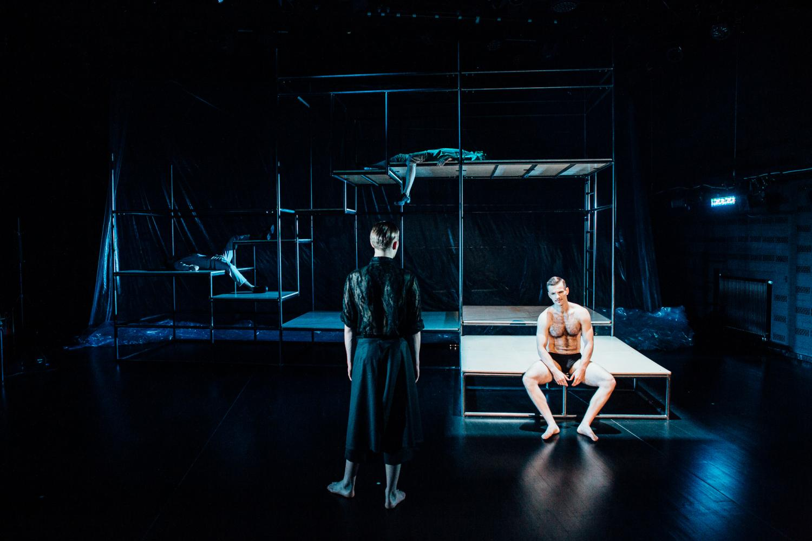
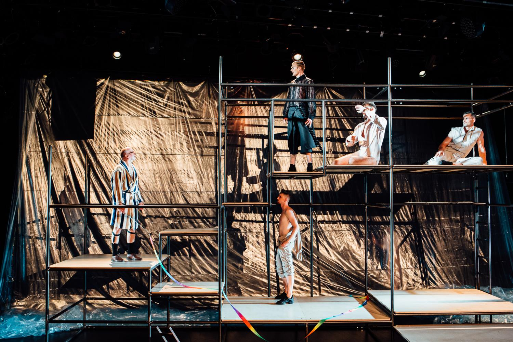

*A pierwsze zamknienie*

*To moje spojrzenie*,

*Że ja ciebie nie chcę znać.*

*A drugie zamknienie*

*To wysokie sienie*,

*Po których muszę stąpać.*

*A trzecie zamknienie*

*To siwe kamienie*,

*Pod którymi muszę spać.*

Słowa ,,Pieśni kurpiowskich” Karola Szymanowskiego brzmią już kiedy wchodzimy na widownię Malarni Teatru Wybrzeże. Trzy męskie głosy cicho, jakby w zamyśleniu śpiewają o śmierci…  Półprzezroczystość dymu i ciepłe światło (Damian Pawella) nadają scenie miękkości i liryczności. Na dole sceny siedzi półnagi, przystojny, dobrze zbudowany, młody mężczyzna. Pozą przypomina rzeźbę greckiego boga; kolejnych dwóch leży na rozstawionych z tyłu sceny podestach.

Metalowo — drewniane rusztowanie, rozwieszona w tle gruba folia malarska (scenografia autorstwa Kornelii Dzikowskiej) i bałagan kabli przy stanowisku muzyka Rafała Ryterskiego przypominają budowę/kulisy. Tworzą metaforę nawarstwienia tematów i emocji, a także pewnego rodzaju tabu. 

Młody mężczyzna okazuje się nie żyć i przygotowywany jest właśnie do pochówku. To Jurek Błeszyński — największa miłość i muza Jarosława Iwaszkiewicza, jak pisał o nim — ,,mój jedyny, mój najdroższy”. Tanatotoaletę z namaszczeniem, miłością do ludzkiego ciała, ale też dużą wprawą i zwyczajowością wykonuje Dziad Szpitalny (Robert Ciszewski). Wszystkiemu przygląda się starszy mężczyzna w szarym, wełnianym garniturze. To Jarosław Iwaszkiewicz grany przez Krzysztofa Matuszewskiego (wiemy to, chociaż w całym spektaklu ani razu nie pada nazwisko pisarza). Tą mocno sensualną sceną rozpoczyna się “Życie intymne Jarosława” w reżyserii Kuby Kowalskiego, na podstawie tekstu Magdy Kupryjanowicz i Michała Kurkowskiego. Nielinearna opowieść o Iwaszkiewiczu, jego żonie Annie i wspomnianym Jurku Błeszyńskim; o uczuciach, skomplikowanych relacjach, przywiązaniu, ,,(…) miłosnym poszukiwaniem świętego Graala”*.

Spektakl Kuby Kowalskiego powstał na podstawie korespondencji, dzienników i wątków z opowiadań Iwaszkiewicza. W ,, Życiu intymnym Jarosława” Jurków jest trzech. Ten grany przez Piotra Biedronia jest zbuntowany i nieufny, Marcina Miodka najbardziej zmysłowy, uwodzicielski, efemeryczny, Jana Napieralskiego bierny. Różnice te najlepiej  widać chyba w scenie przy stole w mieszkaniu Iwaszkiewiczów. Opisany zabieg teatralny ma na celu (podobnie zresztą jak scenografia) pokazanie wielowątkowości relacji Iwaszkiewicza i jego o prawie cztery dekady młodszego kochanka. Z jednej strony jest to wynikająca z relacji duchowość, inspiracja i twórcze uskrzydlenie poety; z drugiej pociąg seksualny, próba życia w zgodzie ze swoimi potrzebami, a wbrew PRL-owskiej ideologii wypierającej ze zbiorowej świadomości istnienie homoseksualizmu. To też niepewność, pasywność i wyrachowanie — Błeszyński był żonaty i miał dzieci. Iwaszkiewiczowi znany był też jego autodestrukcyjny tryb życia, liczne kochanki. Z racji złej sytuacji materialnej, Jurek często korzystał z pomocy finansowej pisarza. Natomiast gruźlica, na którą chorował Jerzy, intensyfikowała dodatkowo zakazaną znajomość bo uświadamiała o czasowości jej trwania. Błaganie młodszego kochanka o miłość wydaje się być w tym kontekście niezwykle smutne i tragiczne.

Choroba i pewna interesowność Jurka, ale też jego wiek sprawiały, że stawał się dla Iwaszkiewicza często nieuchwytny, nieosiągalny. Jego ciało było młode, skóra jędrna.  Popychało to poetę tak w zachwyt, jak w zażenowanie. Sprawiał wrażenie jakby kwestia fizyczna ich romansu interesowała go najmniej (może wcale), co widać wspaniale, między innymi w scenie, gdzie zafrasowany opowieścią Iwaszkiewicz zdaje się nie zwracać uwagi na uwodzenie, rozbierającego go właśnie kochanka. Pisarz odwraca się, zakrywa, opowiada dalej. Czuły w słowach. Jak czytamy w wywiadzie z reżyserem w Gazecie Wyborczej: ,,Iwaszkiewicz ~przepisywał~ w „Dzienniku” swoje życie intymne, sam przed sobą je niejako uwznioślał, często ukrywał czy bagatelizował seksualną stronę relacji z Błeszyńskim i próbował nadać jej wyłącznie charakter duchowy. Jest coś niezwykłego w tej mieszance hipokryzji, pruderii, uwewnętrznionej homofobii i utopijnego marzenia o pokrewieństwie dusz, o wzniesieniu się ponad brudną cielesność. Coś naszego, polskiego.”* Urzeczywistnia się to także w choreografii autorstwa Katarzyny Sikory, w której trzech synchronicznych Jurków wymyka się poecie, jest zawsze krok przed nim. Są szybsi, zmysłowi, wyzywający, eteryczni, zgodni. 

Opowieść i układ dopełnia postać Anny Iwaszkiewicz (świetna rola Anny Kociarz) — żony pisarza, z którą spędził ponad pięćdziesiąt lat i miał dwie córki. Anna, czy jak nazywał ją poeta — ,,Hania” doskonale wiedziała o romansie męża z Błeszyńskim, nie tylko mu się przyglądała, ale umożliwiała jego dalsze trwanie. ,,Anna odgrywa rolę drugoplanową i zasadniczą zarazem. (…) przez całe życie Iwaszkiewicza (…) była jego oparciem, najbliższą rodziną, najbliższą przyjaciółką.”* Postać wielowymiarowa. W spektaklu przesuwa się między scenami, przeciera metalowe elementy scenografii ściereczką, krytyczna i poważna, wypowiada się i zachowuje z rozwagą. Dla Błeszyńskiego bywa matką, choć wydaje się, że czasami wolałaby być kochanką, poczuć ożywienie, o którym tak wiele mówił jej mąż. Kowalski poprzez sceny niedopowiedzianego flirtu Błeszyńskiego z Anną pokazuje pewien margines ustalonego systemu. Przez cały spektakl jednak Anna stanowi dla obu mężczyzn opokę i wsparcie. Spokoju szuka zaś w modlitwie. Jest w niej jakaś niejasna siła, a zarazem subtelność. 

,,Życie intymne Jarosława” jest, jak chciał i zapowiadał reżyser, ,,poetycką opowieścią”*. I choć nie jest politycznym czy społecznym manifestem, na krótki moment wyrasta w niej odniesienie do tragicznego podziału Polek i Polaków, nagonki na środowisko LGBT+. Na tle przerobionej przez Ryterskiego, bo zaskakująco lirycznej wersji piosenki Y.M.C.A. zespołu Village People, przez środek widowni z tęczową taśmą gimnastyczną w ręku, przechodzi Robert Ciszewski z głośnym apelem: ,,Do czego doszło, że musimy walczyć o tak podstawowe prawa, jak prawo do kochania?”.

*,,Jarosław Iwaszkiewicz i jego życie poza normami” 

Z Kubą Kowalskim rozmawia Przemysław Gulda

Gazeta Wyborcza, 22 lipca 2020

[https://trojmiasto.wyborcza.pl/trojmiasto/7,35611,26142962,jaroslaw-iwaszkiewicz-i-jego-zycie-poza-normami-w-queerowej.html](https://trojmiasto.wyborcza.pl/trojmiasto/7,35611,26142962,jaroslaw-iwaszkiewicz-i-jego-zycie-poza-normami-w-queerowej.html)

fot. Dominik Werner
