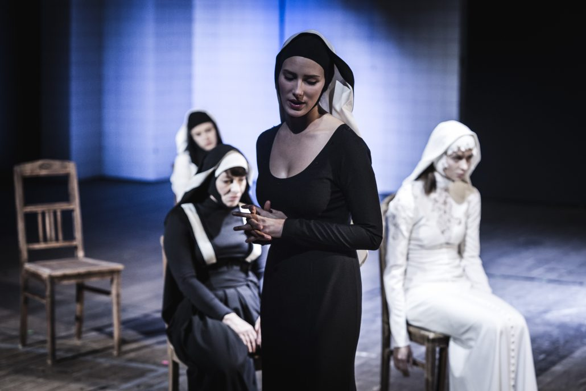
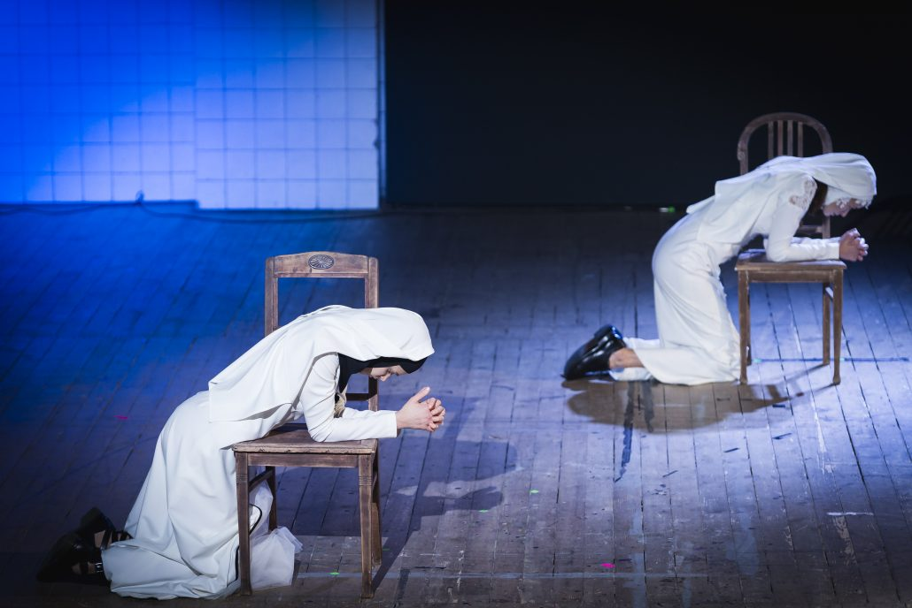
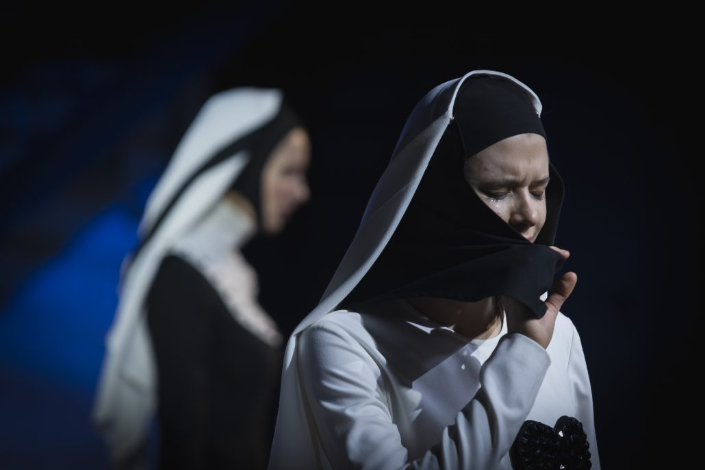

Agnieszka, Dorota, Joanna, Magdalena. Cztery kobiety, które łączy jedno – wszystkie wybrały życie zakonne i wszystkie z niego zrezygnowały. 

Źródłem świadectw byłych sióstr i ich historii, które posłużyły do stworzenia spektaklu jest genialny reportaż Marty Abramowicz *Zakonnice odchodzą po cichu*, z którego został zaczerpnięty także jego tytuł. Opolska inscenizacja jest już zatem drugim przetworzeniem historii kobiet.

Daria Kopiec – reżyserka wraz z dramaturżką Martyną Lechman podejmują w nim próbę zrozumienia powołania, poświęcenia swojego życia w służbę Bogu. Obnażają przy tym system, w którym kobieta jest zmuszona do posłuszeństwa. Manipulowana, tłamszona, uległa. 

Realizują to poprzez podzielenie spektaklu na dwie wyraźne części, rozdzielone rytualnym nałożeniem habitów. Aktorki przechodzą od monologów na temat wiary, które mogą być tak ich własnym doświadczeniem, jak dopowiedzeniem, kreacją wspomnień granych przez nie kobiet, do interpretacji opisanych w książce historii, w drugiej połowie. Wprowadzenie do wydarzeń pierwszej części jest bardzo inteligentnym pomysłem bo przyczynia się do zbudowania relacji – aktorek i widowni z opisywanymi bohaterkami. Dzięki temu prostemu zabiegowi nie mamy wrażenia nienaturalnego skoku prosto w niezrozumiały nam świat.

Wydaje się, że do drugiej – głównej części spektaklu wybrane zostały historie o największym potencjale scenicznym, choć to oczywiście nie jedyne moim zdaniem kryterium. Celem było też przedstawienie możliwie najszerszego przekroju charakterów i dojrzałości kobiet, ich motywacji.

Joanna (Joanna Sokołowska) młoda dziewczyna, słodka, urocza, nieświadoma swojej seksualności. Jej charakter został dobrze uchwycony w kostiumie – biała, dziewczęca sukienka z cekinowym sercem na udzie. W zakonie najpierw zaprzyjaźnia się z inną nowicjuszką – Magdaleną (Karolina Kuklińska), potem podczas wakacji, pomiędzy kobietami wybucha pożądanie. Spędzają razem noc, zakochują się w sobie. Magdalena tak w reportażu, jak i w aktorskiej kreacji Kuklińskiej zdaje się być od Joanny bardziej dojrzała, przebojowa i mniej naiwna. Jej habit to czarna suknia, mocno podkreślająca talię, której biała górna część jest odpinana. Po jej zdjęciu odkryty zostaje pełen dekolt kobiety. To fantastyczny zabieg stylistyczny, który pokazuje tak kobiecość, jak i w szerszym rozumieniu – człowieczeństwo i wynikające z niego potrzeby i popędy. Rozdzielenie zakonnic, ich inwigilacja przez inne siostry, poniżanie na forum przez matkę przełożoną, doprowadzają Magdalenę do myśli samobójczych. Kobiety decydują się na opuszczenie zakonu. Razem.

Dorota (wybitna rola Małgorzaty Mikołajczak) – wygadana, dowcipna, młoda kobieta z małej wsi. W zakonie chciała doświadczyć wspólnoty. Tymczasem jedyne co otrzymała, to tłamszenie, przemoc psychiczną, roztrzaskane poczucie własnej wartości skutkujące nerwicą, depresją, leczeniem psychiatrycznym i… wydaleniem z zakonu. Siostra przełożona poleciła Dorocie prowadzenie dzienniczka, w którym zapisywać miała swoje grzechy i postanowienia poprawy. W książce Abramowicz zostały zacytowane jego fragmenty w kolejności chronologicznej, co pozwala zarejestrować i przyjrzeć się stopniowemu postępowaniu choroby przy jednoczesnym braku zainteresowania pozostałych sióstr jej stanem, czy jakiejkolwiek formy wsparcia. Intensyfikujące się gesty, ruchy, powtórzenia, miotanie się, zmieniające się nastroje, strach i płacz w wykonaniu Małgorzaty Mikołajczak mistrzowsko ilustrują zapadanie się w szaleństwie i depresji, w końcu utratę powołania i wiary. W jednej z ostatnich notatek Dorota pisze: *Żyję w wielkiej ciszy. Z nikim nie rozmawiam. Nikt do mnie nic nie mówi. Żyję osobno. To byłoby dobre, gdyby był Bóg. Ale jego nie ma.** Dorota ma na sobie koronkową, białą suknię i długi, ażurowy welon. To panna młoda porzucona przez Boga (swojego oblubieńca) i wspólnotę. Może dlatego jej welon skojarzył mi się z pogrzebowym woalem.

Agnieszka (Cecylia Caban), to kobieta pewna siebie, zaradna, przebojowa. Do zakonu wstąpiła, żeby nieść pomoc potrzebującym. Jej wizja funkcjonowania zakonów była mocno… romantyczna. Szybko okazało się, że *zgromadzeniu nie była miła praca na rzecz potrzebujących. A przecież siostry miały piękny, jasny charyzmat: służyć biednym, pielęgnować chorych, otaczać miłością samotnych i wykluczonych*.** Rzeczywistość okazała się zgoła inna. Biedni posiłek owszem dostawali, ale odpłatnie; chorym siostry pielęgniarki robiły zastrzyki, ale nie za darmo. Przykładów można by mnożyć. Bunt Agnieszki przeciw zakonnym zasadom, był walką z wiatrakami. Każda próba wyjścia ze schematu kończyła się karą. Agnieszka to przykład idealistki, prawdziwej społeczniczki. Pewnie z tego względu jej habit to szerokie spodnie – wygodne i funkcjonalne. Odeszła po tym, jak po rozdzieleniu jej z siostrami wyznającymi podobne wartości, zaczęła się gorzej czuć.

Figury byłych sióstr zostały przeze mnie jedynie nakreślone. Znacznie ważniejszym wydaje się bowiem być sposób w jaki twórczynie zdecydowały się kobiety pokazać i jakiś środków do tego użyły. Bo pomysłów, prócz adekwatnych, wspomnianych już kostiumów Patrycji Fitzet, jest więcej. 

Jednym z nich jest muzyka na żywo, szalenie sugestywna! Pianistka – Natalia Czekała jest na scenie cały czas i jej rola nie kończy się na grze na instrumencie. Jest ona kimś w rodzaju demiurga, głosu wewnętrznego kobiet, ich ukrytych obaw, czasami przemocowym tonem siostry przełożonej, innym razem powierniczką. Ciekawa to rola, mocno dynamizująca całe przedstawienie także z uwagi na wspaniały biały śpiew Czekały. Zupełnie niekościelny, w kontrze do naturalnych skojarzeń. Pianistka w niektórych scenach tworzy z siostrami chór, co stanowi o wspólnocie. Temat wspólnoty przewija się zresztą przez cały spektakl. Relacje między zakonnicami się zacieśniają, kobiety wspierają się nawzajem, te które odeszły zdejmują welony pozostałym. Jest to raczej wyrazem myślenia magicznego twórczyń spektaklu, ich wyobrażeń, które chciałyby przekuć w samospełniające się proroctwo. Byłe zakonnice znikają bowiem bez śladu, w przestrzeni publicznej (w odróżnieniu od byłych księży) po prostu nie istnieją, nie ma dla nich grup wsparcia. 

*Młode siostry mają przyjmować wszystko na wiarę i o nic nie pytać*.*** Do zakonów przyjmuje się młode dziewczyny, zaraz po szkole średniej, pozwolenie na studiowanie należy do wyjątków. *Nie ma obyczaju wyjaśniania przepisów, reguł i poleceń. Tak ma być i już. Wola Boska*.**** Zostają złamane, stają się bezbronne, zawstydzone i zagubione. Słowem, zinfantylizowane przez zakon. Bardzo dobrze uchwycone zostaje to w choreografii autorstwa Anety Jankowskiej, która zawiera się tak naprawdę jedynie w przyruchach, drobnych gestach, postawie. Skromna, ascetyczna jest też scenografia. Pianino i cztery krzesła, dyskretne światło są jedynie tłem – prostym, nienarzucającym, wpisującym się w wyobrażenie powściągliwego wnętrza zakonnych cel.

*Zakonnice odchodzą po cichu* to spektakl, który unaocznia też przemoc wynikającą z kościelnej hierarchii – nowicjuszki są tłamszone, karami i pokutą zmuszane do posłuszeństwa (ich przykłady przybliża świadectwo każdej z obecnych w przedstawieniu sióstr). Po wyjściu z teatru wydaje się, że *sacrum *znajdziemy prędzej na ulicy niż w klasztorze, czyli tam, gdzie spodziewalibyśmy się jego urzeczywistnienia. Gdzieś między słowami wybrzmiewa tu także  patriarchat tak mocno zakorzeniony w kościele. Wszelkie decyzje, także te związane z zakonami żeńskimi są przecież podejmowane przez mężczyzn.

To zaś co wydaje się być (nie)zamierzonym efektem ubocznym spektaklu, to pytanie, czy można sobie wyobrazić pełnię życia bez wiary i czy wiara musi być związana z religią. Historie wszystkich czterech kobiet pokazują, że istnieje wiara w sensowność bez potrzeby religijności. 

Polecam gorąco!

---

* M. Abramowicz *Zakonnice odchodzą po cichu*, Wydawnictwo Krytyki Politycznej, Warszawa 2017, s. 47

** tamże, s. 70

*** tamże, s. 171

**** tamże, s. 17

fot. Krzysztof Ścisłowicz
