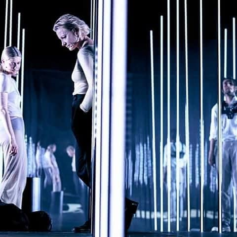
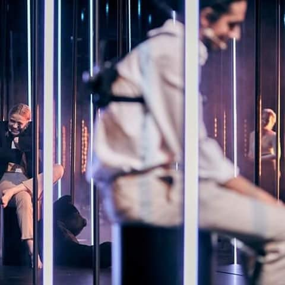
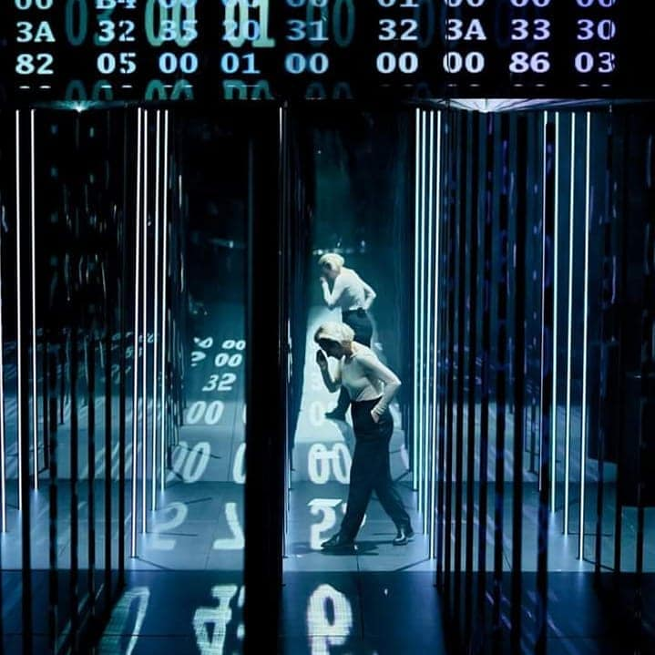

*4.48 Psychosis *to autobiograficzny utwór Sarah Kane, zapis przebiegu jej choroby psychicznej. Inscenizacja tego dramatu na deskach Teatru Polskiego w Poznaniu jest debiutem reżyserskim Pawła Demirskiego – jednego z najwybitniejszych współczesnych dramatopisarzy. To jednocześnie druga premiera tej sztuki w Polsce – po spektaklu w reżyserii Grzegorza Jarzyny z Magdaleną Cielecką w roli głównej.

Dramat określany jest często jako samobójczy list pożegnalny Kane, zapis jej cierpienia, żalu i poczucia niezrozumienia. Jednak dopiero odejście od tej interpretacji, przy jednoczesnym zwróceniu uwagi na wyjątkową formę i język sztuki, pozwala dostrzec coś więcej niż komunikat – autoanalizę, podjęcie ostatniej próby znalezienia pomocy, oraz co podkreśla w wywiadach Demirski – potrzebę Kane do skomunikowania siebie ze światem, do* bycia radykalnie sobą.** Sarah Kane pisze strumieniem świadomości, co oznacza, że tekst oparty jest na obrazach, pozbawiony jest linearności, nie ma tu jasno wyodrębnionych postaci. Monolog miesza się z dialogiem i poetyckim opisem, a same słowa, tekst zapisany jest w różnych graficznych konfiguracjach. Spektakl zaś, na przekór temu, co zapisane w dramacie, wydaje się być bardzo spójny, jakby twórcy chcieli go na siłę uporządkować.

Demirski zdecydował się pracować z trójką aktorów – Aloną Szostak, Moniką Roszko i gościnnie Alanem Al-Murtathą, a rolę cierpiącej na psychozę maniakalno-depresyjną kobiety rodzielić pomiędzy dwie aktorki. Bohaterka *4.48 Psychosis* szuka siebie, podejmuje próbę skomunikowania się ze sobą i światem, jednak sposób w jaki prezentują nam to twórcy spektaklu, mianowicie granie do siebie, współegzystowanie dwóch zasadniczo różnych Bohaterek, które reprezentują tę samą osobę, tyle że w różnych stanach emocjonalnych i psychicznych, jest (przynajmniej dla mnie) zbyt dobitne, żeby nie powiedzieć łopatologiczne… 

-

-

Osoba grana przez Monikę Roszko, jest bezradna, uległa, otumaniona lekami, zalękniona i wycofana. Porusza się po scenie z dużym, pluszowym misiem, nie patrzy wprost na widownię, mówi łamiącym się głosem, emocje wyraża krzykiem, który rozsadza głowę. Jest infantylna, a niektóre jej zachowania, jak na przykład tulenie pluszaka, chowanie się za nim, czy zakładanie na głowę czarnych worków na śmieci są zawstydzająco dosłowne. Podczas *testu siódemek* – *serial sevens *(stosowane w psychiatrii badanie skupienia i pamięci operacyjnej, polegającego na odejmowaniu kolejno liczby siedem od stu) popełnia błędy. 

Bohaterka grana przez Alonę Szostak (świetną aktorkę, jednocześnie starszą i dojrzalszą od Roszko) wydaje się być świadomą i pewną tego co mówi. Jest zrozpaczona, przepełnia ją frustracja i gniew. Jest zdesperowana, ale świadoma, nieugięta. I taka pozostaje przez całe przedstawienie. Bezbłędnie odejmuje siódemki. Spektakl jednak, w przeciwieństwie do dramatu, nie daje poczucia walki z napięciami, autoanalizy i osiągania spokoju/jasności przez tę samą osobę. Bo myli się jedna, bezbłędna jest druga.

Nie sposób nie zauważyć, że twórcy operują tutaj przeciwieństwami, na styku których pojawia się sarkazm, czarny humor. Postaci nie mówią tu jednym głosem, choć często powtarzają te same słowa, co doprowadza do poczucia nieszczerości. Co więcej decyzja o podziale roli Bohaterki dramatu, na osi której został zbudowany przecież cały spektakl i tak wyraźny między nimi kontrast sprawia, że odnoszę wrażenie wartościowania emocji. Pewnie to nie zamierzone, ale zyskują te, które prezentuje pewna swoich słów, dojrzała Szostak, a zdeprecjonowane zostają te, które wyraża infantylna i zahukana postać grana przez Roszko. W takich sytuacjach, między sceną a widownią pojawia się niewidzialny mur, który nie przepuszcza żadnych emocji, choćby aktorzy stawali na głowie i robili co mogli…

Alan Al-Murtatha gra tu zaś lekarza ze szpitala psychiatrycznego, w którym przebywa Bohaterka. Rola to dosyć jednowymiarowa, gdzie jedyną interpretacją wydaje się być uwypuklenie krytyki systemu zdrowia, braku empatii i przedmiotowego podejścia do pacjenta, gdzie celem jest sterowanie emocjami Kobiety za pomocą leków. Tu całkiem niezła scena, w której Lekarz machinalnie recytuje kolejne nazwy leków przyjmowanych przez Kobietę, ich dawki i efekty uboczne ich zażywania. 

Aktorki i aktor krążą po czarnej scenie, pomiędzy rozsianymi metalowymi palami. Pręty, ustawione równiutko niczym drzewa w szkółce leśnej są wysokimi lampami stroboskopowymi, które rozbłyskują w różnych kolorach. Nad sceną znajduje się duży ekran, na którym wyświetlone zostają numeryczne wizualizacje (nawiązanie do *testu siódemek*) bądź twarze i dłonie postaci nagrywane na żywo za pośrednictwem kamery go pro. Zbliżenia z wykorzystaniem kamery, to kontynuacja wątku poszukiwania siebie przez Bohaterkę – dwie kobiety, ale ta sama Osoba obserwują siebie nawzajem, łapią jakiś rodzaju dystansu i zbliżają się do siebie. Las drzew – ale martwych, metalowych i zimnych oraz rażenie światłem są zgrabną metaforą *przesądzonego*, tego co od początku, od pojawienia się na scenie Bohaterki jest jasne i nieuniknione. Pozbawione życia pale rozbłyskują w momentach wybuchu emocji Osoby, światła są pewne – jak jej śmierć. *Pogodziłam się z tym, że umrę w tym roku *mówi*.* Za scenografię odpowiada Anna Haudek, zaś za światła i wizualizacje Jakub Lech. Mocna jest też muzyka Małgorzaty Tekiel, która ogłusza od pierwszych scen, agresywna, rockowa. Scenografia, światło i muzyka, to krzyk! O wiele bardziej niestety wymowny i wzruszający niż ten Bohaterki granej przez Monikę Roszko. 

W 2019 roku podczas Spotkań Teatralnych *Bliscy Nieznajomi*, który odbywał się w poznańskim Teatrze Polskim widziałam przedstawienie Rozy Sarkisian *Psychosis* na motywach dramatu *4:48 Psychosis. *Napisałam wtedy, że *Spektakl odłożył się w moim ciele na długo, nie dawał zapomnieć*.** Wielka szkoda, że nie mogę powiedzieć tego samego o spektaklu Pawła Demirskiego. Bo oczekiwania były wielkie.

* M. Urbaniak *O tęsknocie za światem, który nas rozumie. Psychosis w Teatrze Polskim *[w:] Wyborcza.pl Poznań, dostęp 14.06.2021

** [https://bylamwidzialam.pl/2019/09/26/bliscy-nieznajomi-2019-ukraina/](../../../../2019/09/26/bliscy-nieznajomi-2019-ukraina/)

fot. Bartek Sadowski
