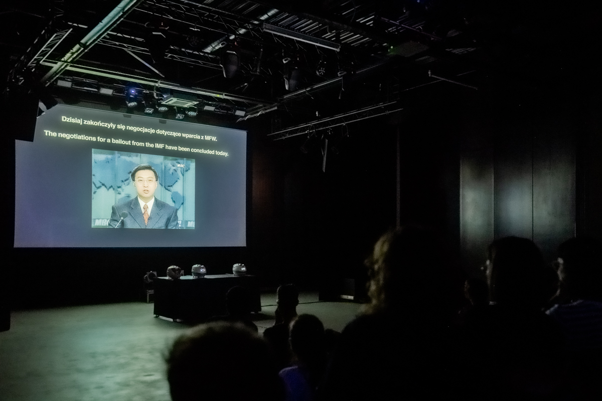
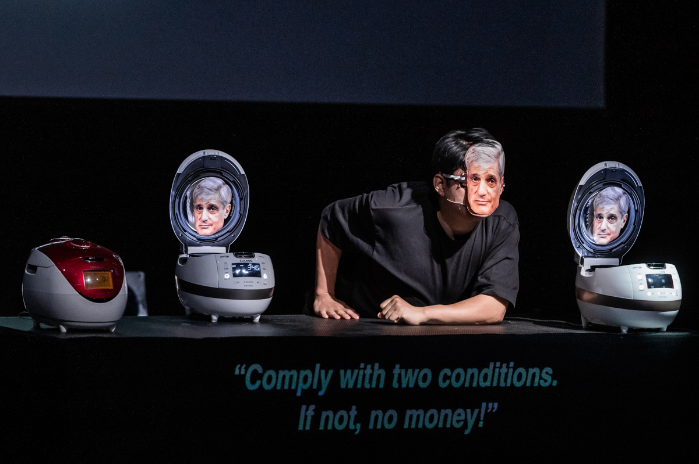
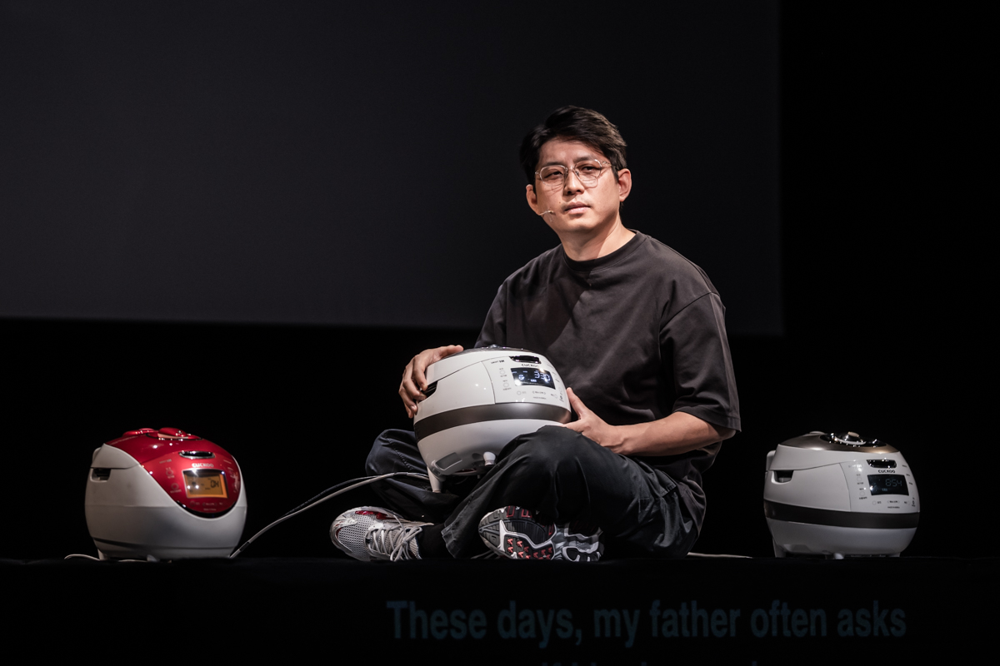

Cuckoo to koreański producent urządzeń dla gastronomii. Ich szybkowar do ryżu stał się tak popularny, że nazwa firmy praktycznie zastąpiła nazwę urządzenia – Koreańczy nie używają ryżowarów, a po prostu cuckoo. Garnek pojawił się w sprzedaży podczas azjatyckiego kryzysu finansowego w latach dziewięćdziesiątych ubiegłego wieku i stał się symbolem korańskiego sukcesu. Cuckoo jest urządzeniem tak niezbędnym i oczywistym dla Koreańczyków, że Jaha Koo – twórca spektaklu, prócz ubrań i książek, zabrał je ze sobą wyjeżdżając z kraju.

Artysta urodził się w 1984 roku, tuż przed transformacją ekonomiczną w Korei Południowej. Dorastał więc w kraju dotkniętym potężną biedą. Władze, starając się opanować kryzys, w 1997 roku przyjęły pięćdziesięciopięciomiliardowy pakiet ratunkowy od Międzynarodowego Funduszu Walutowego (MFW). Warunkiem otrzymania pomocy było wdrożenie szkodliwych zmian w polityce fiskalnej kraju, co doprowadziło do pogłębienia nierówności ekonomicznych i krwawych protestów, a w dalszej perspektywie, także do wzrostu liczby samobójstw. 

,,Cuckoo” nie jest jednak wyłącznie kroniką zmian ekonomicznych i społecznych, czy retrospekcją ,,narodowego dnia upokorzenia” jak nazwano datę przyjęcia pomocy od MFW, ale przede wszystkim oceną wpływu tych zmian na życie zwykłych ludzi – takich jak Jaha Koo, jak jego rodzina i rówieśnicy. Artysta łączy zatem historię transformacji w formie doskonałych fragmentów wideo ze swoimi wspomnienia z tego czasu – między innymi tym o foliowej torebce, którą babcia kazała mu zakładać na głowę przed wyjściem z domu by ochronić go przed działaniem gazu łzawiącego. Wszystkiemu wtórują zaś rozmowy… ryżowarów.

Trzy szybkowary – kuchenne divy o imionach Hana, Seri i Duri – oświetlone i błyszczące znajdują się bowiem na scenie. Dwie z nich wyposażone są w lampki LED, mają dotykowe menu i potrafią mówić. Pierwsza nie posiada żadnego z tych atrybutów, ale przynajmniej gotuje ryż najlepiej ze wszystkich. Garnki przekomarzają się ze sobą, wymyślają sobie od łajz i ćwoków, prowadzą zażarte dyskusje. Są łącznikiem pomiędzy domem Koo w Korei a tym obecnym w Europie. Bywa też, że są jedynym głosem, który odzywa się do niego w ciągu dnia. Komunikaty: ,,Ryż jest gotowy”, czy ,,Pora przemieszać ryż” i mieniące się lampki wyświetlacza to pewna stała w nowej rzeczywistości emigranta. Koo personifikuje szybkowary i przypisuje im rolę świadków zmian jakie zaszły w życiu przeciętnego Koreańczyka. Wszak co lub raczej kto może wiedzieć to lepiej niż przedmiot znajdujący się w każdym, niezależnie od statusu i poglądów, domu. 

Garnki mówią zatem o Robercie Rubinie – amerykańskim ekonomiście i polityku, twarzy MFW podczas podpisywanych przez Koreę umów. Przywołują tym samym głębokie rozczarowanie decyzjami państwa. Kiedy Jaha Koo podnosi wieka ryżowarów, za wznoszącej się pary wyłania się tekturowa twarz polityka. Świadczy to tylko o skali komentarzy dotyczących decyzji państwowych, rozmów które toczyły się w koreańskich domach na co dzień.

Szybkowary są też świadkami niezliczonych rozmów twórcy przedstawienia z ojcem i charakterystycznego pytania skierowanego do syna, które pada podczas każdej z nich – ,,Czy zjadłeś już dziś jakiś pożądny posiłek?”. To pytanie – metafora, mieści w sobie troskę o dobrobyt, o pracę, która zapewnia jedzenie i o spokój ducha. Jest nawykiem budowanym przez lata biedy, braku zatrudnienia i głodu, który wielu Koreańczyków popchnął do samobójstwa. Także najlepszego przyjaciela Jaha Koo, o śmierci którego artysta dowiedział się tuż po przeprowadzce do Holandii.

Korea Południowa ma najwyższy współczynnik samobójstw spośród trzydziestu ośmiu wysoko rozwiniętych i demokratycznych państw wchodzących w skład Organizacji Współpracy Gospodarczej i Rozwoju (OECD). Na stacjach metra postawiono przeszkolone ściany, w których drzwi otwierają się dopiero gdy pociąg stoi już na stacji. To systemowe ograniczenie liczby przypadków samobójczej śmierci poprzez skok pod nadjeżdżający pociąg. Mechanizmy drzwi ulegają jednak uszkodzeniom. Na ich naprawę jest kilkanaście minut. Koo przywołuje historię śmierci mechanika, który by nie stracić posady i nie zawieść pracodawcy jeździ w różne części miasta naprawiać awarie drzwi. Po każdym kolejnym zgłoszeniu usterki, mężczyzna ma coraz mniej czasu na przemieszczanie się pomiędzy stacjami. W końcu nie udaje mu się wyjść na peron na czas, zabija go wjeżdżający na stację pociąg. Opowieści towarzyszy bardzo sugestywna muzyka i wideo, gdzie obrazy pędzącej kolejki, szklanych drzwi i morza ludzi nakładają się na siebie. Artysta zdaje się zadawać pytanie – co tak naprawdę zabiło mechanika – pociąg, czy może raczej tempo życia w Korei Południowej. Przerażającą większość samobójców stanowią młodzi ludzie, dla których ciągły pośpiech, rywalizacja społeczna, presja i samotność (która w dużej mierze wynika z poświęcenia się pracy) jest przyczyną zachowań suicydalnych. Rokrocznie pięćset osób odbiera sobie życie skacząc z jednego z dwudziestu siedmiu mostów na rzece Han. Dwadzieścia lat temu, nazwa rzeki była symbolem sukcesu ekonomicznego, który nazwano ,,cudem nad rzeką Han”. Dziś mówi się o mostach samobójców. 

,,Cuckoo” to tragikomiczna opowieść o życiu w kraju, który nieustannie pracuje nad utrzymaniem miejsca w czołówce gospodarczej świata. Cel ten rzecz jasna  jest okupiony dramatem zwykłych ludzi. Z tej perspektywy ryżowary są swego rodzaju symbolem Korei Południowej, gdzie tempo życia nigdy nie zwalnia. Zupełnie jak temperatura ugotowanego w szybkowarze ryżu  – jest wciąż podtrzymywana.
