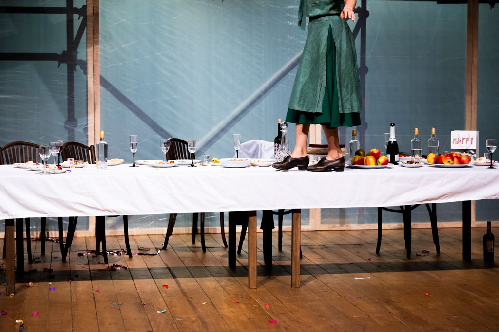
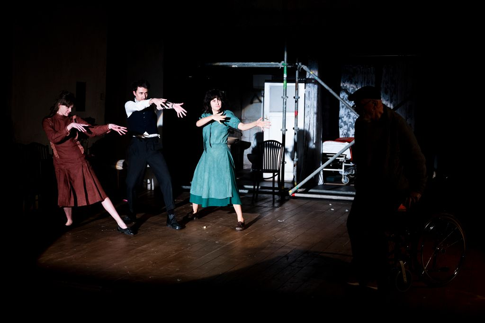
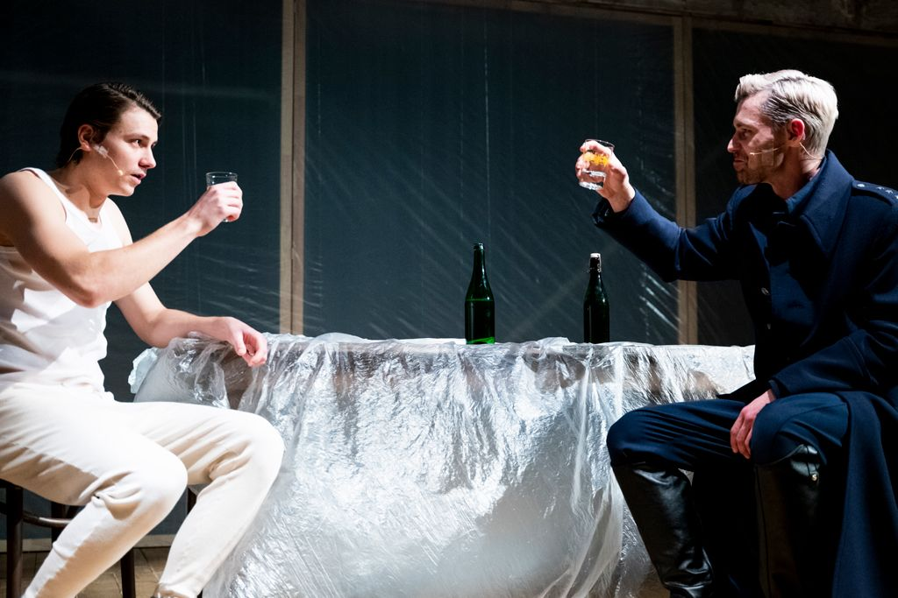

Znajdujemy się w wiosce o przesympatycznej i gościnnej nazwie Dobre. Tak naprawdę  jednak moglibyśmy być teraz w każdym innym miejscu naszego kraju, choćby i w Złej Wsi w województwie pomorskim. W przedwojennej Polsce, gdzie zaczyna się akcja spektaklu ,,Alte hajm/Stary dom” z poznańskiego Teatru Nowego, żyło wszak ponad trzy miliony Żydów. Zakładali tu swoje rodziny, rozkręcali i prowadzili biznesy, budowali domy, gromadzili oszczędności. Po prostu żyli. W Dobrem mieszkali Szmulewiczowie: Abram (Michael Rubenfeld) oraz jego dwie córki – młodsza Ester (Aneta Jankowska) i starsza Chaja (Weronika Asińska). Po wojnie natomiast w ich domu żyły i wychowały się trzy pokolenia rodziny Dobrowolskich. Wszyscy oni spotykają się podczas przyjęcia urodzinowego na cześć Adama Kusza (Sebastian Grek), najstarszego wnuka Huberta Dobrowolskiego (Paweł Hadyński) – ​​zniedołężniałego nestora rodu. Wszyscy – zarówno żywi jak i umarli. Niechciane ślady minionych wydarzeń i ich świadkowie. Wśród czterech ścian starego domu we wsi Dobre i zapisaną w jego murach, starannie przemilczaną historią.

Przeszłość w spektaklu w reżyserii Marcina Wierzchowskiego wydarza się ponownie za pośrednictwem duchów, bladych postaci sióstr Szmulewicz i ich ojca. Przed śmiercią próbował ich ocalić Maksymilian Dobrowolski (Dawid Ptak) – rozstrzelany za tę próbę pomocy Żydom brat Huberta. Historia ta byłaby przejrzysta, gdyby nie fakt, że Maks był członkiem granatowej policji, jak potocznie nazywano funkcjonującą w czasach II Wojny Światowej komunalną policję podporządkowaną niemieckim siłom porządkowym. Ukrył on Szmulewiczów w swojej piwnicy na prośbę Abrama, ale w istocie zrobił to ze względu na uczucie, którym darzył Chaję. Nie on jeden, jak okazało się kilkadziesiąt lat później podczas rodzinnego spotkania Dobrowolskich.

Rozpoczęło się właśnie przyjęcie urodzinowe, na które z różnych stron Polski i świata przyjechała najbliższa rodzina jubilata: jego matka, dziadek, rodzeństwo wraz z partnerami, żona, dzieci. Jest tort, wino i prezenty. ,,Ot, zwykłe przyjęcie!”– powiedzielibyśmy, gdyby nie odkrywane kolejno rodzinne sekrety. A są to tajemnice całkiem aktualne, jak ta dotycząca romansu z nastoletnią uczennicą, skrywana przez Adama i te niewypowiedziane od dawna, jak zwierzenie Kamy (Dorota Abbe) – żony Adama o niespełnieniu w małżeństwie i poczuciu psychicznego zniewolenia przez rodzinę męża.

Jaki wpływ na wyjawienie tych i innych sekretów ma przeszłość, którą na nowo ożywiła fotografia Chai? Zdjęcie, które do Dobrego przywiózł z Ameryki jej wnuk Saul (Miachel Rubenfeld) – partner Kai (Martyna Zaremba-Maćkowska), wnuczki Huberta? Mężczyzna ośmielony jej wspomnieniami o rodzinnym bohaterze, postanowił przekazać jej rodzinie dalszy ciąg opowieści o Żydówce, która przeżyła Zagładę. Wyzwoliło to falę krzyków, wzajemnych oskarżeń, skrywanych przez lata nieporozumień. Przede wszystkim jednak sprawiło, że Hubert opowiedział o duchach przeszłości – wirujących wokół niego jak w tańcu – wyrzutach sumienia, o domu, w którym wychowały się jego dzieci i wnuki, w końcu prawdę o Chai. Jego Chai. Kobiecie, którą kochał tak bardzo, że wydał granatowej policji resztę jej rodziny i własnego brata. O Chai, którą ukrywał potem do końca wojny. O Chai, która tuż przed wyzwoleniem zaszła z nim w ciążę i w końcu o Chai, której rodzinny dom zajął po jej ucieczce.

Obie siostry Szmulewicz są niemal cały czas na scenie. Dzięki kostiumom (Magdalena Mucha) i charakteryzacji nie ma wątpliwości, że to czas ich młodości z czasów Zagłady. Kobiety krążą wokół nowych mieszkańców ich rodzinnego domu, zaglądają do piwnicy, w której się ukrywały, opowiadają o swoim życiu w Dobrem – przed i w czasie wojny. Ich obecność daje zatem niepowtarzalną szansę poznania historii zapisanej w murach starego domu, zanim opowie ją ktoś inny. Nie pozwala tym samym na zawłaszczenie narracji przez którąkolwiek ze stron. Tragicznie spleciona historia Polaków i Żydów pokazana jest zatem wielowymiarowo. Służy temu nie tylko rozpisanie tekstu (Michael Rubenfeld i Marcin Wierzchowski) na trzy języki: jidysz, polski i angielski, ale również uwzględnienie narracji zarówno Żydów zasymilowanych, jak i tych, którzy musieli wyemigrować ze swojego kraju. 

Sam dom natomiast – symbol postpamięci, przekazywanego z pokolenia na pokolenie niewypowiedzianego cierpienia, wyrzutów sumienia i traumy – jest stary, brudny i ciemny. Od dawna stał pusty i wypełnił się ludźmi jedynie na czas przyjęcia, co sugerują przykryte plandekami sprzęty, czy zakurzona drewniana podłoga. Mimo że przestronny, sprawia wrażenie dusznego, dawno niewietrzonego. Przygotowania do urodzin rozpoczynają się od zdjęcia folii, którą przykryte były nieużywane od dawna meble – niemodne brązowo-miodowe fotele, drewniane krzesła, czy ogromny stół stojący w centralnym miejscu salonu. Ten sam stół, wokół którego przed wojną tańczyły siostry Szmulewicz i ten sam, przy którym rozstrzelany został Maksymilian. Za tę niezwykle trafną scenografię, która umożliwiła przeplatanie się kadrów z przeszłości i powtórnego przeżywania jej za pośrednictwem opowieści odpowiedzialna jest Magdalena Mucha.

Przyczynkiem do przenikania się owych wątków jest wspomniany już przyjazd Saula. Fakty dotyczące jego pochodzenia natychmiast uruchomiły w Wandzie (niezwykle przekonująca w tej roli Maria Rybarczyk) – córce Huberta – podszyty antysemityzmem strach przed odebraniem im domu. Była to jednak tylko fasada, pod którą w istocie kryło się zachwiane poczucie stabilności i kontroli. Zdarzenie to bowiem zburzyło utrzymywane przez lata pozory, odsłoniło natomiast prawdę, z którą sama nigdy nie była w stanie się zmierzyć. Milcząca postawa jej ojca była wygodna dla całej rodziny. Każdy bowiem wiedział lub domyślał się choćby ułamka tego, co stało się w ich starym domu w Dobrem. Zabrakło jednak dotychczas odwagi, by zmierzyć się z tym bagażem. Wanda odziedziczyła po swoim ojcu niewypowiedzianą dotąd opowieść w postaci traumy i cierpienia, które  przekazała dalej swoim dzieciom. Jest ofiarą i emocjonalnym despotą jednocześnie. Jest miotana poczuciem winy, wyrzutami sumienia i złością. Niewypowiedziana trauma nie pozwala jej stworzyć dobrych, opartych na szczerości i wzajemnym szacunku, relacji.

,,Alte hajm/Stary dom” to niezmiernie wzruszający i bolesny obraz tłamszonego poczucia winy, wojennej traumy i jej dziedziczenia. Ta fantastycznie napisana i brawurowo odegrana opowieść to próba odpowiedzi na pytanie, jaki wpływ na postrzeganie, a potem wartościowanie życia, celów i pragnień ma odkryta po latach historia i skrzętnie ukryte wspomnienie. Wydarzenia z Dobrego są przykładem, jaki wpływ mogą na żywych mieć umarli i jak wszelkie próby wymazywania pamięci o nich pogłębiają przeżytą traumę.

---

fot. Monika Stolarska
