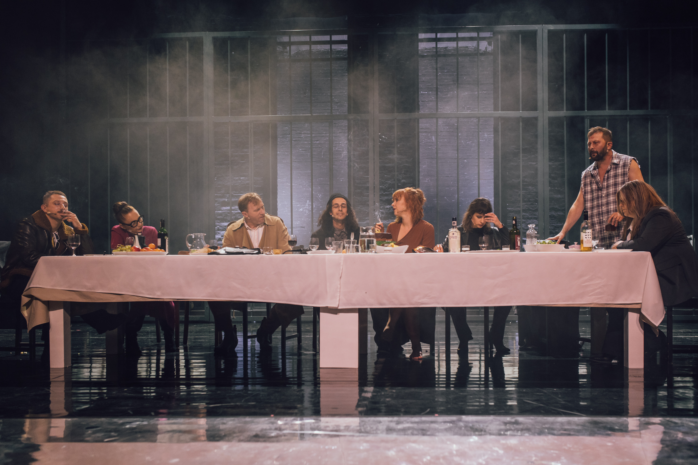
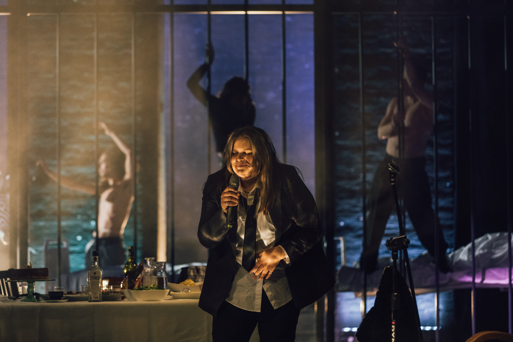

,,Mezopotamia” w reżyserii i adaptacji Wiktora Bagińskiego powstała na podstawie rewelacyjnej książki Serrhija Żadana o tym samym tytule. Tyle, że jak się głębiej zastanowić, to trudno powiedzieć, po co tak naprawdę był Bagińskiego Żadan. Akcja obu ,,Mezopotamii” odbywa się w Charkowie. U Żadana jest to opowieść błyskotliwa i wzruszająca – o miłości i o poszukiwaniu spełnienia. W końcu o poplątanych losach bohaterów, którzy kochają się, krzywdzą, uciekają od siebie i do siebie wracają. Ich ruchy nie mają jednak żadnego wpływu na globalną historie. U Bagińskiego, ludzie są więźniami – swoich historii, przywiązań, ograniczeń, swojej miłości i choroby. Przede wszystkim są jednak więźniami miejsca – z którego nie warto wyjeżdżać, skoro nie można do niego wrócić. Nawiązanie do zatrzymania uwidacznia się w scenografii autorstwa Stafanii Chiarelli, gdzie więzienne kraty są tłem i horyzontem wydarzeń – czy to w szpitalu, czy na urodzinowym przyjęciu. 

Nawiązanie do wojny w Ukrainie wydaje się oczywiste. Mimo dramatycznych wydarzeń, wybuchów bomb i żołnierzy na ulicach, życie toczy się dalej – ktoś zachodzi w ciążę, kto inny umiera na raka. I podobnie jak u Żadana, tak i u Bagińskiego, prywatne historie pozostają jedynie osobistymi końcami świata, które w szerszej perspektywie niczego nie zmieniają. 

Biorąc pod uwagę aktualność, jaka wiąże się z tragicznymi wydarzeniami za naszą wschodnią granicą, ,,Mezopotamia” Bagińskiego mogłaby być wzruszającym i lirycznym obrazem ludzkich dramatów uwięzionych w ich mikrokosmosach. Mogłaby być też czymkolwiek innym, gdyby nie płaska dramaturgia i tekst, który nie integrował się z postaciami. Gdyby nie realnych rozmiarów zebra stojąca z tyłu sceny i której obecności nie sposób uzasadnić – prócz nawiązania do okładki książki. I gdyby nie Patti Smith (Darya Novik), która zaśpiewała dwa wielkie utwory: ,,Because the night” i ,,Gloria” przy akompaniamencie gitary basowej, na której to grała białowłosa, siedząca na kamieniu z boku scena, kobieta. 

I nie pomogli temu przedsięwzięciu nawet rewelacyjna w roli psychoterapeutki Barbara Krasińska ani zabawny, zawadiacki Konrad Cichoń z niezwykłą lekkością i autentycznością grający Jurę.

---

fot. materiały prasowe Teatru Polskiego w Poznaniu
