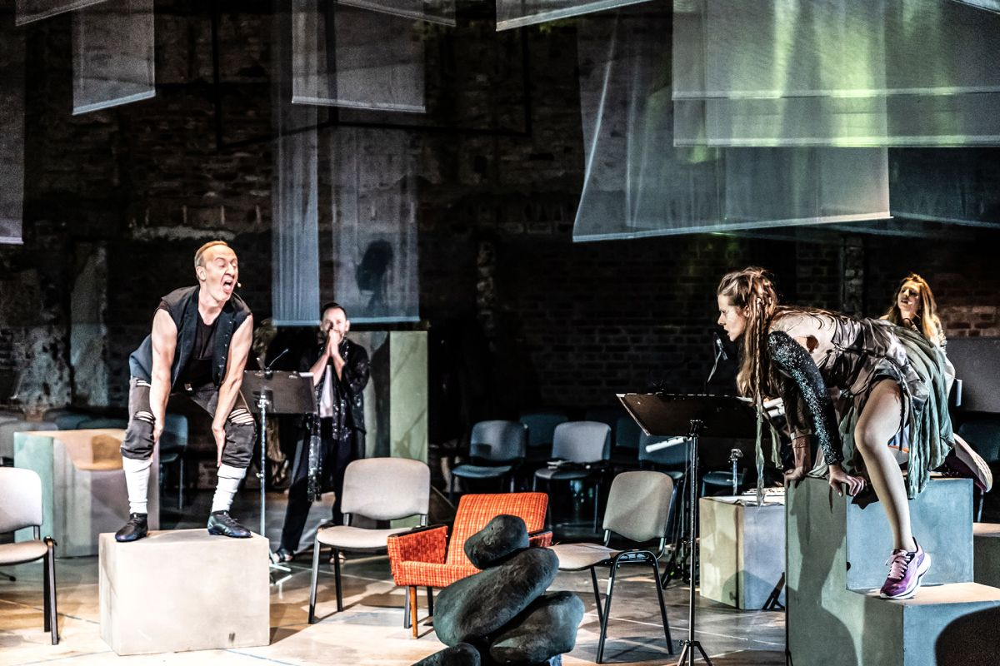

Jaki jest ,,Finnegans W/Fake” w reżyserii Katarzyny Kalwat? Niebywały, potoczysty, uporządkowany w chaosie, soczysty w słowie i wyjątkowo niespodziewany. To z jednej strony. Bo z drugiej jest mocny i szybki. Wyrzucane z niezwykłą prędkością i precyzją słowa tworzą zagadki, echolalie, zapożyczenia, rymy i dwuznaczności lub układają się w zupełnie nowy sens. Twórcy uprawiają tu performatywną grę w łańcuch wyrazowy, gdzie ostatnia sylaba danego słowa jest pierwszą kolejnego. Zupełnie jak w niewiarygodnym dziele Jamesa Joyce’a ,,Finnegans Wake” – symfonii podświadomości, onirycznej podróży poprzez znaki, różne języki i stany emocjonalne. 

W ,,Finnegans W/Fake” zdecydowano się, aby w podobny irlandzkiemy pisarzowi sposób, opowiedzieć historię Polski. Za pomocą słownych kalambur – staropolskich, słowiańskich, mitologicznych, szlacheckich i współczesnych. Wyrzucając z siebie słowa, tak jakby tempo i rytm było przymusem, tak jakby czasu było mało, a dwie godziny w Teatrze Polskim w Podziemiu były jedynym czasem na ziemi, ostatnią i niepowtarzalną szansą na szczerość. Beniaminowi Bukowskiemu i Kamilowi Kawalcowi udało się w oparciu o improwizacje aktorskie i muzyczne, zrobić ze słowem na scenie coś niespodziewanego i zdumiewającego.

Historia ta, to słowny rebus o królach i chamach, niemickim biskupie i polskim chrzcie, o czarownicy i o stosie. I choć narracja może sprawiać wrażenie, podobnie jak ,,Finnegans Wake” Joyce’a, dość bełkotliwej, to wydaje się, że to właśnie ona pozwoliła osiągnąć twórcom i twórczyniom spektaklu prawdziwy wielogłos. Polifonię tak często pomijaną w oficjalnym – dychotomicznym przedstawianiu wydarzeń. Wszak bez nagonki i zgody tłumu na stosach nie płonęły by kobiety, a chrztu nie przyjął tylko Miszko I.

,,Finnegans W/Fake” to przede wszystkim słowo. Słowo brawurwo wykonane przez Cezarego Kosińskiego, Igora Kujawskiego, Agnieszkę Kwietniewską, Monikę Łopuszewską, Michała Opalińskiego oraz Karolinę Staniec. Scenografia (Anna Tomczyńska) jest bowiem dość szczątkowa. To zaledwie krzesła ustawione w krąg, pulpity do nut. Kostiumy (Anna Tomczyńska) zaś są na tyle powściągliwe i symboliczne, by nie odwracać uwagi od języka. Zdaje się, że także muzyka (Wojciech Blecharz), a raczej dźwięki, dalekie od melodyjności i delikatności, zdeformowane tony w wykonaniu flecistek: Gabrieli Irzyk oraz Małgorzaty Mikulskiej, miały być rytmem, nie tyle tłem do słowa, co jego radykalną symulacją.

I taki właśnie jest ,,Finnegans W/Fake” – zarówno ,,wake”, jak i ,,fake”. Prawdziwy i nierealny jednocześnie.

---

fot. N. Kabanow
